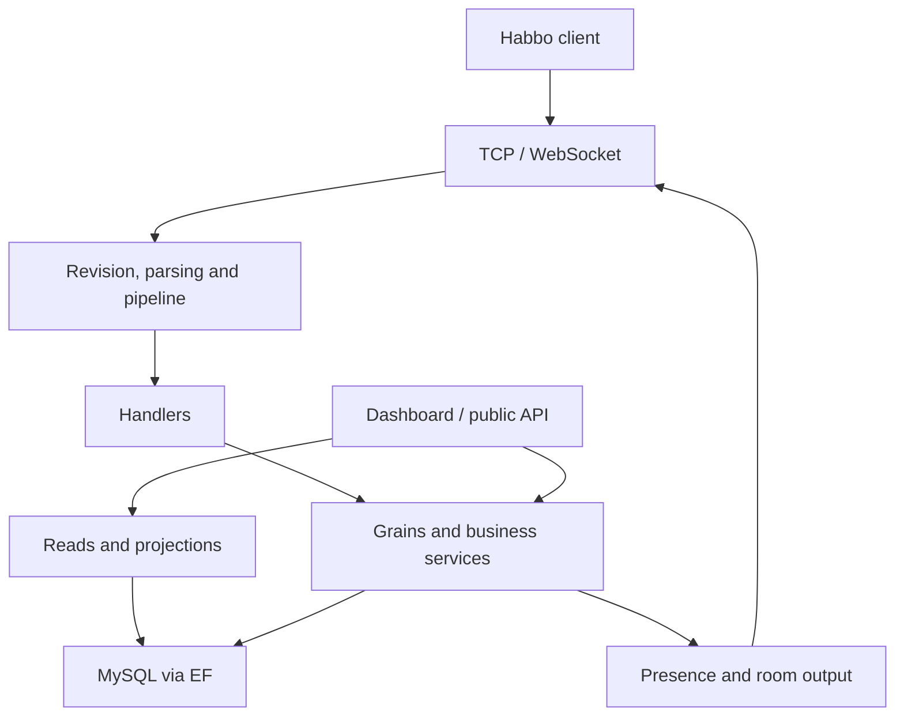

# Vortex Cloud — technical and architectural audit before beta

**Audited revision: `04550328f8d696358d477cc835c7d86dffb2b8bc` · source branch: `main` · observations from 14 to 16 September 2026.**

This report covers that revision only, not the changes published afterwards. No production code was modified. The report and one isolated validation probe are the only additions proposed.

## 1. Overall verdict

**Not ready for an open beta with a persistent economy and persistent rewards.**

Several reachable paths show demonstrable windows for free delivery, duplication, or loss of entitlements and revenue. The serialisation of a grain's calls and the SQL receipts already present do not, on their own, guarantee the consistency of an operation spread across several grains and commits. The most important problems are transaction boundaries and the meaning of mutation results, rather than a general lack of modularity.

The priorities before opening are: close the purchase and marketplace windows, make reward entitlements recoverable, protect deferred furniture writes against a change of state owner, then validate recovery against a MySQL test database and against the client actually distributed. Optional features left unfixed must be removed from the opening scope by a server-side control that has actually been tested. Hiding a client button does not constitute that closure.

The codebase also contains solid protections: distinct modules, typed contracts, a live owner per room, conditional location operations, a trade transaction, Wired budgets, match identity, a commerce journal, capability checks and many tests. **A full rewrite of the emulator is not justified by the evidence gathered. A targeted rework of the durable-operation contract is, before player data arrives.**

The Ubuntu CI of the audited SHA reports **3,869 tests passing across 18 projects**, then fails in the header check. That pass does not cover the failure windows identified. The overall CI also fails on Windows and macOS; only the detailed Ubuntu cause was examined. Source: [Code Quality run](https://github.com/absolutezeroo/vortex-cloud/actions/runs/34803028084).

**No P0 is established.** That is not an attestation that no P0 exists: real exposure, the deployed configuration, penetration testing and load measurements were not available. The negative verdict already rests on P1s established from the code, independently of those missing validations.

## 2. Context, method and assumptions

### 2.1 Reference and environment

| Item | Observation |
|---|---|
| Repository | [absolutezeroo/vortex-cloud](https://github.com/absolutezeroo/vortex-cloud) |
| Frozen reference | [04550328f8d696358d477cc835c7d86dffb2b8bc](https://github.com/absolutezeroo/vortex-cloud/commit/04550328f8d696358d477cc835c7d86dffb2b8bc) |
| Checkout | Clean initial clone; no application change |
| Contracts read | [AGENTS.md](https://github.com/absolutezeroo/vortex-cloud/blob/04550328f8d696358d477cc835c7d86dffb2b8bc/AGENTS.md), [CONTEXT.md](https://github.com/absolutezeroo/vortex-cloud/blob/04550328f8d696358d477cc835c7d86dffb2b8bc/CONTEXT.md), [CLAUDE.md](https://github.com/absolutezeroo/vortex-cloud/blob/04550328f8d696358d477cc835c7d86dffb2b8bc/CLAUDE.md), build files, samples and the documents of the domains concerned |
| Static inventory | 58 C# projects, 18 of them test projects; 77 grain implementations and 568 handlers detected by the repository script; 6,627 C# files present at the first inventory |
| Local platform | Linux Ubuntu 24.04, x64; .NET SDK 10.0.401 and runtime 10.0.12 installed for the validations |
| Database and client | No access to the production database; no MySQL test server configured initially; sources of the external Habbo client absent |
| Deployment studied | Single-silo assumption, consistent with the repository contract; the effective settings of the beta server are unknown |

At finalisation on 16 September, GitHub reads of the repository and of the commit returned HTTP 404. The cause (permissions, availability or a change to the repository) was not determined. The frozen checkout and the CI outputs retrieved beforehand remain the basis of this audit; later changes, and publishing the report in GitHub, could not be verified or carried out. The source links keep the original revision.

The inventory numbers are static detections, not a count of components all active at runtime. The link between registration, entry point and domain was checked for every operational finding. Administered data — offers, prices, tasks, NFT entitlements, Shop products — is not known: its presence conditions the exposure of the features concerned.

### 2.2 Qualification of the evidence

- **Confirmed — code**: control flow or data model sufficient to demonstrate the defect under the stated conditions. It does not mean a real failure was injected into a cluster.
- **Confirmed — probe**: behaviour executed against the explicitly named production file and doubles of its dependencies. The scope of the probe is stated.
- **To be verified**: a risk whose exposure, ordering or magnitude remains to be established.
- **Improvement**: an architectural proposal; its benefit, cost and transition are developed in section 8.

High confidence: direct chain of evidence, with neighbouring protections examined. Medium confidence: one execution condition remains uncertain. The P0–P3 priorities apply to defects; the schedule of structural changes is kept separate. No supported player count is inferred from the readings or from benchmark comments.

Comments and earlier audits served as orientation. Several comments promise a property that the scope of a `catch`, the order of two commits or an SQL query does not guarantee: the findings follow the implementation.

## 3. Map of the repository and of the flows

### 3.1 Technologies actually declared

| Technology | Version / role observed | Evidence |
|---|---|---|
| C# / .NET | `net10.0`, `LangVersion=latest`; the SDK requested by [global.json](https://github.com/absolutezeroo/vortex-cloud/blob/04550328f8d696358d477cc835c7d86dffb2b8bc/global.json) is in the invalid form `10.0` | [Directory.Build.props:1-30](https://github.com/absolutezeroo/vortex-cloud/blob/04550328f8d696358d477cc835c7d86dffb2b8bc/Directory.Build.props#L1-L30), [global.json:1-6](https://github.com/absolutezeroo/vortex-cloud/blob/04550328f8d696358d477cc835c7d86dffb2b8bc/global.json#L1-L6), [Vortex.Main/Vortex.Main.csproj:1-10](https://github.com/absolutezeroo/vortex-cloud/blob/04550328f8d696358d477cc835c7d86dffb2b8bc/Vortex.Main/Vortex.Main.csproj#L1-L10) |
| Orleans | 10.2.1; grains, streams, localhost or ADO.NET clustering | [Directory.Packages.props:29-39](https://github.com/absolutezeroo/vortex-cloud/blob/04550328f8d696358d477cc835c7d86dffb2b8bc/Directory.Packages.props#L29-L39), [Vortex.Main/Extensions/HostApplicationBuilderExtensions.cs:89-163](https://github.com/absolutezeroo/vortex-cloud/blob/04550328f8d696358d477cc835c7d86dffb2b8bc/Vortex.Main/Extensions/HostApplicationBuilderExtensions.cs#L89-L163) |
| EF Core / MySQL | EF Core 9.0.8, Pomelo 9.0.0, MySqlConnector 2.4.0; staying on EF 9 is explicitly intended | [Directory.Packages.props:11-18](https://github.com/absolutezeroo/vortex-cloud/blob/04550328f8d696358d477cc835c7d86dffb2b8bc/Directory.Packages.props#L11-L18), [Directory.Packages.props:40-51](https://github.com/absolutezeroo/vortex-cloud/blob/04550328f8d696358d477cc835c7d86dffb2b8bc/Directory.Packages.props#L40-L51) |
| Game networking | SuperSocket 2.1.0; TCP and WebSocket | [Directory.Packages.props:70-73](https://github.com/absolutezeroo/vortex-cloud/blob/04550328f8d696358d477cc835c7d86dffb2b8bc/Directory.Packages.props#L70-L73), [Vortex.Networking/NetworkManager.cs:130-224](https://github.com/absolutezeroo/vortex-cloud/blob/04550328f8d696358d477cc835c7d86dffb2b8bc/Vortex.Networking/NetworkManager.cs#L130-L224) |
| Dashboard | Svelte 5, Vite 8, Tailwind 4, TypeScript 6 per the manifest; SPA compiled then embedded in the API assembly | [Vortex.Dashboard.Web/package.json](https://github.com/absolutezeroo/vortex-cloud/blob/04550328f8d696358d477cc835c7d86dffb2b8bc/Vortex.Dashboard.Web/package.json), [Vortex.Dashboard.API/Vortex.Dashboard.API.csproj](https://github.com/absolutezeroo/vortex-cloud/blob/04550328f8d696358d477cc835c7d86dffb2b8bc/Vortex.Dashboard.API/Vortex.Dashboard.API.csproj) |
| Observability | OpenTelemetry, runtime instrumentation, Prometheus export; versions centralised | [Directory.Packages.props:52-69](https://github.com/absolutezeroo/vortex-cloud/blob/04550328f8d696358d477cc835c7d86dffb2b8bc/Directory.Packages.props#L52-L69) |
| Tests | xUnit, FluentAssertions, EF InMemory/SQLite tests and Orleans infrastructure depending on the project | [Directory.Packages.props](https://github.com/absolutezeroo/vortex-cloud/blob/04550328f8d696358d477cc835c7d86dffb2b8bc/Directory.Packages.props), the tests' `.csproj` files |

The front-end manifest versions include ranges; [Vortex.Dashboard.Web/package-lock.json](https://github.com/absolutezeroo/vortex-cloud/blob/04550328f8d696358d477cc835c7d86dffb2b8bc/Vortex.Dashboard.Web/package-lock.json) is the resolution lock. This audit does not recommend an EF upgrade independent of Pomelo: the .NET/EF version gap is not, on its own, a defect.

### 3.2 Projects and responsibilities

| Group | Projects / responsibilities | Structuring dependencies |
|---|---|---|
| Composition and operations | `Vortex.Main`: startup and registrations; `Vortex.Supervisor`: separate executable; `Vortex.LoadGen`: external generator; `Vortex.Benchmark`: operator function | Main references the modules. LoadGen is not linked into the runtime (`ReferenceOutputAssembly=false`). Benchmark is registered but gated by configuration |
| Transport and protocol | `Vortex.Networking`, `Vortex.Crypto`, `Vortex.Messages`, `Vortex.PacketHandlers`, `Vortex.Revisions`, `Vortex.Protocol` | Transport → decoding/revision → messages → pipeline/handlers; the protocol is separate from the Primitives hub |
| Common infrastructure | `Vortex.Primitives`, `Vortex.Runtime`, `Vortex.Pipeline`, `Vortex.Events`, `Vortex.Signals`, `Vortex.Logging`, `Vortex.Plugins` | Contracts, assembly discovery, execution and event translation; plugins distinct from the core |
| Accounts and players | `Vortex.Authentication`, `Vortex.Players` | Authentication/permissions, directory, presence, wallet, profile, clothing; grains + EF |
| Rooms | `Vortex.Rooms`, `Vortex.Furniture`, `Vortex.Navigator` | Live room, internal systems, secondary persistence, definitions and search |
| Economy | `Vortex.Catalog`, `Vortex.Inventory`, `Vortex.Marketplace`, `Vortex.Shop` | Catalogue/inventory/wallet and a shared commerce journal; Shop receives the payment notifications |
| Progression and social | `Vortex.Progression`, `Vortex.Habbicons`, `Vortex.RewardTracks`, `Vortex.Fishing`, `Vortex.Collectibles`, `Vortex.Social` | Events, entitlements/rewards, groups/messaging, specialised grains |
| Data | `Vortex.Database` | `VortexDbContext`, entities, migrations, journal/receipts, backup and recovery |
| HTTP and observability | `Vortex.WebApi`, `Vortex.Dashboard.API`, `Vortex.Observability`; `Vortex.Dashboard.Web` outside the C# projects | Public API and operator API kept distinct; DB reads and commands towards the business owners |
| Tooling and tests | `Vortex.Specs`, `Vortex.Specs.Cli`, `Vortex.Tests.Support`, `Vortex.Plugins.TestPlugin`, 18 `*.Tests` projects | Specs are development-only; helpers and tests are not business services |

Composition evidence: [Vortex.Main/Program.cs:123-155](https://github.com/absolutezeroo/vortex-cloud/blob/04550328f8d696358d477cc835c7d86dffb2b8bc/Vortex.Main/Program.cs#L123-L155), [Vortex.Main/Vortex.Main.csproj](https://github.com/absolutezeroo/vortex-cloud/blob/04550328f8d696358d477cc835c7d86dffb2b8bc/Vortex.Main/Vortex.Main.csproj), [CONTEXT.md](https://github.com/absolutezeroo/vortex-cloud/blob/04550328f8d696358d477cc835c7d86dffb2b8bc/CONTEXT.md). An XML read of the references of all 58 projects finds **no ProjectReference cycle**. That proves neither the absence of call cycles between grains nor the business independence of every domain.

### 3.3 State ownership

| State | Runtime owner | Durability / boundary |
|---|---|---|
| Socket and session/player association | `SessionGateway` and the TCP/WS contexts | In-memory dictionaries; one active association per player; lifecycle separate from presence |
| Presence, active room and player output | `PlayerPresenceGrain` | Live state, observer and a bounded queue; rebuilt on connection |
| Player and currencies | `PlayerGrain`, `PlayerWalletGrain` | EF for the data; the wallet also keeps caches; receipts for some mutations |
| Owned furniture / inventory | `InventoryGrain` and its modules | SQL rows and caches; transfers may go through the room systems |
| Room simulation | `RoomGrain` and its systems | Live state serialised per room; timer; positions and dirty states handed back to the persistence grain |
| Deferred room writes | `RoomPersistenceGrain` | In-memory queue then EF; keeping a batch after a DB error protects one boundary, not all of them |
| Location of a furniture item | `RoomFurnitureLocationStore` | Conditional UPDATE in SQL; the distinction from deferred snapshots is essential |
| Purchase / offer / reward entitlement | Domain grains + `CommerceJournal` | Several commits and owners; this is the main fragile boundary identified |
| Settings and definitions | Providers/managers, `ServerConfigGrain` and domain caches | Explicit reloads; single-silo assumption |

The business data inspected is persisted with EF. The `GrainStorageProvider` option configured in Main feeds **PubSubStore** here, not automatic storage of the wallet or of rooms. Enabling ADO.NET therefore does not turn the business operations into distributed transactions and does not make the messages of the `AddMemoryStreams` durable. References: [Vortex.Main/Extensions/HostApplicationBuilderExtensions.cs:127-163](https://github.com/absolutezeroo/vortex-cloud/blob/04550328f8d696358d477cc835c7d86dffb2b8bc/Vortex.Main/Extensions/HostApplicationBuilderExtensions.cs#L127-L163), [Vortex.Players/Grains/PlayerWalletGrain.cs:149-228](https://github.com/absolutezeroo/vortex-cloud/blob/04550328f8d696358d477cc835c7d86dffb2b8bc/Vortex.Players/Grains/PlayerWalletGrain.cs#L149-L228), [Vortex.Rooms/Grains/RoomPersistenceGrain.cs:144-211](https://github.com/absolutezeroo/vortex-cloud/blob/04550328f8d696358d477cc835c7d86dffb2b8bc/Vortex.Rooms/Grains/RoomPersistenceGrain.cs#L144-L211).

### 3.4 Main flows



This diagram describes the common boundaries, not every individual call. Initial authentication also has direct replies to a context that is not attached yet. Sources: [Vortex.Networking/Package/PackageHandler.cs:42-103](https://github.com/absolutezeroo/vortex-cloud/blob/04550328f8d696358d477cc835c7d86dffb2b8bc/Vortex.Networking/Package/PackageHandler.cs#L42-L103), [Vortex.Messages/Registry/MessageRegistry.cs:39-60](https://github.com/absolutezeroo/vortex-cloud/blob/04550328f8d696358d477cc835c7d86dffb2b8bc/Vortex.Messages/Registry/MessageRegistry.cs#L39-L60), [Vortex.Main/Program.cs:123-155](https://github.com/absolutezeroo/vortex-cloud/blob/04550328f8d696358d477cc835c7d86dffb2b8bc/Vortex.Main/Program.cs#L123-L155), [Vortex.Players/Grains/PlayerPresenceGrain.cs:98-147](https://github.com/absolutezeroo/vortex-cloud/blob/04550328f8d696358d477cc835c7d86dffb2b8bc/Vortex.Players/Grains/PlayerPresenceGrain.cs#L98-L147).

| Path followed | Chain observed and boundary to control |
|---|---|
| Startup | Configuration → Orleans/modules → host construction → optional migrations → StartAsync → loading references and listeners. Production can refuse a localhost/memory mode that was not explicitly accepted; a second silo is refused by the startup check |
| Connection | Transport accept → gateway/observer → SSO parsing → authentication and ban → player association → parallel snapshot reads → initial replies |
| Entering / leaving a room | Handler and presence → directory/room → admission, objects and unit → emission; leaving/disconnecting via presence and room cleanup. Observer replacement races remain to be tested |
| Furniture | Handler → room/inventory authorisation → location claim → live mutation → dirty → enqueue → EF flush; a transfer changes the owner of the future write |
| Tick / Wired / games | Room timer → avatar/pet/bot/Wired/game steps → mutations and outputs; errors isolated per step. Wired has budgets; games have a match identity |
| Catalogue / gift | Offer/quantity/condition validation → journal operation → debit with receipt → inventory grant → pivot/finalisation → events/notification |
| Marketplace | Listing → conditional purchase of an offer → delivery; seller cancellation and payout use distinct paths that must share the invariants |
| Trade | RoomTradeSession → validation → ownership transfer transaction → refresh of both inventories; the transaction exists, but failure coverage after the commit remains partial |
| Reward | Progression conditions → durable claim → journal → grants → final state/event. Claim uniqueness is not proof of delivery |
| Shop | Webhook verified by the provider → order paid → FulfilAsync → wallet or club → journal and order; the club marker is written too early |
| Operator action | Route/policy → actor context → domain command → result → asynchronous audit; the latter is not durable proof at the moment success is returned |

### 3.5 Lifecycle, existing guarantees and invariants tracked

The room hydrates its data and its moderation, registers in the directory and obtains the output stream before starting its timer. The timer is rearmed in a `finally`; the tick steps run one after another and isolate their errors, with spaced logging of repeated failures. A pet error therefore does not systematically suppress all subsequent flushes. A slow step can, however, delay the rest: isolating exceptions is not isolating latency. Sources: [Vortex.Rooms/Grains/RoomGrain.cs:301-351](https://github.com/absolutezeroo/vortex-cloud/blob/04550328f8d696358d477cc835c7d86dffb2b8bc/Vortex.Rooms/Grains/RoomGrain.cs#L301-L351), [Vortex.Rooms/Grains/RoomGrain.cs:364-450](https://github.com/absolutezeroo/vortex-cloud/blob/04550328f8d696358d477cc835c7d86dffb2b8bc/Vortex.Rooms/Grains/RoomGrain.cs#L364-L450).

On deactivation, the room stops its games, hands back the dirty states and removes itself from the directory. The persistence grain drains its batches until they are exhausted or no progress is made. These paths protect a normal shutdown; they do not run as a guaranteed transaction on a kill. Presence empties its queue, unregisters the observer and cleans up its subscription. Sources: [Vortex.Rooms/Grains/RoomGrain.cs:457-479](https://github.com/absolutezeroo/vortex-cloud/blob/04550328f8d696358d477cc835c7d86dffb2b8bc/Vortex.Rooms/Grains/RoomGrain.cs#L457-L479), [Vortex.Rooms/Grains/RoomPersistenceGrain.cs:87-128](https://github.com/absolutezeroo/vortex-cloud/blob/04550328f8d696358d477cc835c7d86dffb2b8bc/Vortex.Rooms/Grains/RoomPersistenceGrain.cs#L87-L128), [Vortex.Players/Grains/PlayerPresenceGrain.cs:194-228](https://github.com/absolutezeroo/vortex-cloud/blob/04550328f8d696358d477cc835c7d86dffb2b8bc/Vortex.Players/Grains/PlayerPresenceGrain.cs#L194-L228). The annotations examined on these grains and on the purchase orchestrators do not justify assuming a global transaction across activations.

| Invariant | Protection actually found | Established limit / remaining verification |
|---|---|---|
| An economic resource produces only one paid effect | Unique receipts and local wallet/inventory transactions | Interpretation of errors and transitions after the commit: B01–B09, B21 |
| An offer has a single terminal outcome | Purchase conditioned on Active | Cancellation is not conditional: B04 |
| A furniture item has a consistent location | Location store with a conditional UPDATE | Authority of old snapshots: B10; other transfers to be tested together |
| A trade preserves the owners | Transfer transaction and conditional updates | Recovery after commit and notifications only partially verified; no duplication is asserted from the mere presence of several grains |
| An old session does not destroy the new one | Mapping pairs removed only when they match | Observer without a generation and a global wait: B13 |
| A slow client or a Wired does not create an unbounded queue on the paths read | Bounded presence queue, Wired depth budgets, pending events and executions | Settings, other queues and behaviour under load not measured |

Additional evidence: [Vortex.Rooms/Grains/Systems/RoomFurnitureLocationStore.cs:31-79](https://github.com/absolutezeroo/vortex-cloud/blob/04550328f8d696358d477cc835c7d86dffb2b8bc/Vortex.Rooms/Grains/Systems/RoomFurnitureLocationStore.cs#L31-L79), [Vortex.Rooms/Grains/Systems/RoomTradingSystem.cs:593-673](https://github.com/absolutezeroo/vortex-cloud/blob/04550328f8d696358d477cc835c7d86dffb2b8bc/Vortex.Rooms/Grains/Systems/RoomTradingSystem.cs#L593-L673), [Vortex.Players/Grains/PlayerPresenceGrain.cs:150-179](https://github.com/absolutezeroo/vortex-cloud/blob/04550328f8d696358d477cc835c7d86dffb2b8bc/Vortex.Players/Grains/PlayerPresenceGrain.cs#L150-L179), [Vortex.Rooms/Wired/Engine/RoomGrainWiredHost.cs:74-84](https://github.com/absolutezeroo/vortex-cloud/blob/04550328f8d696358d477cc835c7d86dffb2b8bc/Vortex.Rooms/Wired/Engine/RoomGrainWiredHost.cs#L74-L84), [Vortex.Rooms/Grains/Systems/RoomWiredSystem.cs:180-193](https://github.com/absolutezeroo/vortex-cloud/blob/04550328f8d696358d477cc835c7d86dffb2b8bc/Vortex.Rooms/Grains/Systems/RoomWiredSystem.cs#L180-L193), [Vortex.Rooms/Grains/Systems/RoomWiredSystem.cs:523-543](https://github.com/absolutezeroo/vortex-cloud/blob/04550328f8d696358d477cc835c7d86dffb2b8bc/Vortex.Rooms/Grains/Systems/RoomWiredSystem.cs#L523-L543).

## 4. Coverage and limits

**Analysed** means a targeted reading of the paths and boundaries listed, not exhaustive certification of the domain. **Partial** means a substantial subset remains to be validated. No artificial coverage percentage is announced.

| Domain | Coverage | What was examined | What remains open |
|---|---|---|---|
| Structure, stack and composition | Analysed | Projects, references, registrations, Main entry point, contracts | All conditional plugin paths |
| Orleans / concurrency | Partial | Room/timers, presence, per-player purchases, ownership, single silo | Exhaustive matrix of call cycles, forced deactivation and network partitions |
| Auth / sessions | Analysed, targeted | SSO, contexts, replacement/disconnection, observers, leaving | Instrumented concurrent reconnections, external auth in a deployed environment |
| Networking | Analysed, targeted | Decoding, body limit, parsing, quota ordering, logs | Full fuzzing of each parser; network load and distributed IPs |
| Rooms / furniture | Analysed, targeted | Tick, dirty, location, removal and flush | MySQL A/B ordering test, all furniture logics |
| Wired / games / pets | Partial | Budgets, engine, match stamps, families present | Complex deferred loops, cross-match cancellations, simultaneous pet placement, the real client side |
| Catalogue / wallet / inventory | Analysed, targeted | Debit, compensation, grants, receipts, exceptions, gifts | MySQL failure matrix and the effects/badges/club of every offer |
| Marketplace | Analysed, targeted | Purchase, cancellation, delivery, payout, constraints | Concurrent MySQL reproduction and expiry under load |
| Trades / Wired transactions | Partial | Ownership transaction and refresh; settlement structure | Concurrency between trade/placement/sale, recovery of all Wired states |
| Progression / rewards | Analysed, targeted | RewardTracks, DailyTask, NFT claims, grant contracts | Habbicons/fishing/achievements/social in all their scenarios |
| Persistence | Analysed, targeted | EF, commits/receipts, the constraints concerned, write-behind, migrations/backup | Import of a historical database, constraints actually deployed, full restore |
| Dashboard / API / Shop | Partial | Auth/capabilities pipeline, operations, audit, the Shop club path, front-end compilation | Exhaustive review of every endpoint, uploads and the permission matrix over real HTTP |
| General security | Partial | Exposure of the inputs, errors, existing auth, economic invariants | Pentest, production dependencies at their exact resolution, real proxy/TLS/secret management |
| Performance / operations | Partial | Queues/budgets, the gateway contention point, per-tick load, configuration and shutdown | p95/p99 measurements, soak, GC, slow DB, timed deployment/restore |
| Build / tests / CI | Analysed, with the limits in §9 | The exact CI, Node checks, front end, executor probe, local .NET attempts | A fully green gate and fault-injection tests on MySQL |

Features distinguished:

- The Catalogue, Rooms, Marketplace, Social, Habbicons, RewardTracks and Fishing modules are composed in Main. Their registration does not prove that their administered content is present.
- NFT claims have a handler and a grain; a valid entitlement is required. No new or post-SHA blockchain integration is assumed.
- DailyTask item rewards are **partial**: they are representable and announced, but the grant inspected does not materialise them (B07).
- Multi-silo is **not declared ready**; the startup check refuses it unless an option is set explicitly. That is an accepted limit, not a clustering defect discovered by this audit.
- The composer `CustomStackingHeightUpdateMessageComposer=9201` is registered but no business emission was found when searching for the symbol at that SHA. Its confirmed impact is the CI blockage; no player-visible malfunction is attributed to it without a caller.
- Specs/Cli are development tools. LoadGen is an auxiliary process. The presence of their code does not make them reachable as a player feature.

## 5. Summary of the risks

1. **Money, goods and proof do not move together.** A failure after a commit can be taken for the absence of a commit and refunded; the reverse order can permanently consume an entitlement before delivery.
2. **Local guarantees are extrapolated to shared resources.** Two player grains can act on the same offer; an old room can still write an item that has moved.
3. **Results that are too poor erase uncertainty.** `false`, a generic EF exception or an existing marker sometimes become "already applied" or "delivered" without matching proof.
4. **Recovery detects some of the problems without repairing all of them.** Prepared/Debited operations and owed bundles require explicit reconciliation; a queue of interventions can moreover mask new incidents.
5. **The opening lacks operational evidence.** A restore that actually succeeded, a gate consistent with the client and measurements of the beta scenario are needed, in addition to the existing unit tests.

## 6. Table of findings

The detailed references, conditions, protections and validation methods are in section 7. "Code + probe" remains a local reproduction of the executor, not of the whole SQL operation.

| ID | Category | Priority | Evidence / confidence | Main impact | First reference |
|---|---|---|---|---|---|
| B01 | Defect | P1 | Code + probe / high | Goods delivered then the purchase refunded | [Vortex.Primitives/Players/Wallet/WalletPurchaseExtensions.cs:72-109](https://github.com/absolutezeroo/vortex-cloud/blob/04550328f8d696358d477cc835c7d86dffb2b8bc/Vortex.Primitives/Players/Wallet/WalletPurchaseExtensions.cs#L72-L109) |
| B02 | Defect | P1 | Code + probe / high | Durable debit with no delivery and no immediate compensation | [Vortex.Players/Grains/PlayerWalletGrain.cs:149-228](https://github.com/absolutezeroo/vortex-cloud/blob/04550328f8d696358d477cc835c7d86dffb2b8bc/Vortex.Players/Grains/PlayerWalletGrain.cs#L149-L228) |
| B03 | Defect | P1 | Code / high | An SQL error wrongly taken for an already-applied operation | [Vortex.Players/Grains/PlayerWalletGrain.cs:166-197](https://github.com/absolutezeroo/vortex-cloud/blob/04550328f8d696358d477cc835c7d86dffb2b8bc/Vortex.Players/Grains/PlayerWalletGrain.cs#L166-L197) |
| B04 | Defect | P1 | Code / high | Concurrent sale and restitution of the same offer | [Vortex.Marketplace/Grains/MarketplacePurchaseGrain.cs:221-278](https://github.com/absolutezeroo/vortex-cloud/blob/04550328f8d696358d477cc835c7d86dffb2b8bc/Vortex.Marketplace/Grains/MarketplacePurchaseGrain.cs#L221-L278) |
| B05 | Defect | P1 | Code / high | Loss or double payment of sale proceeds | [Vortex.Marketplace/Grains/MarketplacePurchaseGrain.cs:496-572](https://github.com/absolutezeroo/vortex-cloud/blob/04550328f8d696358d477cc835c7d86dffb2b8bc/Vortex.Marketplace/Grains/MarketplacePurchaseGrain.cs#L496-L572) |
| B06 | Defect | P1 | Code / high | Reward entitlement consumed outside the recovery path | [Vortex.RewardTracks/Grains/PlayerRewardTrackGrain.Claims.cs:185-250](https://github.com/absolutezeroo/vortex-cloud/blob/04550328f8d696358d477cc835c7d86dffb2b8bc/Vortex.RewardTracks/Grains/PlayerRewardTrackGrain.Claims.cs#L185-L250) |
| B07 | Partial feature / defect | P2 | Code / high; deployed content unknown | DailyTask finalised without all of its reward | [Vortex.Progression/Grains/PlayerDailyTaskGrain.cs:227-286](https://github.com/absolutezeroo/vortex-cloud/blob/04550328f8d696358d477cc835c7d86dffb2b8bc/Vortex.Progression/Grains/PlayerDailyTaskGrain.cs#L227-L286) |
| B08 | Defect | P1 if claims are enabled | Code / high | Duplication of NFT claim furniture on replay | [Vortex.Collectibles/Grains/PlayerNftClaimsGrain.cs:68-127](https://github.com/absolutezeroo/vortex-cloud/blob/04550328f8d696358d477cc835c7d86dffb2b8bc/Vortex.Collectibles/Grains/PlayerNftClaimsGrain.cs#L68-L127) |
| B09 | Defect | P1 if club sales are enabled | Code / high | Club purchase paid then declared delivered with no months | [Vortex.Shop/ShopService.cs:490-514](https://github.com/absolutezeroo/vortex-cloud/blob/04550328f8d696358d477cc835c7d86dffb2b8bc/Vortex.Shop/ShopService.cs#L490-L514) |
| B10 | Defect | P2 | Code / high | An old flush overwriting position/ExtraData after a transfer | [Vortex.Rooms/Grains/RoomPersistenceGrain.cs:144-211](https://github.com/absolutezeroo/vortex-cloud/blob/04550328f8d696358d477cc835c7d86dffb2b8bc/Vortex.Rooms/Grains/RoomPersistenceGrain.cs#L144-L211) |
| B11 | Defect | P2 | Code / high | Furniture dirty state lost before the handoff is acknowledged | [Vortex.Rooms/Grains/RoomGrain.Furni.cs:134-155](https://github.com/absolutezeroo/vortex-cloud/blob/04550328f8d696358d477cc835c7d86dffb2b8bc/Vortex.Rooms/Grains/RoomGrain.Furni.cs#L134-L155) |
| B12 | Defect | P2 | Code / high | The player's clothing missing on the first SSO | [Vortex.PacketHandlers/Handshake/SSOTicketMessageHandler.cs:164-166](https://github.com/absolutezeroo/vortex-cloud/blob/04550328f8d696358d477cc835c7d86dffb2b8bc/Vortex.PacketHandlers/Handshake/SSOTicketMessageHandler.cs#L164-L166) |
| B13 | Architectural weakness / risk | P2 | Code; race to be verified / medium | Connections blocked between players, a stale observer possible | [Vortex.Networking/Session/SessionGateway.cs:117-173](https://github.com/absolutezeroo/vortex-cloud/blob/04550328f8d696358d477cc835c7d86dffb2b8bc/Vortex.Networking/Session/SessionGateway.cs#L117-L173) |
| B14 | Protection weakness | P2 | Code / high; capacity not measured | Parsing, errors and presence resolution outside the quota | [Vortex.Networking/Package/PackageHandler.cs:42-103](https://github.com/absolutezeroo/vortex-cloud/blob/04550328f8d696358d477cc835c7d86dffb2b8bc/Vortex.Networking/Package/PackageHandler.cs#L42-L103) |
| B15 | Confidentiality defect | P2 | Code / high | Sensitive data possible in the dump of a failed packet | [Vortex.Primitives/Packets/ClientPacket.cs:28-43](https://github.com/absolutezeroo/vortex-cloud/blob/04550328f8d696358d477cc835c7d86dffb2b8bc/Vortex.Primitives/Packets/ClientPacket.cs#L28-L43) |
| B16 | Architectural weakness | P2 | Code / high | An administrative action with no durable trail; missing HTTP denials | [Vortex.Observability/Audit/ChannelAuditSink.cs:25-49](https://github.com/absolutezeroo/vortex-cloud/blob/04550328f8d696358d477cc835c7d86dffb2b8bc/Vortex.Observability/Audit/ChannelAuditSink.cs#L25-L49) |
| B17 | Defect | P2 | Code / high | New blocked operations invisible to escalation | [Vortex.Database/Commerce/CommerceJournal.cs:275-307](https://github.com/absolutezeroo/vortex-cloud/blob/04550328f8d696358d477cc835c7d86dffb2b8bc/Vortex.Database/Commerce/CommerceJournal.cs#L275-L307) |
| B18 | Operational defect | P2 | Code / high | An incomplete dump listed as an available backup | [Vortex.Database/Backup/DatabaseBackupService.cs:118-164](https://github.com/absolutezeroo/vortex-cloud/blob/04550328f8d696358d477cc835c7d86dffb2b8bc/Vortex.Database/Backup/DatabaseBackupService.cs#L118-L164) |
| B19 | Operational prerequisite | P1 | CI and local check / high | Gate failing; later checks never reached | [scripts/hooks/check-header-registry.mjs:191-204](https://github.com/absolutezeroo/vortex-cloud/blob/04550328f8d696358d477cc835c7d86dffb2b8bc/scripts/hooks/check-header-registry.mjs#L191-L204) |
| B20 | Reproducibility defect | P2 | Local SDK / high | [global.json](https://github.com/absolutezeroo/vortex-cloud/blob/04550328f8d696358d477cc835c7d86dffb2b8bc/global.json) invalid, SDK selection not locked | [global.json:1-6](https://github.com/absolutezeroo/vortex-cloud/blob/04550328f8d696358d477cc835c7d86dffb2b8bc/global.json#L1-L6) |
| B21 | Defect | P2 | Code / high; a missing currency required | A full credit receipt despite a currency that was not credited | [Vortex.Players/Grains/PlayerWalletGrain.cs:462-543](https://github.com/absolutezeroo/vortex-cloud/blob/04550328f8d696358d477cc835c7d86dffb2b8bc/Vortex.Players/Grains/PlayerWalletGrain.cs#L462-L543) |

## 7. Detailed analyses

### B01 — Catalogue and gifts: an error after delivery still triggers a refund

**Defect · P1 · confirmed by code and by the executor probe · high confidence.**

Evidence: [Vortex.Primitives/Players/Wallet/WalletPurchaseExtensions.cs:72-109](https://github.com/absolutezeroo/vortex-cloud/blob/04550328f8d696358d477cc835c7d86dffb2b8bc/Vortex.Primitives/Players/Wallet/WalletPurchaseExtensions.cs#L72-L109) and [Vortex.Primitives/Players/Wallet/WalletPurchaseExtensions.cs:128-154](https://github.com/absolutezeroo/vortex-cloud/blob/04550328f8d696358d477cc835c7d86dffb2b8bc/Vortex.Primitives/Players/Wallet/WalletPurchaseExtensions.cs#L128-L154) (`ExecutePurchaseAsync`); [Vortex.Catalog/Grains/CatalogPurchaseGrain.cs:135-185](https://github.com/absolutezeroo/vortex-cloud/blob/04550328f8d696358d477cc835c7d86dffb2b8bc/Vortex.Catalog/Grains/CatalogPurchaseGrain.cs#L135-L185) (`PurchaseOfferFromCatalogAsync`); [Vortex.Catalog/Grains/CatalogPurchaseGrain.Gift.cs:81-137](https://github.com/absolutezeroo/vortex-cloud/blob/04550328f8d696358d477cc835c7d86dffb2b8bc/Vortex.Catalog/Grains/CatalogPurchaseGrain.Gift.cs#L81-L137) (`PurchaseOfferAsGiftAsync`); [Vortex.Inventory/Grains/InventoryGrain.Furni.cs:204-258](https://github.com/absolutezeroo/vortex-cloud/blob/04550328f8d696358d477cc835c7d86dffb2b8bc/Vortex.Inventory/Grains/InventoryGrain.Furni.cs#L204-L258) and [Vortex.Inventory/Grains/InventoryGrain.Furni.cs:897-925](https://github.com/absolutezeroo/vortex-cloud/blob/04550328f8d696358d477cc835c7d86dffb2b8bc/Vortex.Inventory/Grains/InventoryGrain.Furni.cs#L897-L925) (grants); [Vortex.Database/Commerce/CommerceJournal.cs:94-133](https://github.com/absolutezeroo/vortex-cloud/blob/04550328f8d696358d477cc835c7d86dffb2b8bc/Vortex.Database/Commerce/CommerceJournal.cs#L94-L133) (`TransitionAsync`).

The catalogue delivers to the inventory and then writes `Pivoted` inside the same closure on which the executor refunds for **any** exception. The gift path writes `Completed` in that scope after its grant. A journal failure after delivery therefore leaves the goods and refunds the price. The wrapped gift also has an unprotected reload after its `SaveChangesAsync`. A transient failure or a cancellation is enough; deliberate exploitation by disconnecting is not asserted, because propagation of the token depends on the transport.

Protections verified: local granting of several families within one SaveChanges, debit/refund receipts and protection of many post-commit notifications. These protections avoid certain duplications or repeated refunds, but not the first undue refund. The final catalogue event is already outside the closure; the pivot journal entry is not.

The probe provided compiles the real executor file, simulates a completed grant and then a journal exception: **one item, initial balance restored, one refund**. It does not simulate a MySQL commit. Integrated validation needed: a failpoint after the real inventory commit and before each journal transition, then restart and reconciliation.

Fix: delivery receipt and durable effect in a transaction common to the owner; after proof of delivery, a failure means "finalisation owed", never "refund by default". For a lost response, re-read the result by operation id. Moving one line out of the `try` is not enough to resolve every ambiguous commit result.

### B02 — The wallet can raise an error after a debit has already been committed

**Defect · P1 · confirmed by code and by the boundary probe · high confidence.**

Evidence: [Vortex.Players/Grains/PlayerWalletGrain.cs:149-232](https://github.com/absolutezeroo/vortex-cloud/blob/04550328f8d696358d477cc835c7d86dffb2b8bc/Vortex.Players/Grains/PlayerWalletGrain.cs#L149-L232) (`TryDebitAsync`); [Vortex.Primitives/Players/Wallet/WalletPurchaseExtensions.cs:72-88](https://github.com/absolutezeroo/vortex-cloud/blob/04550328f8d696358d477cc835c7d86dffb2b8bc/Vortex.Primitives/Players/Wallet/WalletPurchaseExtensions.cs#L72-L88).

The wallet commits the debit and its receipt, then awaits presence and events before returning success. The debit call in `ExecutePurchaseAsync` is **before** its compensation block. If the Orleans call to presence fails after the commit, the purchase exits without running the grant or that refund. Ordinary socket transport errors and event handler errors are generally isolated; they are not enough to demonstrate this propagation. The condition targeted is a failure of the grain call itself after the commit. The catalogue operation can stay Prepared: the Debited transition is inside the closure that never started.

Transactions and receipts do preserve useful proof: the money is not "untraceable". They do not, however, create any automatic path that carries this new purchase forward from its random operation. A notification incident must not change the meaning of the debit result.

Probe: a fake wallet that applies the debit then throws, with the real executor compiled; **balance 90 of 100, zero goods, zero refunds**. To be completed with a test of the real grain where `OnCurrencyUpdateAsync` fails after an SQL commit. Fix: a durable result returned independently of the notifications; those are retried/projected separately. Expose lookup of an unknown result by operationId.

### B03 — A generic EF exception is not proof of idempotence

**Defect · P1 · confirmed by code · high confidence.**

Evidence: [Vortex.Players/Grains/PlayerWalletGrain.cs:166-197](https://github.com/absolutezeroo/vortex-cloud/blob/04550328f8d696358d477cc835c7d86dffb2b8bc/Vortex.Players/Grains/PlayerWalletGrain.cs#L166-L197) (`TryDebitAsync`), [Vortex.Players/Grains/PlayerWalletGrain.cs:520-535](https://github.com/absolutezeroo/vortex-cloud/blob/04550328f8d696358d477cc835c7d86dffb2b8bc/Vortex.Players/Grains/PlayerWalletGrain.cs#L520-L535) (`CreditOnceAsync`); [Vortex.Inventory/Grains/InventoryGrain.Furni.cs:595-632](https://github.com/absolutezeroo/vortex-cloud/blob/04550328f8d696358d477cc835c7d86dffb2b8bc/Vortex.Inventory/Grains/InventoryGrain.Furni.cs#L595-L632) (`GrantFurnitureDefinitionCopiesAsync`); [Vortex.RewardTracks/Grains/PlayerRewardTrackGrain.Claims.cs:219-233](https://github.com/absolutezeroo/vortex-cloud/blob/04550328f8d696358d477cc835c7d86dffb2b8bc/Vortex.RewardTracks/Grains/PlayerRewardTrackGrain.Claims.cs#L219-L233) (`ClaimInternalAsync`).

These catches treat every `DbUpdateException` as an expected duplicate, without checking the provider code or re-reading the receipt. A failure of another constraint, or of a command wrapped in that exception, can be presented as a debit that already succeeded, a grant already made, or a claim already consumed. The wallet can thereby allow a purchase to continue after a rollback with no prior debit; the grants can conceal a missing delivery. RewardTracks even adds the claim to its cache after this error.

The SQL uniqueness of `(OperationId, StepKey)` is a good protection against a **real** duplicate. It does not allow identifying the cause of every write exception. The priority reflects how widely shared these primitives are; the exact trigger depends on the provider and the data.

Validation: inject an EF error unrelated to the receipt, check there is no success and that the cache is unchanged; separately test a violation of the expected index alone, with a genuinely consistent receipt. Fix: precise provider classification, re-reading the receipt and checking its scope/result; propagate the other errors. Do not treat absence of proof as success.

### B04 — Marketplace: purchase and cancellation do not share an atomic transition

**Defect · P1 · confirmed by code · high confidence; DB ordering to be reproduced.**

Evidence: [Vortex.Marketplace/Grains/MarketplacePurchaseGrain.cs:221-278](https://github.com/absolutezeroo/vortex-cloud/blob/04550328f8d696358d477cc835c7d86dffb2b8bc/Vortex.Marketplace/Grains/MarketplacePurchaseGrain.cs#L221-L278) (`CancelOrRedeemOfferAsync`), [Vortex.Marketplace/Grains/MarketplacePurchaseGrain.cs:363-409](https://github.com/absolutezeroo/vortex-cloud/blob/04550328f8d696358d477cc835c7d86dffb2b8bc/Vortex.Marketplace/Grains/MarketplacePurchaseGrain.cs#L363-L409) (`BuyOfferAsync`), [Vortex.Database/Entities/Marketplace/MarketplaceOfferEntity.cs](https://github.com/absolutezeroo/vortex-cloud/blob/04550328f8d696358d477cc835c7d86dffb2b8bc/Vortex.Database/Entities/Marketplace/MarketplaceOfferEntity.cs), [Vortex.Database/Entities/VortexEntity.cs](https://github.com/absolutezeroo/vortex-cloud/blob/04550328f8d696358d477cc835c7d86dffb2b8bc/Vortex.Database/Entities/VortexEntity.cs).

The buyer uses a conditional UPDATE on `State == Active`. Cancellation loads the seller's offer, refuses Sold as of the moment of the read, then writes Cancelled with a SaveChanges that is not conditioned on the initial state. The grains are keyed by player: buyer and seller do not serialise together. No concurrency property was found on this entity in the mappings inspected.

Scenario: the seller reads Active; the buyer claims Sold and receives the item; the cancellation then writes Cancelled and hands back a copy. The offer ownership check does protect other sellers, and the restitution receipt protects against a double click on cancel. Neither makes purchase and cancellation mutually exclusive.

Validation: two DbContexts/grains, a barrier after the seller's read, let the purchase finish then resume the cancellation; check for a single final item and one consistent terminal outcome. Fix: a CAS common to every exit from Active, with a "transition lost" result, plus a delivery/restitution operation tied to the offer. One grain per offer can make the orchestration easier; it does not replace the SQL constraints and recovery.

### B05 — Marketplace: a changing batch can lose or double the proceeds

**Defect · P1 · confirmed by code · high confidence.**

Evidence: [Vortex.Marketplace/Grains/MarketplacePurchaseGrain.cs:496-572](https://github.com/absolutezeroo/vortex-cloud/blob/04550328f8d696358d477cc835c7d86dffb2b8bc/Vortex.Marketplace/Grains/MarketplacePurchaseGrain.cs#L496-L572) (`RedeemCreditsAsync`); [Vortex.Players/Grains/PlayerWalletGrain.cs:510-535](https://github.com/absolutezeroo/vortex-cloud/blob/04550328f8d696358d477cc835c7d86dffb2b8bc/Vortex.Players/Grains/PlayerWalletGrain.cs#L510-L535).

The operation is derived from the smallest ID among the offers owed. After a payment succeeds but before the reset, a new sale can join the next batch while keeping the same minimum. The receipt of the earlier payment then causes the new amount to be ignored; the code nevertheless resets every offer in the new batch.

Validation example: A is owed 90 credits, A's payment succeeds, a failure occurs before the clear; B is then owed 45. On retry, the operation based on A is already credited, but A+B are cleared: 45 credits lost. Serialisation of the seller grain protects neither against a restart between these steps nor against a sale added by a buyer's grain.

The earlier change of "pay before clearing" and the receipt are useful, but they assume an immutable payload. Fix: a durable batch with frozen membership and amount, or a receipt/payment per offer, then closing only the debts attached to the proven payment. A new sale with a lower ID conversely changes the payment identity: the older proceeds still owed in the table can be credited twice. Test both ID orders and the replay after a lost notification.

### B06 — RewardTracks and DailyTask: the claim and the recoverable debt are two commits

**Defect · P1 · confirmed by code · high confidence.**

Evidence: [Vortex.RewardTracks/Grains/PlayerRewardTrackGrain.Claims.cs:156-158](https://github.com/absolutezeroo/vortex-cloud/blob/04550328f8d696358d477cc835c7d86dffb2b8bc/Vortex.RewardTracks/Grains/PlayerRewardTrackGrain.Claims.cs#L156-L158), [Vortex.RewardTracks/Grains/PlayerRewardTrackGrain.Claims.cs:185-250](https://github.com/absolutezeroo/vortex-cloud/blob/04550328f8d696358d477cc835c7d86dffb2b8bc/Vortex.RewardTracks/Grains/PlayerRewardTrackGrain.Claims.cs#L185-L250) (`ClaimInternalAsync`); [Vortex.Database/Entities/RewardTracks/PlayerRewardTrackClaimEntity.cs:15-46](https://github.com/absolutezeroo/vortex-cloud/blob/04550328f8d696358d477cc835c7d86dffb2b8bc/Vortex.Database/Entities/RewardTracks/PlayerRewardTrackClaimEntity.cs#L15-L46); [Vortex.Progression/Grains/PlayerDailyTaskGrain.cs:175-240](https://github.com/absolutezeroo/vortex-cloud/blob/04550328f8d696358d477cc835c7d86dffb2b8bc/Vortex.Progression/Grains/PlayerDailyTaskGrain.cs#L175-L240) (`ClaimAsync`); [Vortex.Database/Commerce/CommerceJournal.cs:275-307](https://github.com/absolutezeroo/vortex-cloud/blob/04550328f8d696358d477cc835c7d86dffb2b8bc/Vortex.Database/Commerce/CommerceJournal.cs#L275-L307); [Vortex.Database/Commerce/CommerceRelayService.cs:110-149](https://github.com/absolutezeroo/vortex-cloud/blob/04550328f8d696358d477cc835c7d86dffb2b8bc/Vortex.Database/Commerce/CommerceRelayService.cs#L110-L149).

The claim is committed before the journalled pivot and before the grant. A stop between these steps leaves the claim consumed and an operation at Prepared that the sweep of pivoted operations does not examine. RewardTracks moreover mints a random identity that is not recorded in the claim; the next click returns AlreadyClaimed. DailyTask has a deterministic identity, but it too refuses a task already claimed, before any recovery.

The access conditions, points, premium, window and unique index limit out-of-condition claims and the ordinary double click. They do not guarantee delivery. The relay can republish events and escalate certain operations; it does not replay every grant owed.

Fix: claim, operationId, bundle snapshot and initial delivery state in one transaction; recovery through idempotent steps at each owner. Migration: attach old claims to operations where that is provable, and place ambiguous cases in intervention rather than reassigning blindly. Validation: stop after each commit, reactivate, retry/sweep; exactly one complete grant, or an explicit debt that can be looked up.

### B07 — DailyTask can announce a reward it does not hand over

**Partial feature and result defect · P2 · confirmed by code · high confidence; deployed content to be verified.**

Evidence: [Vortex.Progression/Grains/PlayerDailyTaskGrain.cs:227-286](https://github.com/absolutezeroo/vortex-cloud/blob/04550328f8d696358d477cc835c7d86dffb2b8bc/Vortex.Progression/Grains/PlayerDailyTaskGrain.cs#L227-L286) (`ClaimAsync`, `GrantAsync`), [Vortex.Progression/Grains/PlayerDailyTaskGrain.cs:401-410](https://github.com/absolutezeroo/vortex-cloud/blob/04550328f8d696358d477cc835c7d86dffb2b8bc/Vortex.Progression/Grains/PlayerDailyTaskGrain.cs#L401-L410) (snapshot); [Vortex.Players/Grains/PlayerWalletGrain.cs:649-683](https://github.com/absolutezeroo/vortex-cloud/blob/04550328f8d696358d477cc835c7d86dffb2b8bc/Vortex.Players/Grains/PlayerWalletGrain.cs#L649-L683) (`GrantCurrencyAsync`).

The grant ignores the boolean returned by the currency payment. Non-monetary rewards are only journalled, even though the snapshot represents them. The task can move to Claimed and the journal to Completed without the whole reward. The exposure depends on the task definitions and the currencies available; the deployment database was not consulted.

The owner and the status of the task are checked. Administrative editing already validates the currencies via `ValidateRewardCurrencies` ([Vortex.Dashboard.API/Admin/Progression/QuestContentAdminService.cs:170-180](https://github.com/absolutezeroo/vortex-cloud/blob/04550328f8d696358d477cc835c7d86dffb2b8bc/Vortex.Dashboard.API/Admin/Progression/QuestContentAdminService.cs#L170-L180), [Vortex.Dashboard.API/Admin/Progression/QuestContentAdminService.cs:218-229](https://github.com/absolutezeroo/vortex-cloud/blob/04550328f8d696358d477cc835c7d86dffb2b8bc/Vortex.Dashboard.API/Admin/Progression/QuestContentAdminService.cs#L218-L229), [Vortex.Dashboard.API/Admin/Progression/QuestContentAdminService.cs:387-409](https://github.com/absolutezeroo/vortex-cloud/blob/04550328f8d696358d477cc835c7d86dffb2b8bc/Vortex.Dashboard.API/Admin/Progression/QuestContentAdminService.cs#L387-L409)); that protection reduces the risk of an invalid initial currency configuration. It explicitly leaves items unchecked, and it does not prove the payment succeeded at grant time, after a definition change or an error. Fix: refuse unsupported rewards at edit time for as long as their grant is missing, then use an explicit bundle result and the B06 recovery. Test: a wallet returning false, an item, a mixed bundle; none of them may end up "fully delivered" if a step is still owed.

### B08 — NFT claims: copies handed over before the durable counter

**Defect · P1 if this feature is open · confirmed by code · high confidence.**

Evidence: [Vortex.Collectibles/Grains/PlayerNftClaimsGrain.cs:68-127](https://github.com/absolutezeroo/vortex-cloud/blob/04550328f8d696358d477cc835c7d86dffb2b8bc/Vortex.Collectibles/Grains/PlayerNftClaimsGrain.cs#L68-L127) (`ClaimAllAsync`), [Vortex.Collectibles/Grains/PlayerNftClaimsGrain.cs:149-159](https://github.com/absolutezeroo/vortex-cloud/blob/04550328f8d696358d477cc835c7d86dffb2b8bc/Vortex.Collectibles/Grains/PlayerNftClaimsGrain.cs#L149-L159) (`OutstandingQuery`); [Vortex.PacketHandlers/Collectibles/ClaimNftClaimsMessageHandler.cs:35-43](https://github.com/absolutezeroo/vortex-cloud/blob/04550328f8d696358d477cc835c7d86dffb2b8bc/Vortex.PacketHandlers/Collectibles/ClaimNftClaimsMessageHandler.cs#L35-L43); inventory grant path [Vortex.Inventory/Grains/InventoryGrain.Furni.cs](https://github.com/absolutezeroo/vortex-cloud/blob/04550328f8d696358d477cc835c7d86dffb2b8bc/Vortex.Inventory/Grains/InventoryGrain.Furni.cs).

Each copy is handed over by an inventory call with no operation id. The counters of all the claims are saved after the loop. A first durable handover followed by a failure or a stop therefore leaves its entitlement outstanding; the next call hands the copy over a second time.

The player, validity, deletion and limit filters exist; unknown definitions are kept pending. The defect assumes a valid claim and a failure, not the ability to claim someone else's entitlements. Validation: fail the second grant after the first succeeds, then retry; repeat with a failure of the final SaveChanges. Fix: a deterministic claim/copy identity and a receipt atomic with the furniture; advance the counters from those proofs. Actually close the handler if the feature is deferred.

### B09 — Shop: an existing club marker becomes false proof of delivery

**Defect · P1 if club sales are open · confirmed by code · high confidence.**

Evidence: [Vortex.Shop/ShopService.cs:299-304](https://github.com/absolutezeroo/vortex-cloud/blob/04550328f8d696358d477cc835c7d86dffb2b8bc/Vortex.Shop/ShopService.cs#L299-L304), [Vortex.Shop/ShopService.cs:394-471](https://github.com/absolutezeroo/vortex-cloud/blob/04550328f8d696358d477cc835c7d86dffb2b8bc/Vortex.Shop/ShopService.cs#L394-L471) (`HandleWebhookAsync`, `FulfilAsync`), [Vortex.Shop/ShopService.cs:490-514](https://github.com/absolutezeroo/vortex-cloud/blob/04550328f8d696358d477cc835c7d86dffb2b8bc/Vortex.Shop/ShopService.cs#L490-L514) (`GrantAsync`); [Vortex.Players/Grains/PlayerGrain.cs:593-600](https://github.com/absolutezeroo/vortex-cloud/blob/04550328f8d696358d477cc835c7d86dffb2b8bc/Vortex.Players/Grains/PlayerGrain.cs#L593-L600) (`GrantClubMonthsAsync`).

The CLUB_MONTHS marker is written before the call that adds the months. If that call fails, the order is put into intervention. On a replayed webhook, the marker already being present causes true to be returned with no addition; FulfilAsync then moves to Completed/Fulfilled. A paid, undelivered order becomes indistinguishable from a successful delivery.

Webhook verification and the stable order identity do not close this window; no bypass of the provider is required. Test: two identical valid notifications, with a grant that fails on the first call after the marker is written; check that the second does not erase the debt. Durable fix: an operationId received by the owner of the subscription, months + receipt in its transaction. As an interim measure, keep the ambiguous state in intervention instead of turning "claimed" into "delivered".

### B10 — An old room can still overwrite the state of a transferred item

**Defect · P2 · confirmed by code · high confidence. Structural change A2 recommended before beta.**

Evidence: [Vortex.Rooms/Grains/RoomPersistenceGrain.cs:144-211](https://github.com/absolutezeroo/vortex-cloud/blob/04550328f8d696358d477cc835c7d86dffb2b8bc/Vortex.Rooms/Grains/RoomPersistenceGrain.cs#L144-L211) (`FlushDirtyItemsAsync`); [Vortex.Rooms/Grains/RoomGrain.Furni.cs:134-155](https://github.com/absolutezeroo/vortex-cloud/blob/04550328f8d696358d477cc835c7d86dffb2b8bc/Vortex.Rooms/Grains/RoomGrain.Furni.cs#L134-L155); [Vortex.Rooms/Grains/Modules/RoomObjectModule.cs:202-209](https://github.com/absolutezeroo/vortex-cloud/blob/04550328f8d696358d477cc835c7d86dffb2b8bc/Vortex.Rooms/Grains/Modules/RoomObjectModule.cs#L202-L209); [Vortex.Rooms/Grains/Systems/RoomFurnitureLocationStore.cs](https://github.com/absolutezeroo/vortex-cloud/blob/04550328f8d696358d477cc835c7d86dffb2b8bc/Vortex.Rooms/Grains/Systems/RoomFurnitureLocationStore.cs).

The flush writes X/Y/Z/Rotation/ExtraData by primary key with no placement version. A pickup/placement may have transferred the item from A to B before A's snapshot arrives. If B has already flushed its new state, A can overwrite it. The comment's claim that B rewrites on the next tick is not guaranteed: only dirty objects are resent.

Important protection: the batch no longer rewrites owner or room_id; location claims are conditional. The audit therefore does not attribute a re-appropriation of the item to it. The established impact is the persistence of a stale position or ExtraData, visible on reload; how serious that is varies with the item.

Test: enqueue A, transfer to B, flush B, flush A, reload with no further mutation. Fix: a placement generation/version in each snapshot and a conditional write, with the last state handled at pickup. A simple room_id guard must handle this exit save explicitly. The goal is to keep the batching, not to impose one SQL round trip per property.

### B11 — Furniture dirty state cleared before the next queue acknowledges it

**Defect · P2 · confirmed by code · high confidence.**

Evidence: [Vortex.Rooms/Grains/RoomGrain.Furni.cs:134-155](https://github.com/absolutezeroo/vortex-cloud/blob/04550328f8d696358d477cc835c7d86dffb2b8bc/Vortex.Rooms/Grains/RoomGrain.Furni.cs#L134-L155) (`FlushDirtyItemsAsync`); [Vortex.Rooms/Grains/RoomPersistenceGrain.cs:196-211](https://github.com/absolutezeroo/vortex-cloud/blob/04550328f8d696358d477cc835c7d86dffb2b8bc/Vortex.Rooms/Grains/RoomPersistenceGrain.cs#L196-L211); [Vortex.Rooms/Grains/RoomGrain.cs:394-408](https://github.com/absolutezeroo/vortex-cloud/blob/04550328f8d696358d477cc835c7d86dffb2b8bc/Vortex.Rooms/Grains/RoomGrain.cs#L394-L408).

The room clears DirtyItemIds before awaiting `EnqueueDirtyItemsAsync`. A failure before it is received leaves the snapshot in neither queue. The persistence grain does keep its batch if the SaveChanges fails, but that protection starts after the batch is accepted. The tick's error isolation logs without restoring the IDs.

Validation: have the secondary grain refuse the first handoff, then a second tick with no new movement; the snapshot must still be transmitted. Fix: clear after the batch is acknowledged, or restore the IDs on failure with a version that protects a more recent mutation. Low local cost; this does not remove the accepted loss window when the whole process crashes before a flush.

### B12 — The first SSO loads clothing with the pre-authentication identity

**Defect · P2 · confirmed by code · high confidence.**

Evidence: [Vortex.Messages/Registry/MessageRegistry.cs:39-56](https://github.com/absolutezeroo/vortex-cloud/blob/04550328f8d696358d477cc835c7d86dffb2b8bc/Vortex.Messages/Registry/MessageRegistry.cs#L39-L56) (`CreateContextAsync`); [Vortex.PacketHandlers/Handshake/SSOTicketMessageHandler.cs:111-113](https://github.com/absolutezeroo/vortex-cloud/blob/04550328f8d696358d477cc835c7d86dffb2b8bc/Vortex.PacketHandlers/Handshake/SSOTicketMessageHandler.cs#L111-L113), [Vortex.PacketHandlers/Handshake/SSOTicketMessageHandler.cs:164-166](https://github.com/absolutezeroo/vortex-cloud/blob/04550328f8d696358d477cc835c7d86dffb2b8bc/Vortex.PacketHandlers/Handshake/SSOTicketMessageHandler.cs#L164-L166), [Vortex.PacketHandlers/Handshake/SSOTicketMessageHandler.cs:282-287](https://github.com/absolutezeroo/vortex-cloud/blob/04550328f8d696358d477cc835c7d86dffb2b8bc/Vortex.PacketHandlers/Handshake/SSOTicketMessageHandler.cs#L282-L287) (`HandleAsync`); [Vortex.Players/Grains/PlayerClothingGrain.cs:48-56](https://github.com/absolutezeroo/vortex-cloud/blob/04550328f8d696358d477cc835c7d86dffb2b8bc/Vortex.Players/Grains/PlayerClothingGrain.cs#L48-L56) (`GetUnlockedAsync`).

The message context captures the gateway identity before authentication. Associating the session with the real playerId does not change that context. The clothing read nevertheless uses `ctx.PlayerId`, unlike the neighbouring reads which use the authenticated playerId. On the first SSO the read therefore targets the grain of the unattached identity instead of the player.

The impact is an incorrect or empty initial clothing snapshot; a takeover of another account is not demonstrated. The SSO and ban checks remain in place. Validation: a fresh login of a player with unlocked clothing; record the key of the grain consulted and decode the initial composer. Local fix: use the authenticated identity, then introduce a type distinction between an anonymous context and an authenticated session to stop this mistake recurring.

### B13 — The gateway's global lock awaits remote calls; the observer has no generation

**Architectural weakness · P2 · waiting under the lock confirmed by code; observer race to be verified · medium confidence for the full impact.**

Evidence: [Vortex.Networking/Session/SessionGateway.cs:117-173](https://github.com/absolutezeroo/vortex-cloud/blob/04550328f8d696358d477cc835c7d86dffb2b8bc/Vortex.Networking/Session/SessionGateway.cs#L117-L173) (`AddSessionToPlayerAsync`), [Vortex.Networking/Session/SessionGateway.cs:193-263](https://github.com/absolutezeroo/vortex-cloud/blob/04550328f8d696358d477cc835c7d86dffb2b8bc/Vortex.Networking/Session/SessionGateway.cs#L193-L263) (`RemoveSessionFromPlayerAsync`, `RemovePlayerSessionCoreAsync`); [Vortex.Players/Grains/PlayerPresenceGrain.cs:98-116](https://github.com/absolutezeroo/vortex-cloud/blob/04550328f8d696358d477cc835c7d86dffb2b8bc/Vortex.Players/Grains/PlayerPresenceGrain.cs#L98-L116) (`RegisterSessionObserverAsync`, `UnregisterSessionObserverAsync`).

The semaphore is shared across the gateway. A replacement awaits, under that semaphore, the presence unregistration, the disconnect publication and the closing of the old session. A slow dependency for A therefore delays the association mutations of other players. The comment announcing a lock limited to the dictionaries does not match the scope of the `await`s.

Another boundary: the new observer is registered after the lock is released, and the presence grain assigns the observer with no generation number. An interleaving where A is slow to register, B replaces A and registers, then A registers, can restore a stale reference. That ordering must be reproduced with barriers; it is not claimed to have been observed in a cluster. The conditional removal of the mappings already protects against some callbacks from old sessions, and the presence queue is bounded: these protections must be kept.

Validation: deliberately block A's cleanup and time B's attachment; then force the order of the two registrations and deliver a late disconnect. Fix A3: per-player serialisation, a monotonic session generation and attach/detach commands conditioned on that generation. Do not simply move the `await`s out of the lock without making stale transitions harmless.

### B14 — The quota comes after parsing and a remote context resolution

**Architectural protection weakness · P2 · confirmed by code · high confidence; magnitude under load not measured.**

Evidence: [Vortex.Networking/Package/PackageHandler.cs:42-103](https://github.com/absolutezeroo/vortex-cloud/blob/04550328f8d696358d477cc835c7d86dffb2b8bc/Vortex.Networking/Package/PackageHandler.cs#L42-L103) (`HandleCoreAsync`); [Vortex.Messages/MessageSystem.cs:39-64](https://github.com/absolutezeroo/vortex-cloud/blob/04550328f8d696358d477cc835c7d86dffb2b8bc/Vortex.Messages/MessageSystem.cs#L39-L64), [Vortex.Messages/MessageSystem.cs:85-104](https://github.com/absolutezeroo/vortex-cloud/blob/04550328f8d696358d477cc835c7d86dffb2b8bc/Vortex.Messages/MessageSystem.cs#L85-L104) (`PublishAsync`, `ResolveRoomIdAsync`); [Vortex.Messages/Behaviors/RateLimitBehavior.cs:20-47](https://github.com/absolutezeroo/vortex-cloud/blob/04550328f8d696358d477cc835c7d86dffb2b8bc/Vortex.Messages/Behaviors/RateLimitBehavior.cs#L20-L47); [Vortex.Networking/Configuration/NetworkingConfig.cs:13-41](https://github.com/absolutezeroo/vortex-cloud/blob/04550328f8d696358d477cc835c7d86dffb2b8bc/Vortex.Networking/Configuration/NetworkingConfig.cs#L13-L41).

Parsing happens before the pipeline that holds the quota. An unknown or malformed packet therefore causes a lookup, possibly parsing, and a log without going through that quota. For a valid packet from an attached player, resolving the room through presence also precedes the quota rejection. A sender can thus make these steps work even when the business handlers are rate limited.

A packet body is bounded by configuration (64 KiB by default) and the business quota exists. The audit therefore claims neither an unbounded single allocation nor a measured attack capacity. The problem is the work accepted before admission, made worse by repeated error logs.

Validation: on a test listener, valid traffic above the quota and then invalid packets; measure presence calls, CPU, log volume and the latency of a control player. Fix: an early packet/byte budget per connection, a parse-failure budget and graduated closing, then the existing business quota. Reserve IP quotas for a policy that accounts for players behind NAT; do not remove the per-player checks.

### B15 — The dump of a malformed packet can retain an SSO ticket

**Confidentiality defect · P2 · confirmed by code; no log containing a real secret was consulted.**

Evidence: [Vortex.Networking/Package/PackageHandler.cs:75-89](https://github.com/absolutezeroo/vortex-cloud/blob/04550328f8d696358d477cc835c7d86dffb2b8bc/Vortex.Networking/Package/PackageHandler.cs#L75-L89); [Vortex.Primitives/Packets/ClientPacket.cs:28-43](https://github.com/absolutezeroo/vortex-cloud/blob/04550328f8d696358d477cc835c7d86dffb2b8bc/Vortex.Primitives/Packets/ClientPacket.cs#L28-L43) (`ToString`); [Vortex.Revisions/Revision20260701/Parsers/Handshake/SSOTicketMessageParser.cs:8-11](https://github.com/absolutezeroo/vortex-cloud/blob/04550328f8d696358d477cc835c7d86dffb2b8bc/Vortex.Revisions/Revision20260701/Parsers/Handshake/SSOTicketMessageParser.cs#L8-L11) (`Parse`).

A parsing error logs the hexadecimal content of the packet. The SSO parser reads the ticket then an integer: supplying the string and omitting the end triggers the error after the secret is already in the buffer. The 128-byte dump limit reduces its volume but does not mask a short ticket placed at the start. Hexadecimal is reversible.

The impact depends on who can read the logs, and on the ticket's length and validity period; a real account theft is not demonstrated. The same mechanism must be examined for the other sensitive messages. Test: a sentinel ticket, a truncated packet, an in-memory sink; the sentinel must be absent in every representation. Fix: metadata only by default (header, length, error code, correlation), classification of sensitive packets, and payload diagnostics explicitly reserved for redacted test data.

### B16 — An operator action can succeed with no durable audit proof

**Architectural weakness · P2 · confirmed by code · high confidence. A5 recommended before beta for privileged mutations.**

Evidence: [Vortex.Dashboard.API/Operations/OperationRunner.cs:79-99](https://github.com/absolutezeroo/vortex-cloud/blob/04550328f8d696358d477cc835c7d86dffb2b8bc/Vortex.Dashboard.API/Operations/OperationRunner.cs#L79-L99) (`ExecuteAsync`); [Vortex.Observability/Audit/AuditChannel.cs:18-36](https://github.com/absolutezeroo/vortex-cloud/blob/04550328f8d696358d477cc835c7d86dffb2b8bc/Vortex.Observability/Audit/AuditChannel.cs#L18-L36); [Vortex.Observability/Audit/ChannelAuditSink.cs:25-49](https://github.com/absolutezeroo/vortex-cloud/blob/04550328f8d696358d477cc835c7d86dffb2b8bc/Vortex.Observability/Audit/ChannelAuditSink.cs#L25-L49) (`Emit`); [Vortex.Dashboard.API/Hosting/DashboardWebHost.cs:671-673](https://github.com/absolutezeroo/vortex-cloud/blob/04550328f8d696358d477cc835c7d86dffb2b8bc/Vortex.Dashboard.API/Hosting/DashboardWebHost.cs#L671-L673), [Vortex.Dashboard.API/Hosting/DashboardWebHost.cs:717-757](https://github.com/absolutezeroo/vortex-cloud/blob/04550328f8d696358d477cc835c7d86dffb2b8bc/Vortex.Dashboard.API/Hosting/DashboardWebHost.cs#L717-L757) (`ConfigurePipeline`). Documented contract: [docs/architecture/dashboard-api-security.md:194-226](https://github.com/absolutezeroo/vortex-cloud/blob/04550328f8d696358d477cc835c7d86dffb2b8bc/docs/architecture/dashboard-api-security.md#L194-L226).

The mutation precedes `Emit`, which uses `TryWrite` on an in-memory channel. Despite the channel's Wait mode, that call does not wait: if the queue is full, only a log/counter records the loss, and the operation then returns success. A crash before consumption also loses the entries that were accepted. The defect concerns proof of the mutation, not a bypass of the administrative capabilities.

The HTTP audit middleware is moreover placed after authorization and the rate limiter: ordinary denials that never reach the next middleware are not recorded by it. Its final block's handling of 401/403 therefore does not cover every rejected request. Deduplicating a successful operation and its HTTP trace is intentional; it does not explain the missing denials.

Validation: a channel of capacity 1 with no consumer, two successful mutations; then a stop before the drain. For HTTP: 401/403/429 requests through the real pipeline with a recording sink, one trace per denial and no secrets. Fix: a durable ledger of privileged operations, transactional with the local effect or an intent correlated before the remote command; keep the channel for projections/telemetry. Wrap the middlewares that can deny inside the access logging layer. The P2 priority reflects the operator access required and the absence of a demonstrated bypass; the traceability foundation still has to be addressed before opening.

### B17 — Old interventions can mask every new blocked operation

**Defect · P2 · confirmed by code · high confidence.**

Evidence: [Vortex.Database/Commerce/CommerceJournal.cs:275-307](https://github.com/absolutezeroo/vortex-cloud/blob/04550328f8d696358d477cc835c7d86dffb2b8bc/Vortex.Database/Commerce/CommerceJournal.cs#L275-L307) (`GetIncompletePivotedAsync`); [Vortex.Database/Commerce/CommerceRelayService.cs:110-149](https://github.com/absolutezeroo/vortex-cloud/blob/04550328f8d696358d477cc835c7d86dffb2b8bc/Vortex.Database/Commerce/CommerceRelayService.cs#L110-L149) (`EscalateAsync`); [Vortex.Database/Configuration/CommerceRecoveryConfig.cs:20-21](https://github.com/absolutezeroo/vortex-cloud/blob/04550328f8d696358d477cc835c7d86dffb2b8bc/Vortex.Database/Configuration/CommerceRecoveryConfig.cs#L20-L21).

The query includes NeedsIntervention, sorts oldest first and applies Take. The loop then skips those interventions. As soon as a full batch of old interventions exists — 100 by default — no more recent pivoted operation is examined, even after the delay has expired. The SQL journal remains, but automatic detection stops advancing.

Critical logs and escalation transitions exist for the rows selected; this is not a total absence of recovery. Test: a full batch of old interventions, one Pivoted operation that is too old, one sweep; the latter must be escalated. Local fix: filter to only the escalatable operations and dates before Take; paginate the operator view of all interventions separately. Add the age of the oldest eligible item and the processing throughput to the metrics.

### B18 — An interrupted dump is published under the same name as a successful backup

**Operational defect · P2 · confirmed by code · high confidence.**

Evidence: [Vortex.Database/Backup/DatabaseBackupService.cs:92-107](https://github.com/absolutezeroo/vortex-cloud/blob/04550328f8d696358d477cc835c7d86dffb2b8bc/Vortex.Database/Backup/DatabaseBackupService.cs#L92-L107) (`List`), [Vortex.Database/Backup/DatabaseBackupService.cs:118-164](https://github.com/absolutezeroo/vortex-cloud/blob/04550328f8d696358d477cc835c7d86dffb2b8bc/Vortex.Database/Backup/DatabaseBackupService.cs#L118-L164), [Vortex.Database/Backup/DatabaseBackupService.cs:199-218](https://github.com/absolutezeroo/vortex-cloud/blob/04550328f8d696358d477cc835c7d86dffb2b8bc/Vortex.Database/Backup/DatabaseBackupService.cs#L199-L218) (`RunAsync`); [Vortex.Database/Backup/DatabaseBackupScheduler.cs:47-63](https://github.com/absolutezeroo/vortex-cloud/blob/04550328f8d696358d477cc835c7d86dffb2b8bc/Vortex.Database/Backup/DatabaseBackupScheduler.cs#L47-L63).

The mysqldump stream writes directly into the final `.sql` name. A cancellation by the caller escapes both the catch reserved for the internal timeout and the one that excludes OperationCanceledException. A stop during the copy therefore leaves a partial file; a crash has the same effect. List exposes every file matching the pattern, with no success status.

There is mutual exclusion, the single-transaction option, an exit code check, cleanup on several errors, and a purge only after success. The audit does not say that all backups are invalid. The concrete risk is selecting an incomplete dump as the latest backup, with a failed or partial restore and a longer recovery.

Validation: a fake mysqldump producing a few lines then waiting; cancel after the first bytes, check the final file is absent and the child process terminated. Also test kill/restart. Fix: a temporary file outside List and retention, closing and success of the process, then an atomic rename; cleanup on every cancellation. A restore exercise remains necessary even after this fix.

### B19 — The gate of the audited revision fails before the remaining checks

**Operational prerequisite · P1 · confirmed by CI and by a local command · high confidence.**

Evidence: [Code Quality, run 34803028084](https://github.com/absolutezeroo/vortex-cloud/actions/runs/34803028084), at the audited SHA; [scripts/hooks/check-header-registry.mjs:191-204](https://github.com/absolutezeroo/vortex-cloud/blob/04550328f8d696358d477cc835c7d86dffb2b8bc/scripts/hooks/check-header-registry.mjs#L191-L204); [scripts/hooks/header-registry-baseline.json](https://github.com/absolutezeroo/vortex-cloud/blob/04550328f8d696358d477cc835c7d86dffb2b8bc/scripts/hooks/header-registry-baseline.json); [Vortex.Revisions/Revision20260701/Headers.cs:934](https://github.com/absolutezeroo/vortex-cloud/blob/04550328f8d696358d477cc835c7d86dffb2b8bc/Vortex.Revisions/Revision20260701/Headers.cs#L934); [Directory.Build.targets](https://github.com/absolutezeroo/vortex-cloud/blob/04550328f8d696358d477cc835c7d86dffb2b8bc/Directory.Build.targets).

All three jobs of the matrix end in failure at the quality gate. The Ubuntu log shows the 18 .NET suites passing, then the header check failing: the fallback with no client sources rejects header 9201 as above the 4101 ceiling. The isolated local check reproduces that failure. The baseline does document this composer; that fallback path does not apply the same tolerance to it.

No business emission of this composer was found. This finding therefore does not demonstrate an invalid received packet or a broken player path. It establishes an inconsistent gate that prevents obtaining the full validation signal; the vulnerability scan located after the gate is skipped on those jobs.

Fix: decide explicitly on the status of the composer and of the client contract; remove the unused mapping if it is confirmed obsolete, or make the fallback honour a documented and tested exception, without raising the ceiling globally. Then replay the whole gate and the check with the target client's sources. Acceptance requires a green pipeline obtained by fixing the cause, with no blanket disabling of the checks.

### B20 — The SDK version in global.json is invalid

**Reproducibility defect · P2 · confirmed by the local SDK · high confidence.**

Evidence: [global.json:1-6](https://github.com/absolutezeroo/vortex-cloud/blob/04550328f8d696358d477cc835c7d86dffb2b8bc/global.json#L1-L6); local `dotnet --info` output and the commands in §9.

The value `sdk.version = "10.0"` does not have the full form of an SDK version. The installed SDK reports the file as invalid and ignores that version request during resolution. This does not prove the build is impossible: it means the selection announced by the repository contract is not actually locked.

Validation: run `dotnet --info` from the root with two SDKs available and check which one is selected. Fix: a full SDK version chosen by the project, an intentional rollForward, and the same policy in CI/containers. Do not change the EF/Pomelo pair arbitrarily on this occasion. Low cost now; expected effect: reproducible builds and a clear diagnostic when the required SDK is missing.

### B21 — A partial credit can be sealed as fully applied

**Defect · P2 · confirmed by code; an unresolvable currency required · high confidence on this path.**

Evidence: [Vortex.Players/Grains/PlayerWalletGrain.cs:462-543](https://github.com/absolutezeroo/vortex-cloud/blob/04550328f8d696358d477cc835c7d86dffb2b8bc/Vortex.Players/Grains/PlayerWalletGrain.cs#L462-L543) (`CreditOnceAsync`).

For each unresolved currency the code logs and continues. It then writes the Applied receipt for the whole step with the credits it was able to apply, and returns true. A replay after the configuration is repaired finds the receipt and does not complete the missing part. The effect is durably partial while the proof is global.

Non-positive amounts are filtered and the shared SaveChanges avoids separating the credits that are present from their receipt. The missing case depends on an absent currency or definition: it is not assumed to be systematic for standard credits. Validation: a bundle containing one valid currency and one that cannot be found, repair then retry; no part may stay lost behind Applied. Fix: validate the whole bundle before any effect, or per-component receipts and an explicit, recoverable PartiallyApplied result. Do not let a log stand in for a business result.

## 8. Proposed architectural changes

The proposals below follow from the boundaries that fail in the paths studied. They assume neither hundreds of silos nor a change of database engine. EF transactions protect a unit of writing that is explicitly shared; SaveChanges calls across several contexts/grains do not spontaneously form one common transaction. That is the limit used in this analysis, consistent with the [EF documentation on transactions](https://learn.microsoft.com/en-us/ef/core/saving/transactions).

| Decision | Recommended timing | Cost now | Main consequence of deferring |
|---|---|---|---|
| A1 — Durable economic operations and receipts that prove the effect | **Before beta** | High, cross-cutting but a gradual migration is possible | Economic debt and an ambiguous history to reconcile on real players |
| A2 — Ownership/version of furniture writes | **Before beta** | Medium | Persistent states becoming indistinguishable from a legitimate change |
| A3 — Per-player versioned session lifecycle | **Before beta** for the generation and conditional removal | Medium | Reconnection regressions and implicit dependencies spreading to new domains |
| A4 — Network admission before expensive work | **Before beta** for the early quota and sensitive data; optimisation afterwards | Low to medium | Poorly bounded cost of abuse; diagnostics containing secrets |
| A5 — Durable audit of operator commands | **Before beta** for sensitive mutations | Medium | A permanently incomplete history of privileged changes |
| A6 — Reproducible single-silo operations contract | **Before beta** | Medium, mostly validation and automation | Uncertain recovery at the first incident and schema changes that are hard to undo |
| A7 — Keep the modules and improve their targeted contracts | **To be planned quickly**, economic types within A1 | Low to medium, incremental | Proliferation of special paths and ambiguous boolean results |

### A1 — Unify the proof and the recovery of economic operations

**Current limit.** The journal, the receipts and `ExecutePurchaseAsync` are a good basis, but their contract varies across wallet, furniture, club, claims and marketplace. A marker written before the effect, a boolean or a generic exception can be treated as terminal proof. A pivot written after the effect is not atomic with that effect. B01–B09 and B21 are different expressions of this same boundary; fixing the exceptions one at a time would leave other windows open.

**Options examined.**

| Option | Benefit | Limit / trade-off |
|---|---|---|
| Move a few `try/catch` blocks and add retries | Quick for the clear-cut cases | Does not distinguish a successful commit whose response was lost; can amplify duplicates and wrong compensations |
| One SQL transaction wrapping each operation | Very good atomicity when all the data belongs to a single owner and context | Forcing every domain and cache under an orchestration transaction would bypass the owners; a poor choice for all grain calls and notifications |
| Durable operation + locally atomic steps + recovery | Reuses MySQL, the receipts and the journal; effects verifiable after a failure | Requires a state machine, explicit handling of the unknown result, and migration tests |
| Orleans distributed transactions or global event sourcing | May answer other needs | No evidence here that they would simplify the existing EF writes and integrations; a disproportionate migration before the local contracts are fixed |

**Recommended architecture: the third option, with a local transaction wherever it is natural.**

1. The entry point validates actor, permission, price and quantity; it creates an operation with a stable identity, an owner, a kind, a version and an **immutable payload**. The same ID with a different payload is refused. For a provider order or a claim, use its business identity; for a client purchase, define precisely the scope of the retry so that a deliberate repeat is distinguished from a recovery.
2. Each owner applies one step in **its own** transaction: effect + that step's receipt + durable result. For example debit + wallet movement + receipt, or granting the items + the IDs assigned + receipt. Claim/copy and offer identities must survive a restart.
3. Results distinguish at minimum Applied, AlreadyApplied with proof, Rejected with no effect, and Unknown to be reconciled. A partial result never turns into a global success. The receipt carries the business scope or a fingerprint of the payload; it does not prove an amount that was not recorded.
4. The orchestrator records monotonic progress and resumes from the receipts. If a response is missing, it queries the step before compensating. A consumed entitlement creates, in the same commit, a delivery owed with the bundle frozen. Compensations have their own identity and their own authorisation condition.
5. Notifications and events leave from an outbox local to the effect they represent, or from a projection whose rebuildability is demonstrated. The outbox is at-least-once: consumers that assign value must deduplicate. It does not replace the business receipts.
6. A bounded recovery worker processes non-terminal operations, including Prepared/Debited. An intervention preserves the uncertainty and allows an explicit repair; it does not disappear because a webhook was replayed. The client can find the result again without tying completion to the original socket.

**Expected invariants.** An uncompensated debit corresponds to a delivery owed or made; a compensation forbids a future delivery that is not explicitly paid for again; an entitlement gives each component at most once; an offer has a single terminal recipient; a payout designates an immutable set of debts; every step said to be applied has proof of its effect. Disconnecting stops the client waiting, without erasing a debt already created.

**Benefits and trade-offs.** Explainable repair, player support and financial reconciliation become possible. The price is more SQL state and a recovery semantics to maintain. A small append-only history of wallet movements, correlated to operationId, brings a concrete reconciliation benefit; rebuilding the whole game from an event log is not necessary. Caches must be rebuilt from committed states, not become a second authority.

**Transition.** Add schemas/indexes compatible with the old reader; introduce the extended result and receipts; migrate catalogue/wallet/inventory first, then marketplace, claims and club. Put each family behind a feature switch while it migrates. Do not retroactively invent proof of delivery for historical receipts: classify the undecidable cases and reconcile them. Rehearse on a copy of the data with verification of the sums, quantities and identities before and after; keep a binary-compatible way back during the schema expansion. Remove the old contracts only after the operations in flight have drained.

**Validation.** A matrix of failpoints before and after each commit, a lost response, a retry, a forced stop, a cancellation and a re-read after reactivation. The assertions are about SQL and receipts after restart, not only about the handler's response. InMemory tests alone prove neither MySQL constraints nor SQL races. The cost is high now, but real player data would make deciding on the repairs more expensive than the migration code.

### A2 — Separate location, live state and the right to write a snapshot

**Current limit.** The SQL owner of the location changes, but the old room can keep an implicit right to write through its queue. B10/B11 show that separating simulation from I/O is not enough to define consistency.

**Options.** Saving everything synchronously from the tick simplifies the local ordering but adds I/O and latency to frequent paths, without removing the other owners. One grain per furniture item would be a major rework, with more calls on the tick, and no demonstrated need. Keeping the batching and adding a placement generation is the best trade-off observed.

**Recommended architecture.** An explicit transfer service controls the location state (inventory/room/another authorised place) and its generation. Each location mutation advances that generation with a conditional write. A room snapshot contains itemId, roomId, generation and state version; the store accepts only an owner/version that is still valid. A response identifies which items were accepted, stale, or to be retried. The last state that matters at pickup is committed/carried in the same transition or explicitly kept; it must not be discarded blindly like any old snapshot.

Selecting a property as a token is not enough without configuring the UPDATE that checks it; the [EF documentation on concurrency](https://learn.microsoft.com/en-us/ef/core/saving/concurrency) distinguishes those conditional writes from ordinary updates. An explicit SQL CAS remains an option consistent with the store already present.

**Benefits/trade-offs.** The tick keeps its batching; lost acknowledgements become replayable; old callbacks become harmless. Costs: columns/versions, handling rejections and closing transfers. An unbounded retry or a new unbounded queue would be a regression: merge snapshots by object/version and expose age and depth.

**Transition and validation.** Column initialised on existing placements; a compatible phase where both paths are instrumented, then a generation required for every write. Inventory pickup, placement, trade, sale and admin intervention; test a transfer A→inventory→B with the flush order reversed, with deactivation, and with an exception before reception. Choose and document the maximum acceptable loss for recent positions on a crash; ownership rights and the economy must not share that tolerance. Medium cost before players, high afterwards if corrupted ExtraData has to be repaired with no proof of its last legitimate value.

### A3 — Make sessions replaceable without ambiguity

**Current limit.** The gateway dictionaries and the presence observer are two halves of a distributed state with no shared generation. The global lock serialises too many players, while still not serialising the whole attachment.

**Options.** Keeping the lock and adding timeouts bounds the wait but keeps the contention. Removing it without a protocol can make the races worse. Recommendation: a session state machine per player, and a local transport that carries out its decisions.

**Responsibilities.** Presence decides the active session `(playerId, generation, sessionKey)`; the gateway manages sockets/observers and their resources. Attach returns the generation and the old binding to close. Detach, heartbeat and cleanup carry the expected generation; a stale message cannot close the new presence. Transport references live in memory and are not treated as durable, rehydratable state. Local tables use short critical sections; if a per-player lock is kept during the transition, its collection must be released or bounded.

**Benefits/risks.** Deterministic reconnection, less blocking between players, testable cleanup. The main risk is a mixed migration order where some callbacks do not yet carry the generation. Introduce the field and the observations first, then the checks, then remove the waits under the global lock. No database change is needed for the ephemeral binding; session-duration events must nevertheless be idempotent if rewards depend on them.

**Validation.** Two sockets on the same account, a late close, a register exception, a presence failure, leaving a room during a replacement, a slow transport close, and a server stop. One session allowed, no stale observer accepted, and no more blocking of other players by one session's cleanup. Typing AnonymousContext/AuthenticatedContext addresses B12 at this boundary. Medium cost, immediate benefit before adding new social/gameplay callbacks.

### A4 — Admit traffic before paying for it

**Current limit.** The pipeline quota protects the handlers but arrives after allocations, logs and context calls (B14/B15).

**Options and choice.** Simply lowering the quota in the same place does not protect the earlier steps. A network proxy can limit connections and raw throughput but ignores the cost of the protocol. Recommendation: complementary protections in the listener, then the existing semantic quota; no new service is required for the first step.

**Responsibilities.** The transport bounds size, byte/packet throughput, work in flight and parsing errors. The pipeline validates authentication and business cost, then the domain enforces invariants and business limits. Gathering context for metrics must not precede admission for free; a routing snapshot may be enough for diagnostics, but authorisation stays evaluated by the business owner. Outputs keep bounded queues with a slow-client policy. Logs are redacted and sampled by cause without hiding the total error counter.

**Benefits/trade-offs.** A bounded cost of abuse and a more predictable load, at the price of settings that can penalise a legitimate connection if tuned badly. Deploy with rejection metrics, then real client scenarios, notably a login burst and a slow connection. Tests: mixed valid/invalid load, large packets under the limit, a client that stops reading, and no continuous growth of memory or queues. Low to medium cost; the absence of measurement forbids inferring a player capacity from it.

### A5 — Separate the privileged-operation log from telemetry

**Current limit.** The same best-effort Emit contract can be taken for a durable audit trail (B16).

**Options.** Enlarging the channel delays saturation without closing the crash window. Simply awaiting the sink after the mutation leaves an effect with no proof if the process dies in between. Recommendation: an operation ledger at the command boundary, with the channel kept for projections and non-critical events.

**Architecture.** For a local DB mutation, the effect and the audit entry go in the same transaction. For a call to a grain owner, create a durable intent correlated to operationId, pass actor/capability/reason/scope, then have the owner's durable result close the proof. The ledger keeps actorId, target, operation, result and the appropriate changed fields, without tokens or sensitive bodies; reading it and its retention have their own permissions. Cleanly refuse a privileged mutation if its proof cannot be guaranteed, while keeping safe diagnostic reads available.

**Transition.** Migrate currencies, inventories, sanctions, permissions, products and sensitive restore/configuration first. Traces of denied access belong to a middleware wrapping the pipeline; they must not block all reads on every incident of the log storage. Keep the old data with its real guarantee level. Test saturation, a crash and a DB failure; rebuild a change timeline and link it to its effect. Medium cost; events lost before the migration cannot be honestly recreated.

### A6 — Formalise the deployment actually supported and its recovery

**Current limit.** The code provides for several providers, but the business behaviour inspected and the startup check remain single-silo. Choosing ADO.NET for clustering/PubSubStore turns neither the caches nor the memory streams into a durable multi-silo system. Backups, the SDK and the gate have concrete defects, B18–B20.

**Recommended choice.** Open on a single silo after the fixes and the measurements; keep the guard preventing several silos. A single-silo architecture can be clean and durable if its limit is accepted and recovery is reliable. Moving to several silos now would increase the states to validate without solving the local economic losses.

**Operational responsibilities.** A release identifies code, SDK, dependencies, client protocol, configuration and schema version. A single authorised executor performs the migration; the service checks compatibility before accepting players. Shutdown: close admission, bound the drain, make the operations owed visible, wait for acknowledged writes, then stop the transport and the host. A drain never replaces recovery after a kill. Backup: atomic publication, retention, a copy independent of the machine, and a restore exercise. No claim is made here about the presence of an external copy in the real deployment.

**Transition and trade-offs.** Fix the SDK and the gate, produce a reproducible image and a redacted configuration manifest, rehearse the migration and a binary rollback on a copy. Prefer expand/contract migrations; an application rollback does not automatically undo a schema change or an economic operation. Measure the acceptable loss and recovery objectives, then have them accepted for the opening. Medium cost now; improvised recovery once persistent data has arrived is far riskier.

### A7 — Preserve the useful boundaries, strengthen the contracts instead of adding layers

The cycle-free project graph, the handler pipeline, the protocol/revisions separation, the specialised grains and the shared game framework are useful foundations. The architecture wall tests pass. No evidence gathered justifies replacing Orleans, merging all the projects or extracting every domain into a microservice.

What needs to change are the **contracts**: a commit result distinct from a notification, a typed operation identity, terminal steps that cannot be confused with a marker, versioned session and placement states, clear ownership of a debt. Primitives must carry the common contracts required; the recovery logic specific to a family stays in its domain. An extra interface is useful only if it clarifies the owner, enables a failure test, or removes a real duplication.

The large room systems would first benefit from isolating their pure testable rules from their I/O, as the game framework already does, rather than becoming more grains that call each other during every tick. The Wired budgets and match identities should be reused. Reentrancy attributes are not a general repair for cycles: Orleans serialises per activation according to its scheduling, and cyclic calls require an analysis of the waiting and of the invariants. Semantics reference: [Orleans request scheduling](https://learn.microsoft.com/en-us/dotnet/orleans/grains/request-scheduling).

Plan a targeted matrix of room↔presence lifecycle calls and of deferred game/Wired callbacks soon, with tests for leaving and for a match change. Do not create a durable messaging service for every timer: activation-bound timers and reminders do not have the same guarantees, and none of them alone constitutes a business transaction ([Orleans timers and reminders](https://learn.microsoft.com/en-us/dotnet/orleans/grains/timers-and-reminders)). Economic entitlements arising from a callback follow A1; stale animations can be dropped with their generation. The cost is incremental, with no global migration of the object model.

## 9. Validations performed and the limits of their results

The commands and outputs are consolidated below. The CI results at the frozen SHA are distinct from the local runs. The validations touch a test checkout; no load query, migration, backup or data manipulation was run in production.

### 9.1 Commands and results

Commands run from the repository root, except those marked `Vortex.Dashboard.Web`. For the local .NET commands, the SDK 10.0.401 installed for the audit was added to the PATH; Node is 24.19.0 and npm 11.9.0. The durations below are validation durations, not measurements of server performance.

| Command / source | Result actually obtained | Scope / limit |
|---|---|---|
| `git rev-parse HEAD` | `04550328f8d696358d477cc835c7d86dffb2b8bc` | Application revision frozen |
| `python3 .claude/skills/document-vortex/scripts/inventory.py --root . --output ../audit-inventory.json` | Inventory produced; counts in §2 | Static detection; a detected class ≠ an active feature |
| XML read of the `.csproj` files, walking the ProjectReferences | No cycle in the graph of the 58 projects | Does not cover runtime call cycles |
| `dotnet --info` from the repository | SDK 10.0.401, runtime 10.0.12; global.json reported invalid and ignored | B20 reproduced; no configuration file modified |
| `dotnet restore Vortex.Cloud.sln --disable-parallel -m:1 -v:minimal` | Restore log for the projects obtained; NU1903 warnings in test projects | The later resumption hit an incomplete NuGet cache; no overall reproducibility is inferred from this log |
| `dotnet tool restore` | Success, CSharpier 1.2.6 and dotnet-ef 9.0.8 restored | Tools declared by the repository |
| `dotnet build Vortex.Main/Vortex.Main.csproj --no-restore -m:1 -v:minimal` | **Success**, 0 errors, 3 CS0105 warnings; 9 min 55 s; dashboard Vite compiled | Duplicate-using warnings in Primitives, Social and PacketHandlers. The hotel/MySQL was never started |
| `dotnet test Vortex.Cloud.sln --no-restore -m:1 -v:minimal` | 7 suites reported: **2,630 passed, 15 failed, 0 skipped** | The 15 Rooms failures share one cluster initialisation error: access to the network interfaces denied. The other 11 suites are not declared as passing locally |
| `dotnet test <project.Tests.csproj> --no-restore -m:1 -v:minimal`, for the 11 projects not reported | 11 commands failing before any test results: NETSDK1064/CS0006, packages/assemblies not found | Local cache under `/root/.nuget/packages` incomplete on resumption, notably Microsoft.CodeAnalysis.Analyzers 5.3.0; does not demonstrate a source regression |
| `dotnet build Vortex.Main/Vortex.Main.csproj -t:VortexCloudFastCheck` | Local attempts failing during restore; last one: 2.98 s, no compilation diagnostics | The gate was not run through locally; do not present "0 Error(s)" as success |
| `dotnet build Vortex.Main/Vortex.Main.csproj -t:VortexCloudQualityGate` | Local failure during restore; 2.96 s, no compilation diagnostics | Same limit; independent CI result below |
| Code Quality CI at the frozen SHA, Ubuntu job `103849344325` | Build executed, **3,869/3,869 tests** across 18 suites; the gate then failing on header 9201 | CI evidence retrieved via GitHub; Windows/macOS details not re-read, but their jobs also fail at the gate |
| `node scripts/hooks/check-dashboard-capabilities.mjs` | Success: 64 capabilities, 52 routes, 3,486 locale keys | Declarative consistency, not every authorisation executed over HTTP |
| `node scripts/hooks/check-header-registry.mjs` | Failure, exit code 2: 9201 exceeds the 4101 ceiling | Fallback with no client sources; B19 |
| `node scripts/hooks/check-architecture-walls.mjs` | Success: 7 walls, 0 baselined leak | Only the walls covered by this script |
| `node scripts/hooks/check-logic-groups.mjs` | Success: 261 keys, 14 groups | Registration of the logics; does not test their gameplay scenarios |
| `node scripts/hooks/check-wire-conflicts.mjs` | CLI failed to launch, `exit null`, at a moment when dotnet was not on the PATH | **No client comparison result**; does not prove a new wire conflict |
| `npm ci` in `Vortex.Dashboard.Web` | Success, 235 packages installed | Locked install; this is not a vulnerability scan |
| `npm run lint` in `Vortex.Dashboard.Web` | Success | Front-end lint |
| `npm run test` in `Vortex.Dashboard.Web` | Success; svelte-check: 0 errors, 16 warnings across 11 files; the articleBlocks, pickerWiring, sequenceSteps and graphModel checks passed | No real browser run; the warnings remain visible |
| `python3 docs/audits/validation/run-wallet-purchase-probe.py` | **Three assertions satisfied**, two reproducing defects and one a compensation control | Compiles the real WalletPurchaseExtensions.cs with doubles; no database, no Orleans grain |
| `dotnet csharpier format docs/audits/validation/wallet_purchase_probe.cs` | One probe file formatted | No production file touched; this is not the global gate |
| `dotnet csharpier check docs/audits/validation/wallet_purchase_probe.cs` on resumption | Not possible: the tool has to be restored; the CLI exits with ObjectDisposedException (code 134) | The final format check was not obtained in this environment; the final probe compiles and its three assertions pass |

The individual commands for the eleven blocked suites concern Authentication, Crypto, Dashboard, Navigator, PacketHandlers, Pipeline, Rewards, Shop, Signals, Specs and Supervisor. The network interface restriction was not worked around; no additional privilege and no change to the production environment was requested.

CI and the restore both report `SQLitePCLRaw.lib.e_sqlite3 2.1.10`, warning NU1903, with [advisory GHSA-2m69-gcr7-jv3q](https://github.com/advisories/GHSA-2m69-gcr7-jv3q). The signal appears in test projects that use SQLite. This dependency must be handled or qualified, and an inventory of the production dependencies redone; the report does not turn this test warning into an exploitable vulnerability of the hotel. The vulnerability scan placed after the gate in the CI jobs did not run.

### 9.2 Suite by suite: CI and local run

| Test project | Passed in Ubuntu CI | Local result |
|---|---:|---|
| Vortex.Pipeline.Tests | 13 | Blocked before running: dependencies |
| Vortex.Crypto.Tests | 64 | Blocked before running: dependencies |
| Vortex.WebApi.Tests | 134 | 134 passed |
| Vortex.Specs.Tests | 217 | Blocked before running: dependencies |
| Vortex.Revisions.Tests | 295 | 295 passed |
| Vortex.Dashboard.Tests | 215 | Blocked before running: dependencies |
| Vortex.Rewards.Tests | 94 | Blocked before running: dependencies |
| Vortex.Plugins.Tests | 31 | 31 passed |
| Vortex.Signals.Tests | 437 | Blocked before running: dependencies |
| Vortex.Shop.Tests | 19 | Blocked before running: dependencies |
| Vortex.Players.Tests | 349 | 349 passed |
| Vortex.Navigator.Tests | 54 | Blocked before running: dependencies |
| Vortex.Supervisor.Tests | 36 | Blocked before running: dependencies |
| Vortex.Authentication.Tests | 68 | Blocked before running: dependencies |
| Vortex.Rooms.Tests | 1,478 | 1,463 passed, 15 failures at cluster initialisation |
| Vortex.Database.Tests | 220 | 220 passed |
| Vortex.PacketHandlers.Tests | 7 | Blocked before running: dependencies |
| Vortex.Hosting.Tests | 138 | 138 passed |
| **Total** | **3,869** | **2,630 passed / 15 failed reported; 11 suites not run on resumption** |

The cluster test error is `System.Net.NetworkInformation.NetworkInformationException: Operation not permitted`, from `LinuxNetworkInterface.GetLinuxNetworkInterfaces`, then `Orleans.Runtime.Configuration.ConfigUtilities.GetLocalIPAddress` and `LocalClientDetails`. The classes affected are GrainTurnIsolationTests, GroupGrainMembersAuthorizationTests, GroupGrainStaffActionsTests and RoomDirectoryGrainClusterTests. This error prevents their initialisation: their business assertions are not failures demonstrated by this run.

### 9.3 Reproducible probe and preserved evidence

See the [validation instructions](validation/README.md), the [C# probe](validation/wallet_purchase_probe.cs), the [launcher without NuGet restore](validation/run-wallet-purchase-probe.py) and the [output excerpts](validation/evidence.txt).

```text
POST-GRANT FAILURE: goods=1, balance=100, refunds=1 (free delivery reproduced in executor)
POST-DEBIT FAILURE: goods=0, balance=90, refunds=0 (no recovery in executor)
CONTROL: failure before delivery refunds the debit once
```

These assertions describe the defective behaviours of the audited revision. After the fix, their failure can be expected: convert them then into tests that require the repaired invariants. The control checks that the compensation is still used when no delivery took place. The results simulate neither SQL isolation, nor Orleans serialisation, nor client visibility.

### 9.4 Essential validations not obtained

- **Real MySQL**: constraints and seller/buyer concurrency, rollback, deadlock/retry, ambiguous commits, historical migrations. Prerequisites: a disposable instance, a representative schema and data, failpoints and test network access.
- **Full cluster and lifecycle**: recovery after a kill, timer cancellation, concurrent reconnection, leaving a room during a callback. Prerequisites: an environment allowing Orleans network initialisation and a test client.
- **Client compatibility**: sources/captures of the distributed client and its exact revision; registries and serialisers alone do not prove the visible experience.
- **Load and endurance**: no capacity benchmark was run. Prerequisites: a characterised machine, a representative corpus, a beta target and CPU/GC/DB/queue/tick instrumentation; compare a login burst, a dense room, Wired and a slow client.
- **Deployment and recovery**: no database migration or restore, no kill of a user-facing server, no RPO/RTO measurement. Prerequisites: isolated staging, a representative backup and a switchover procedure.
- **Security of the real exposure**: active secrets, proxy, TLS, firewall, operator accounts and the full route matrix were not reachable here. Configuration examples are not enough to certify them.

These gaps are not compensated for by compilation, the 3,869 CI tests or the probe. They appear in the plan and in the opening checklist. An independent re-read of the P1 findings is what added the DailyTask currency edit protection, in particular; the observations kept remain tied to their exact conditions.

## 10. Work plan before beta

Each batch must produce evidence of behaviour, in addition to its code review. The order proposed accounts for the dependencies; the effort is qualitative, with no artificial estimate in days.

| Batch | Depends on | Work and scope | Acceptance criteria | Effort |
|---|---|---|---|---|
| L0 — Verifiable baseline | — | B19/B20: SDK, dead header or a justified exception, gate, client manifest and a MySQL test environment | The whole gate green at the candidate SHA; versions recorded; no blanket change of thresholds to hide a failure | Low to medium |
| L1 — Economic contract and schema | L0 for the final validation | A1; durable result, receipts/payload, monotonic journal, wallet movement; classify B03/B21 | Repeatable migration; the same operationId with a different payload refused; a receipt implies a complete effect; a non-duplicate SQL error propagated | High |
| L2 — Core purchasing | L1 | B01/B02, catalogue/gift/inventory; separate the notifications | Failpoints after the debit and after the grant: neither free goods nor a debit with no visible debt; disconnection/restart converge; idempotent recovery | Medium to high |
| L3 — Marketplace | L1, then the same primitives as L2 | B04/B05; CAS transitions for purchase/cancellation/expiry, per-offer debts or immutable batches | Concurrent buyer and seller: a single recipient; payout of A then a failure then B: A+B paid exactly once | Medium |
| L4 — Rewards and Shop | L1/L2 | B06–B09; durable bundle, identified NFT copy, club + receipt; B07 content validation | Every claim consumed is delivered or owed; restart at each step; a replayed webhook does not mask the missing club; no task promises an absent grant | Medium to high |
| L5 — Room writes | L0; independent of L2–L4 | A2, B10/B11; versions and acknowledgements, transfers | Reversed flushes, pickup/placement and an owner change do not restore an old snapshot; dirty state restored after an enqueue error | Medium |
| L6 — Sessions and admission | L0; independent of L1 | A3/A4, B12–B15 | Reconnection with a late close is safe; clothing identity correct; one player's slow dependency does not stop others attaching; early budgets and no secrets in the logs | Medium |
| L7 — Operator support and recovery | L1 for the economic correlation | A5, B16/B17; ledger and escalation query | A privileged success tied to durable proof; HTTP denials observable; an old backlog does not mask a new incident; a lookup tool by operationId | Medium |
| L8 — Release and exercises | L0–L7 | A6, B18; backup/restore, migration, load and failure | A complete restore demonstrated, sums/quantities consistent, RPO/RTO objectives stated and met; the beta scenario under load with no unbounded growth | Medium |

Some low-risk local fixes can run in parallel with L1: the SSO identity, the backup cleanup, the escalation filter, clearing dirty state after acceptance, and log redaction. They do not constitute proof that the economic foundations are ready.

If a conditional feature is excluded from the beta, the decision must be explicit, accompanied by a tested server-side control and by the absence of content or a sold order that promises it. Hiding a button is not enough to disable a handler or a webhook. B08/B09 can be out of exposure on those terms; B01/B02/B03 cannot be deferred for a beta where players buy normally.

The minimal A1 test matrix combines: the same command repeated, two players on one resource, a lost response, an exception before and after a commit, a process stop, an unavailable database, a reconnect/disconnect during the action, and recovery with the content changed. For each case, the shared assertions are: amounts and goods conserved, entitlements unique, debt explicit, authorisation unchanged, no misleading success. A grain being non-reentrant is not a dispensation from testing two distinct grains.

## 11. Observable checklist for opening and recovery

### Authorising the opening

- [ ] Release frozen: SHA, client/revision, full SDK, dependencies resolved, image and schema identified; the whole gate green, results archived.
- [ ] No applicable P1 unresolved; excluded features genuinely unreachable server-side and the list communicated to the testers.
- [ ] A1/A2/A3 and the privileged audit done within the active scope, or an alternative solution providing the same demonstrated invariants; no exception justified only by the word "beta".
- [ ] MySQL matrix of commits/retries passing for purchase, gift, marketplace and every reward opened; balance/movements/receipts/goods reconciled with no unexplained difference.
- [ ] Two sessions of one account, leaving a room during an interaction and malformed messages tested; no sentinel secret in the logs; player/operator permissions validated with separate accounts.
- [ ] Production configuration validated: secrets outside the repository, TLS/proxy and allowed origins, listeners/admin/metrics exposed intentionally, single-silo guard kept. The Docker example values are not a production configuration.
- [ ] A backup restored into an empty database with the candidate image, not merely a dump created; inventories, accounts, amounts, entitlements, migrations and a player login verified after the restore.
- [ ] RPO (maximum acceptable loss) and RTO (recovery time) quantified by the operator, measured during the exercise and accepted; a spare copy usable if the main machine is lost.
- [ ] Load scenario described: hardware, database/content, active rooms, players per room, connection burst, Wired, purchases and slow clients. A beta target chosen and then measured; no capacity announced from compilation alone.
- [ ] At the chosen load level, p95/p99 of logins/commands and tick duration respect the defined budgets; queues and memory stabilise; errors, GC pauses and DB latency are observed; a slow-database test shows bounded degradation.
- [ ] Operational alerts tested: payment/recovery errors, age of debts, interventions, backup failures/age, queue saturation, tick errors and admission rejections; an operator knows how to find an operation by its ID.
- [ ] Clean shutdown and kill/restart both exercised. The writes owed reconcile after a kill; a successful graceful drain is not used as proof of durability against a crash.

### Recovering after an incident

- [ ] Stop new mutations of the affected domain; preserve the operation IDs and the evidence; avoid blindly replaying purchases or webhooks.
- [ ] Determine the last durable state and the nature of the incident: lost notification, unknown commit, debt owed, corruption or data loss; use the receipts, not only the client messages.
- [ ] Restore only a backup published as successful, into an isolated environment first; check the schema version and image compatibility before switching over.
- [ ] Reconcile the operations and callbacks that predate the restored point, notably external payments already captured; a DB restore does not reset the provider's events.
- [ ] Check economic conservation, uniqueness of the items, the absence of stale sessions and operator access; produce a durable trace of the manual repairs.
- [ ] Resume admission gradually and watch errors/queues/ticks; tell the testers the real extent of the recovery and which operations are still in intervention.

## 12. Deferred work and conditions for resuming it

| Work | Why deferring is acceptable | Trigger / prerequisite |
|---|---|---|
| Multi-silo and active high availability | The repository assumes a single silo and protects it; solving A1–A6 gives the immediate benefit | A measured need for availability/capacity; beforehand test cache invalidation, streams, the directory, transport, recovery and partitions; do not just switch on `MultiSiloReady` |
| Replacing Orleans wholesale, or event sourcing the game | No established defect requires that change; high rewrite risk | A demonstrated need that the contracts and measurements cannot satisfy; a comparative prototype with equivalent invariants |
| Fine-grained allocation/pathfinding/fan-out optimisation | Inspection alone is not enough to choose the hotspot; budgets/batching exist | A CPU/GC profile and p99 of the target scenario showing a dominant share; a reproducible before/after benchmark |
| Global rework of how the 58 projects are split | No ProjectReference cycle detected; the walls checked hold | A concrete circular dependency, builds or coupling blocking a change; refactoring limited to the boundary at fault |
| Exhaustive review of the 568 handlers and of every serialisation | The audit prioritised the critical paths and boundaries; client sources absent | Before opening a new family, audit its entry point/permissions/invariants + the client contract; before announcing full compatibility, a client corpus and captures |
| NFT claims or club products not opened | Deferring is possible only if no entitlement/product is exposed and the server refusal is tested | Enabling the feature: B08/B09 and recovery tests mandatory beforehand |
| All pet, Fishing, Habbicons, social and advanced Wired scenarios | Present but with coverage declared partial; no safety certificate issued | Define their beta scope; any assignment of value joins L4, any deferred callback must test leaving and a match change; limit the opening if that evidence is missing |
| Exhaustive HTTP permission matrix and uploads | Existing checks examined, but every route was not attacked at runtime | Before external exposure of the dashboard/API and on every new route: positive/negative tests per role and per target identity; this remains an exposure prerequisite, not an acquired validation |
| General cosmetic cleanup/renaming | Does not improve the blocking invariants; can complicate compatibility and serialisation | After stabilisation, when the domains concerned are modified, with compatibility of the persisted contracts |

The opening must cover an **explicitly validated** scope. The partial domains above remain identified work, with paths and conditions for resuming; they are not declared safe by the absence of a finding. The report does not require an exhaustive read of every message before any beta, but it does require validating the paths actually offered to players and their durable effects.
