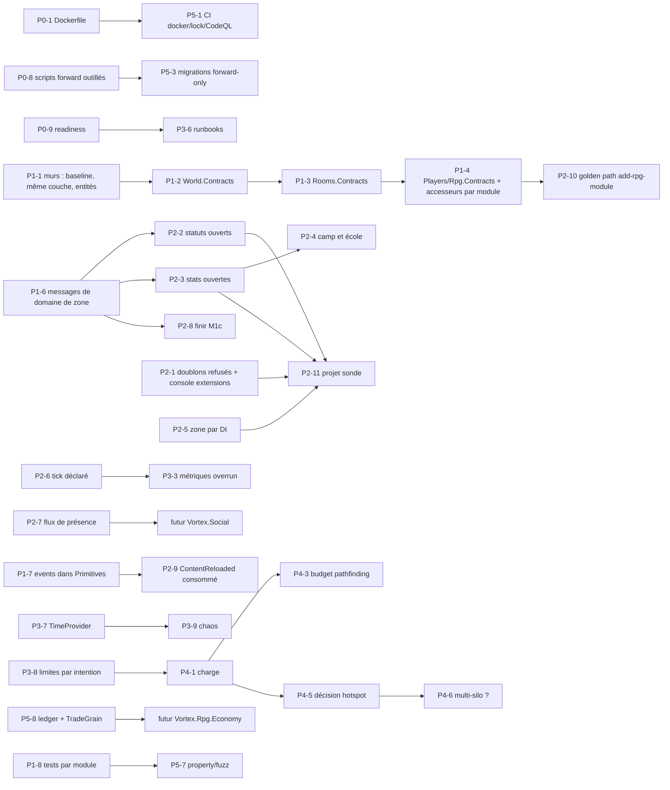

# Ambreia — feuille de route architecturale (ARCHITECTURE-ROADMAP)

Audit du 2026-10-10, lecture seule, `main` @ `c24e882`. Compagnon de `ENTERPRISE-AUDIT.md`.

Interdit : réécrire. Chaque étape compile, garde les tests verts, reste exécutable (`driver.mjs smoke`),
se revert seule et apporte une amélioration indépendante. Les tailles sont en jours de travail d'un
développeur connaissant le dépôt (S ≤ 1, M 2-3, L 4-8).

## P0 — Correction et sécurité (immédiat)

| ID | Étape | Fichiers / modules | Invariant introduit | Tests | Gate | Done | Rollback | Taille |
|---|---|---|---|---|---|---|---|---|
| P0-1 | **Dockerfile sans Dashboard** : retirer les étapes `Vortex.Dashboard.Web/API`, `EXPOSE 9000` | `Dockerfile`, `docker-compose.yml` | l'image se construit depuis le dépôt | job CI `docker build` | CI | `docker compose build` vert | revert | S |
| P0-2 | **Budget pré-auth** : compter les headers inconnus dans le budget de parse (ou dans le seau par session avant le parse) ; réécrire la boucle WS avec un seul compactage par trame | `PackageHandler.cs:74-80`, `WsPackageHandler.cs:118-135`, `UnknownHeaderTests` | coût borné par octet reçu, avant authentification | test « 10 000 headers inconnus = 1 fermeture, ≤ N logs » ; test de réassemblage WS | FastCheck | tests + `driver.mjs ping` | revert | M |
| P0-3 | **Deadline de handshake** : fermer un socket sans `ClientHello`/`SSOTicket` après `HandshakeTimeoutSeconds` (10) ; `IdleSessionTimeOut` explicite | `NetworkManager`, `NetworkingConfig`, `appsettings.json` | un socket non authentifié ne vit pas plus de 10 s | test avec `TimeProvider` (introduit ici pour `Vortex.Networking`) | FastCheck | — | config à 0 désactive | M |
| P0-4 | **Adresse derrière proxy** : support PROXY protocol v1/v2 (TCP) et `X-Forwarded-For` (WS) avec liste de proxies de confiance, comme le web API | `SessionContext`, `WebSocketSessionContext`, `SessionGateway.TryAdmit`, `NetworkingConfig` | la limite par IP et l'audit voient le client, pas le proxy | test « adresse transmise seulement depuis un proxy connu » | FastCheck | `driver.mjs` via proxy local | config vide = comportement actuel | M |
| P0-5 | **Limiteur du web API derrière proxy** : refuser au démarrage `UseForwardedHeaders=false` avec un bind non-loopback hors Development, ou partitionner par compte après login | `WebApiConfigValidator`, `WebApiAppConfigurator.cs:571-592` | pas d'auto-DoS d'un hôtel entier derrière un proxy | test de validateur | FastCheck | — | revert | S |
| P0-6 | **Clé d'idempotence sur le don d'XP admin** ; audit des dons XP/objets avec l'id du compte acteur ; plafond journalier | `WebApiEndpoints.Admin.cs`, `PlayerCharacterGrain.Progress.cs`, `IAuditSink` | un retry HTTP ne double jamais l'XP ; toute action admin a une ligne d'audit | tests de route + de grain | FastCheck | — | revert | M |
| P0-7 | **Vitals écrits à la sortie de zone** (`SetVitalsAsync` flush immédiat, pas seulement sale) | `PlayerCharacterGrain.Vitals.cs:83-96` | la fenêtre de perte des PV passe de 30 s à 0 à la sortie | test « sortie de zone → ligne écrite » | FastCheck | `driver.mjs combat` | revert | S |
| P0-8 | **Chaîne de scripts forward outillée** : `scripts/sql/forward/NNN-*.sql` + exécuteur idempotent (`forward.mjs`) + test CI sur MySQL jetable | `scripts/sql/*`, `.github/workflows/quality.yml` | une base ne peut pas sauter un script | job CI | CI | — | scripts inchangés | M |
| P0-9 | **Readiness** : `/ready` (silo actif, listeners ouverts, contenu chargé, DB) distinct de `/health` (liveness = process) ; Docker healthcheck sur `/ready` | `WebApiEndpoints.cs:55-111`, `VortexEmulator`, `Dockerfile:168` | une panne DB ne redémarre plus le serveur de jeu ; un hôtel non prêt ne reçoit pas de joueur | tests de route | FastCheck | — | revert | M |
| P0-10 | **Logs du web API** : forwarder `ILoggerFactory`, `UseExceptionHandler`, pas de page d'exception hors Development | `WebApiWebHost.cs:335,439-455` | une exception Kestrel est visible et ne fuit pas | test « 500 sans stack » | FastCheck | — | revert | S |
| P0-11 | Orleans silo/gateway sur loopback sauf clustering `adonet` | `HostApplicationBuilderExtensions.cs:347-352` | pas de port Orleans exposé sans raison | test de validateur | FastCheck | — | config | S |
| P0-12 | Gates du pipeline de commandes **échouent fermé** (`MessageRegistry`) | `EnvelopeHost.cs:314-321,346-354` | un behavior qui lève refuse le paquet | test pipeline | FastCheck | — | revert | S |

## P1 — Frontières (avant que le projet grossisse)

| ID | Étape | Fichiers / modules | Invariant | Tests | Done | Taille |
|---|---|---|---|---|---|---|
| P1-1 | **Baseline du mur 4 à jour** (`Vortex.Rpg`, `Vortex.World` et leurs tests dans `protocolFree`) + règle **même couche** (feuille → feuille interdit sauf Skills/Monsters → Combat ; Platform ↔ Platform interdit sauf Rooms → Furniture/Rpg) + règle **entité EF hors module** | `check-architecture-walls.mjs`, baseline | les murs de la spec §3.4 sont exécutables | `__test/run.mjs` étendu (sondes inert/authz/forwarding) | FastCheck rouge sur une arête interdite | M |
| P1-2 | **`Vortex.World.Contracts`** : sortir `Primitives/World/*` (61 fichiers) | `git mv`, csproj | changer une couche de zone ne recompile pas Core | build | gate vert | M |
| P1-3 | **`Vortex.Rooms.Contracts`** : `Primitives/Rooms/*` (105) et `Orleans/Snapshots/Room` | idem | idem | build | gate | M |
| P1-4 | **`Vortex.Players.Contracts`**, **`Vortex.Rpg.Contracts`** ; `GrainFactoryExtensions` éclaté par module | idem | Primitives ≤ 120 fichiers | test d'archi « Primitives ne référence aucun type de module » | gate | M |
| P1-5 | **Création de `players` par `PlayerGrain`** (`CreateAsync` ou `IPlayerFactory` dans Players) ; `rooms` créée par EF via un contrat de World | `AccountCharactersGrain.cs:189`, `ZoneEditorService.cs:239` | une table, un écrivain | tests existants adaptés | gate + `driver.mjs lobby`, `zone` | S |
| P1-6 | **Messages de domaine de zone** : `CombatZone`, `CastSystem`, `StatusSystem` émettent des `ZoneMessage` ; un traducteur dans Rooms produit les composers ; retirer `Vortex.Protocol` des 4 feuilles RPG et de `Rpg.Characters` | `CombatZone.Outbox.cs:40-73`, `RoomZoneRuntime`, nouveaux `Rooms/Zones/Messaging/*Translator.cs` | le combat se teste sans wire ; un changement de wire ne rebuild pas le RPG | tests de combat sans Protocol ; test de traduction | gate + `driver.mjs combat`, `skills` | L |
| P1-7 | `ICancellableEventPublisher` dans Primitives (Players/Rooms/Characters cessent de référencer `Vortex.Events`) ; `OnNoHandlerRegistered` loggue une fois par type d'event | `Vortex.Events`, `Vortex.Primitives/Events` | contrat d'event séparé du runtime | test | gate | S |
| P1-8 | **`Vortex.Rpg.Characters.Tests`** et **`Vortex.World.Tests`** (déplacer les 17 fichiers de `Database.Tests/Rpg`) ; dédoublonner `FakeZoneRuntime`, `FixedRandom`, `ManualClock` dans `Tests.Support` | tests | un projet, ses tests | — | gate | S |
| P1-9 | ADR-001 à ADR-008 écrits (`docs/adr/`), `AGENTS.md`/`architecture.md` corrigés (couches, grains, hooks), README à jour | docs | décisions tracées | — | revue | M |

## P2 — Architecture d'extension

| ID | Étape | Fichiers / modules | Invariant | Tests | Done | Taille |
|---|---|---|---|---|---|---|
| P2-1 | **Doublons refusés** dans les registres à clé (effets, comportements, canaux) sauf `[Replaces]` ; commande console `extensions` + métrique `vortex_extensions_registered` | `SkillEffects`, `RpgZoneSimulationFactory`, `ChatPipeline`, `ConsoleCommands` | un remplacement est explicite et visible | test « deux `damage` sans `Replaces` → démarrage refusé » | gate | M |
| P2-2 | **Types de statut ouverts** : `IStatusKind` (`Contribute`, `Pulse`, `IsBuff`, hooks) ; `StatModifiers` à drapeaux nommés ; `Recompute` générique | `StatusSystem.cs:103-124,230,331-342`, `StatusApplier`, `CombatZone.Extensions.cs:60-70` | un module ajoute `root` sans toucher Skills/Combat | `StatusFromModuleTests` étendu avec un kind de test | gate + `driver.mjs skills` | L |
| P2-3 | **Stats ouvertes** : `StatId` + registre (`AddStat<T>` ou `content/stat`), `StatBlock` compact, snapshots stables (`[Id]` conservés) | `StatBlock`, `StatCalculator`, `Combatant`, `CombatZone.Recompute`, serializer | une stat nouvelle = 1 déclaration + contenu | test d'une stat déclarée par un test | gate | L |
| P2-4 | **Camp et école** : `Faction` + `IFactionPolicy` ; `HitContext.School` + résistance par école | `CombatZone`, `SkillTargets`, `HitContext`, définitions | compagnons/PvP et résistances exprimables | tests | gate | M |
| P2-5 | **Zone déclarée par DI** : conditions, actions, interactions construites depuis `IEnumerable<>` ; schéma polymorphe généré ; `ZoneRuntimeRules` interroge le registre | `ZoneConditions.cs`, `ZoneActions.cs`, `ZoneInteractionModule.cs:24-35`, `ZoneRuntimeRules.cs` | un module RPG ajoute une condition de donjon sans toucher Rooms/World | test « condition déclarée par un test » | gate + `driver.mjs travel` | L |
| P2-6 | **Étapes de tick déclarées** : `IRoomTickStep`, les cinq étapes actuelles deviennent des implémentations ; budget d'overrun mesuré (`room_tick_overruns`) | `RoomGrain.cs:336-347,360-407` | une étape = une classe ; un dépassement est compté | test « étape qui lève n'arrête pas le tick » (manque aujourd'hui) | gate | M |
| P2-7 | **Flux de présence déclarés** : `IPresenceStreamSource` ; `world-chat` devient une source déclarée par Players | `PlayerPresenceGrain.Room.cs:164`, `.Chat.cs:133-137` | un canal `group` à flux propre sans toucher la présence | test | gate + `driver.mjs chat` | M |
| P2-8 | **Finir M1c** : `RankScale` construit par la fabrique, base `MonsterBehavior`, sélecteur de compétences, phases, invocation, cri | `RpgZoneSimulationFactory`, `MeleeBehavior`, `MonsterSpawner` | un boss joue comme un boss | tests M1c 7-9 ; test « rang élite = stats ×k » | gate + `driver.mjs combat` | L |
| P2-9 | **`ContentReloadedEvent` consommé** : spawns, statuts actifs, caches relus ; test « contenu modifié pendant un combat » | `SpawnPoint`, `StatusSystem`, `RpgContentRegistry` | un import se voit sans désactiver la room | test | gate + `driver.mjs content` | M |
| P2-10 | Golden paths manquants : `adding-a-grain`, `adding-an-endpoint`, `adding-an-event-handler`, `adding-an-rpg-module` (sln, Main, baseline, tests, headers par plage) | `.claude/skills/` | un module = 2 fichiers partagés | — | revue | M |
| P2-11 | **Projet sonde** `Vortex.Rpg.FitnessProbe` (tests) : une extension de chaque sorte, dont statut, stat, condition de zone | tests | le test §48 est permanent | — | gate | S |

## P3 — Fiabilité et observabilité

| ID | Étape | Invariant | Taille |
|---|---|---|---|
| P3-1 | Scopes de log `PlayerId`, `RoomId`, `ConnectionId`, `GrainType`, `Operation` ; jamais de ticket | tout log d'un tour de grain est corrélable | M |
| P3-2 | Tracing OpenTelemetry réellement branché (`AddSource` des `ActivitySource` existants) sur login → ticket → socket → grain, et paquet → handler → grain → DB ; **pas** sur le tick | une requête lente se voit | M |
| P3-3 | Métriques manquantes : `room_tick_overruns`, `packets_rejected{reason}`, `db_query_duration`, `login_failure{reason}`, `inventory_operations{op}`, `combat_hits{outcome}` ; jamais `playerId` en label (déjà respecté) | tableau de bord minimal exploitable | M |
| P3-4 | Audit admin complet (catégories `Staff`, `Economy`, `Security`, `System`) ; rétention des `error_*` ; index `occurred_at` ; `remote_ip` haché | toute action de pouvoir est tracée et purgée | M |
| P3-5 | Options validées au démarrage pour les 19 sections non validées (`ValidateOnStart`) | une config invalide refuse le démarrage | M |
| P3-6 | Runbooks `docs/operations/` : lenteur, logins, room qui lag, objets disparus, MySQL ; backup/restore testé, RPO/RTO écrits | un inconnu diagnostique à 3 h du matin | M |
| P3-7 | `TimeProvider` dans Networking (heartbeat), Players (tickets, grâce), Rooms (`ZoneTestGrain`) ; graine RNG par zone loguée | temps et hasard testables et reproductibles | M |
| P3-8 | Limite **par intention** (`MoveAvatar`, `RpgTargetSelect`, `RpgSkillCast`) en plus du seau de session ; limiteur avant l'appel de grain de `MessageSystem` | un flood ne monopolise pas un tour de room | M |
| P3-9 | Tests de chaos ciblés : DB indisponible 10 s, exception dans une étape de tick, socket coupé pendant un flush, arrêt pendant un flush, échec d'import | les politiques d'échec sont pinnées | M |

## P4 — Performance et échelle (mesurer d'abord)

| ID | Étape | Invariant | Taille |
|---|---|---|---|
| P4-1 | Récupérer `Vortex.LoadGen` (`af91e325`) ; scénarios 100 / 500 / 1 000 joueurs simulés : tempête de login, hotspot (100 joueurs dans une zone 64×64), déplacement, chat, combat 20 vs 15, voyage, reconnexion ; mesure sur la machine de référence | budgets chiffrés (spec §19) | L |
| P4-2 | Supprimer la chaîne de debug par paquet (`VortexPacket._logger`) ; mesurer le gain | — | S |
| P4-3 | Budget de pathfinding par tick (cache, `MaxPathSearchesPerTick` pour les joueurs comme pour les monstres), cap de taille de broadcast | un tick reste sous son budget | M |
| P4-4 | `PlayerDirectoryGrain` : cache nom → id (le whisper fait une requête DB par message) ; `ServerConfigGrain` `[KeepAlive]` | — | S |
| P4-5 | Décision hotspot : **seulement si** P4-1 montre qu'un `RoomGrain` sature sous 100 joueurs : découpage de la zone en cellules (sharding spatial) ou réduction du fanout (intérêt par rayon) | — | — |
| P4-6 | Multi-silo : **ne pas le faire** tant qu'un seul silo tient la charge mesurée ; prérequis connus (flux persistants, caches partagés, sessions web, migration hors démarrage) listés dans `single-silo-inventory.yaml` | — | — |

## P5 — Maturité de plateforme

| ID | Étape | Taille |
|---|---|---|
| P5-1 | Dependabot/Renovate, `packages.lock.json`, CodeQL, couverture, `docker build` en CI ; FastCheck réellement rapide (tests du projet touché), gate complet au push | M |
| P5-2 | `CODEOWNERS` : Networking/Crypto, Database/migrations, Rpg.Characters (économie), scripts/hooks (architecture) | S |
| P5-3 | Migrations forward-only (bascule ADR-006) : baseline, `migrations add`, job de migration hors démarrage, `expand/migrate/contract` | L |
| P5-4 | Décision web API : rester plugin (garder les listes et le script) ou hosted service (supprimer `ForwardSingletons`, `check-webapi-forwarding.mjs`, la `FrameworkReference` de Main) | M |
| P5-5 | Outillage portable : `ef.sh`, `import-reference-data.sh`, `driver.mjs` sans Laragon (MySQL par compose) ; e2e `driver.mjs smoke` en CI Linux | L |
| P5-6 | `internal` par défaut dans Rooms et les feuilles RPG ; scanner acceptant les types `internal` | M |
| P5-7 | Property tests (FsCheck) : inventaire (don/déplacement/scission/fusion), hit chain (bornes), serializers (round-trip), pathfinding (chemin valide) ; fuzz des parsers et du JSON de zone/contenu | L |
| P5-8 | Avant la première feature économique : `economy_ledger` append-only, clé d'opération, `TradeGrain` (ADR-008) | M |

## DAG de migration (§107)

Tout ce qui n'est pas relié est indépendant et peut se faire dans n'importe quel ordre, un commit par
étape, sur `main`, avec le gate vert et la preuve `driver.mjs` quand un joueur peut voir le changement.

## Definition of Done entreprise (§108-109)

Une étape est terminée quand : (1) le gate `VortexCloudQualityGate` est vert ; (2) le test d'architecture
ou le script qui protège le nouvel invariant existe et **échoue** si on retire l'étape ; (3) la preuve
runtime est jouée (`driver.mjs <scénario>`) pour toute étape visible d'un joueur ; (4) le signal
d'observabilité du nouveau comportement existe (log corrélé, métrique ou audit) ; (5)
`docs/architecture.md` et l'ADR concerné sont à jour ; (6) le comportement en cas d'échec est écrit
(que se passe-t-il si la DB tombe pendant ce chemin ?) ; (7) l'impact performance est mesuré ou
explicitement « non mesuré, hors chemin chaud ».
