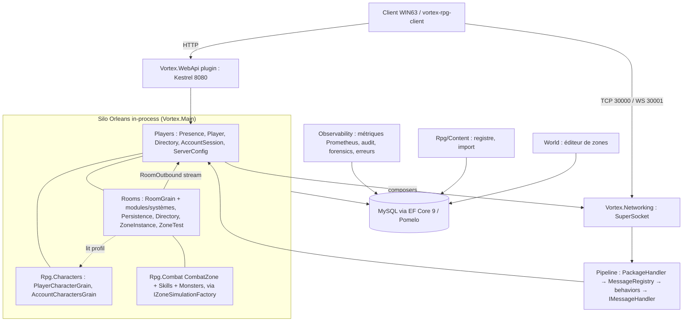
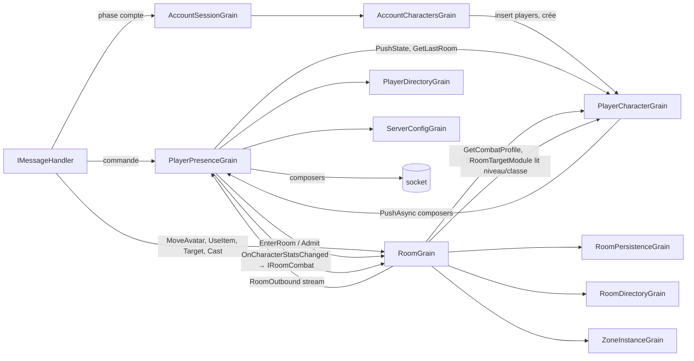
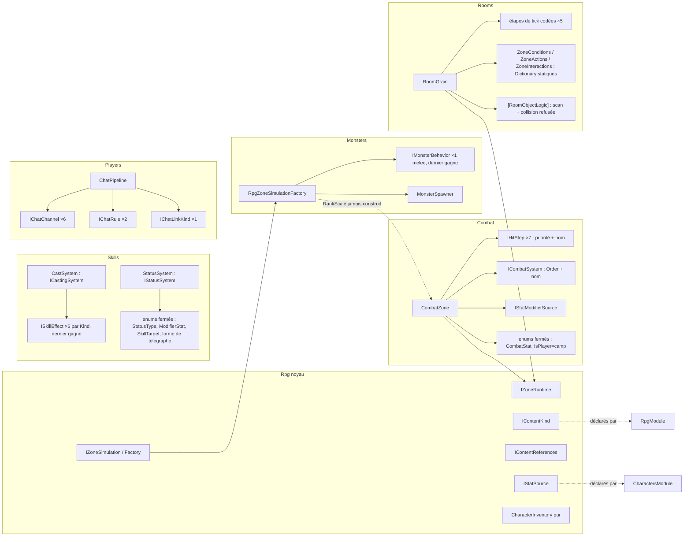

# AMBREIA ENTERPRISE ARCHITECTURE REPORT

Audit architectural du serveur Ambreia (dépôt `absolutezeroo/ambreia-server`, `main` @ `c24e882`,
2026-10-10). Lecture seule : aucun fichier de code modifié, aucun commit. Les six fichiers de ce dossier
sont les livrables demandés ; celui-ci est le rapport maître, les cinq autres le détaillent :

| Fichier | Contenu |
|---|---|
| `ENTERPRISE-AUDIT.md` (ce fichier) | synthèse, AS-IS, risques, menaces, gap, findings, ADR, fitness functions, verdict |
| `TARGET-ARCHITECTURE.md` | modules cibles, graphe de dépendances, matrice interdite, standard de module, flux, arborescence |
| `MODULARITY-MATRIX.md` | bounded contexts, propriété des concepts, kernel, couplage, surface publique, God objects, scorecards, maturité |
| `DATA-OWNERSHIP.md` | matrice des 27 tables, état hors base, transactions, idempotence, schéma, backup/DR, audit, cible |
| `EXTENSION-POINTS.md` | catalogue des points d'extension, qualité des contrats, déterminisme, violations ouvert/fermé, test « feature future », modèle cible |
| `ARCHITECTURE-ROADMAP.md` | P0–P5 avec critères d'acceptation, DAG de migration, Definition of Done |

Méthode : inventaire exhaustif (27 projets de production, 16 projets de tests, 2 de support,
62 155 lignes C# hors tests, 1 547 fichiers), sept passes de lecture par domaine avec preuve
`fichier:ligne` pour chaque constat, passe faux positifs sur tout HIGH/CRITICAL, exécution des gates
du dépôt, puis cinq relectures de rôle (architecte, moteur de jeu, SRE, attaquant, nouveau développeur).

Gates exécutés sur ce conteneur (Linux, SDK .NET 10.0.301 installé pour l'audit) :

| Étape | Résultat |
|---|---|
| `dotnet build Vortex.Cloud.sln` | vert, 0 erreur, 4 avertissements NU1903 (`SQLitePCLRaw.lib.e_sqlite3` 2.1.10, vulnérabilité connue, tests seulement) |
| `dotnet csharpier check .` | vert, 1 602 fichiers |
| `node scripts/hooks/check-*.mjs` (5 scripts) + `__test/run.mjs` | vert (8 murs, 1 547 fichiers de layout, 32 handlers / 57 composers, 50 entrées d'autorisation, 1 service forwardé, 7 sondes) |
| `dotnet test Vortex.Cloud.sln` | **1 642 tests, 0 échec** sur 16 projets |
| `dotnet format style` / `analyzers --verify-no-changes` | vert |
| `driver.mjs smoke` | **non exécuté** : pas de MySQL sur ce conteneur, outillage Windows/Laragon ; aucune preuve runtime dans ce rapport ne va au-delà des tests |

---

## 1. Executive Summary

Ambreia est un **projet structuré, pas un prototype** : couches réelles vérifiées par script, handlers
réduits à l'orchestration, identité jamais lue dans le corps d'un paquet, un seam `IZoneRuntime` qui
isole le combat des rooms, sept points d'extension RPG déclarés par DI où le cœur ne nomme aucune
variante, un pipeline de contenu exemplaire, 1 642 tests verts et un gate qui refuse ce que la prose
promettait. C'est la base à garder.

Ce qui sépare ce dépôt d'une architecture d'entreprise tient en **cinq écarts**, tous corrigeables sans
réécriture :

1. **Déployabilité et exploitation** : le `Dockerfile` construit encore deux projets supprimés par la
   coupe du 2026-10-07 (l'image ne se construit pas) ; `/health` est aussi la sonde Docker et ne
   vérifie que la base (une panne MySQL redémarre le serveur de jeu, un hôtel non prêt est déclaré sain) ;
   la base vivante du propriétaire est **déjà** sur une chaîne de sept scripts SQL manuels qui réécrivent
   `__EFMigrationsHistory`, hors de tout outil et de tout test.
2. **Robustesse réseau pré-authentification** : un header inconnu échappe à toute limite et coûte un log ;
   la boucle de réassemblage WebSocket recopie le tampon à chaque paquet (quadratique) ; aucun socket
   n'est fermé faute de handshake ; derrière le reverse proxy que le projet recommande, tout l'hôtel
   partage une adresse IP, donc **32 sessions WebSocket au total**.
3. **Variantes fermées dans les moteurs** : effets, comportements, hit steps, systèmes, kinds et canaux
   sont additifs ; **stats, types de statut, écoles de dégâts, modes de ciblage, camp** sont des enums
   dont l'ajout traverse `StatusSystem`, `CombatZone.Recompute`, les snapshots Orleans et le client.
   Les conditions, actions, interactions de zone et les étapes de tick sont des listes statiques du cœur.
4. **Kernel et contrats** : `Vortex.Primitives` (374 fichiers, 398 types publics) porte deux modèles de
   domaine entiers (Rooms 105 fichiers, World 61) ; les quatre feuilles RPG référencent `Vortex.Protocol`
   et construisent des composers dans les moteurs ; `Rpg.Skills → Rpg.Combat` contredit la spec.
5. **Le contenu M1c est accepté sans runtime** : rang, phases, compétences, invocation et cri d'un
   monstre sont validés et stockés, mais `RpgZoneSimulationFactory` ne construit jamais de `RankScale`
   et `MeleeBehavior` ne lance rien ; un boss joue comme un loup.

Niveau de maturité : **2 (Production capable), à la limite basse sur le déploiement.** Cible à 24 mois :
**3 (Enterprise modular).** Le multi-silo (niveau 4) n'est **pas** un objectif tant qu'une mesure de
charge ne montre pas qu'un silo sature ; le dépôt le dit déjà lui-même (`single-silo-inventory.yaml`).

Verdict : **garder l'architecture, durcir ses frontières, ouvrir ses enums, rendre le serveur
exploitable.** Douze étapes P0 (toutes ≤ 3 jours), puis les contrats par module (P1), puis l'ouverture
des variantes (P2). Rien dans ce rapport ne recommande un microservice, une saga, un outbox ni un
framework interne.

---

## 2. Maturité actuelle

| Axe | /10 | Axe | /10 |
|---|---|---|---|
| Architecture | 7 | Intégrité des données | 7 |
| Modularité | 7 | Tests | 7 |
| Extensibilité | 6 | Observabilité | 6 |
| Correction | 7 | Exploitabilité | 5 |
| Sécurité | 6 | Déployabilité | 4 |
| Fiabilité | 6 | Maintenabilité | 8 |
| Performance | 5 (non mesurée) | Expérience développeur | 7 |
| Scalabilité | 4 (mono-silo assumé) | Documentation | 7 |

Justifications par axe et scorecard par domaine : `MODULARITY-MATRIX.md` §7-9.

---

## 3. Architecture AS-IS

### 3.1 Composants

Un processus `Vortex.Main` : silo Orleans in-process (clustering localhost, flux mémoire, stockage
mémoire du seul `PubSubStore`, tout l'état durable passe par EF Core), deux hôtes SuperSocket (TCP
30000, WebSocket 30001, loopback par défaut), le web API en **plugin** (Kestrel 8080, conteneur DI
séparé alimenté par `ForwardSingletons`). MySQL 8 pour les données.



### 3.2 Graphe de dépendances réel (références de projet)

26 projets de production hors Main ; arêtes vers `Primitives` (24 projets) et depuis `Main` (25) omises.
Pas de cycle. Aucune référence Players ↔ Rooms. Détail et couplage : `MODULARITY-MATRIX.md` §4.

```mermaid
graph TD
  subgraph Core
    Crypto; Database; Events; Logging; Messages; Networking; Observability; PacketHandlers; Pipeline; Plugins; Protocol; Revisions; Runtime
  end
  subgraph Platform
    Furniture; Permissions; Players; Rooms; Rpg; Characters[Rpg.Characters]; Combat[Rpg.Combat]; Monsters[Rpg.Monsters]; Skills[Rpg.Skills]; World
  end
  subgraph Web
    WebApi; WebApiAuth[WebApi.Authentication]
  end
  Events --> Pipeline; Events --> Runtime
  Furniture --> Database; Furniture --> Observability
  Messages --> Logging; Messages --> Pipeline; Messages --> Runtime
  Networking --> Crypto; Networking --> Messages; Networking --> Protocol
  Observability --> Database; Observability --> Events
  PacketHandlers --> Crypto; PacketHandlers --> Events; PacketHandlers --> Logging; PacketHandlers --> Messages; PacketHandlers --> Protocol
  Permissions --> Database; Permissions --> Observability
  Pipeline --> Runtime
  Players --> Database; Players --> Events; Players --> Logging; Players --> Messages; Players --> Protocol
  Plugins --> Database; Plugins --> Logging; Plugins --> Runtime
  Revisions --> Protocol
  Rooms --> Database; Rooms --> Events; Rooms --> Furniture; Rooms --> Logging; Rooms --> Protocol; Rooms --> Rpg; Rooms --> Runtime
  Rpg --> Database
  Characters --> Database; Characters --> Events; Characters --> Logging; Characters --> Protocol; Characters --> Rpg
  Combat --> Logging; Combat --> Protocol; Combat --> Rpg
  Monsters --> Logging; Monsters --> Protocol; Monsters --> Rpg; Monsters --> Combat
  Skills --> Logging; Skills --> Protocol; Skills --> Rpg; Skills --> Combat
  WebApi --> Database; WebApi --> Events
  WebApiAuth --> Crypto; WebApiAuth --> Database
  World --> Database
```



Trois arêtes à retenir : `Rooms → Rpg` (le seam, voulu), `Skills → Combat` (interdit par la spec §3.4,
toléré par le script), et `{Characters, Combat, Skills, Monsters} → Protocol` (le wire fuit dans le jeu).

### 3.3 Graphe runtime (communication entre grains)



Observation : `PlayerPresenceGrain` est le hub (10 interfaces de grains, 8 services, 7 domaines
connus, 16 méthodes) et `RoomGrain ↔ PlayerCharacterGrain` est un aller-retour dans le tick
(`GainXpAsync` awaité pendant le tick de combat, avec event annulable et flush DB au level-up).

### 3.4 Propriété des données

```mermaid
graph TD
  PA[player_accounts] --> WA[WebApi.Authentication]
  T[account_tickets, security_tickets] --> AU[AuthenticationService]
  PL[players] --> PG[PlayerGrain : update]
  PL -.insert.-> AC[AccountCharactersGrain]
  PC[player_characters] --> CG[PlayerCharacterGrain]
  PC -.ids de classe.-> IMP[import de contenu : IContentReferences]
  IT[rpg_items, rpg_item_grants] --> CS[CharacterItemStore]
  IT -.definition_id.-> IMP
  CT[rpg_content*] --> RCS[RpgContentService]
  RO[rooms] -.SQL brut.-> ZE[ZoneEditorService]
  RO -.aucun écrivain.-> RG[RoomGrain]
  RR[room_rights] -.aucun écrivain.-> RG
  FU[furniture] --> RPG[RoomPersistenceGrain]
  Z[zones, zone_versions] --> ZE
  SC[server_config] --> SG[ServerConfigGrain]
  SC -.->|dev_zone.sql| SQL[scripts]
  AE[audit_events, item_events, room_entry_logs, error_*] --> OB[Observability writers]
  RL[roles, role_permissions, player_account_roles] --> PS[PermissionSeederService]
  REF[room_models, furniture_definitions] --> SQL2[import_reference_data.sql]
```



Matrice complète, fenêtres de perte, transactions : `DATA-OWNERSHIP.md`.

### 3.5 Flux d'un paquet

```text
octets ─▶ TcpFilter / WsPackageHandler ─▶ ClientPacketDecoder (longueur 2..65536 vérifiée avant tampon, RC4 Peek puis Process)
       ─▶ PackageHandler (parser par header dans la révision de session ; inconnu = warning seul ; 10 échecs de parse = fermeture)
       ─▶ MessageSystem (scope de trace, métrique PacketReceived, **un appel de grain GetActiveRoomAsync**)
       ─▶ MessageRegistry / EnvelopeHost : MessageContext construit depuis la session (PlayerId, AccountId, RoomId jamais du corps)
            behaviors par [Order] : RateLimitBehavior (50/s, burst 100, par session) → AccountPhaseGateBehavior → RpgIntentLimitBehavior
            (un behavior qui lève est **sauté** et le handler tourne : échec ouvert)
       ─▶ IMessageHandler<T> découvert par scan (types publics), activé par paquet, plusieurs handlers d'un même T en parallèle, erreurs avalées + reportées
       ─▶ un grain ─▶ le grain qui change l'état envoie : PlayerPresenceGrain.SendComposerAsync (file 500, fermeture fatale au débordement)
       ─▶ sémaphore d'envoi par session ─▶ PackageEncoder (serializer par type de composer, RC4) ─▶ socket
```

### 3.6 Graphe d'extension RPG



Catalogue, qualité des contrats, déterminisme : `EXTENSION-POINTS.md`.

---

## 4. Ce qui doit absolument être conservé

| Élément | Preuve | Pourquoi c'est une qualité d'entreprise |
|---|---|---|
| Couches Core → Platform → Web scriptées, sans cycle | `check-architecture-walls.mjs` (8 murs), graphe §3.2 | la règle se défend elle-même |
| Handlers = orchestration ; identité depuis le contexte ; aucun `DbContext` ; le grain envoie | mur 1, `ProjectBoundaryTests`, grep des 32 handlers | frontière réseau saine, client non fiable traité comme tel |
| Seam `IZoneRuntime` / `IZoneSimulation` : le combat ignore `Vortex.Rooms` | `Vortex.Rpg/Zones/*`, `RoomZoneRuntime.cs`, `RpgZoneSimulationFactory.cs` | le moteur de jeu se teste sans room (`FakeZoneRuntime`, `FixedRandom`) |
| Sept points d'extension RPG + chat déclarés par DI, cœur sans variante nommée | `SkillsModule.AddEffect<T>`, `MonstersModule`, `CombatModule`, `ChatPipeline` ; `CombatExtensionTests`, `ANewChannel_IsRoutedWithoutTouchingTheCore` | la règle n° 1 de modularité est **déjà vraie** pour la moitié des points |
| Pipeline de contenu | `IContentKind`, import atomique, `IContentReferences`, schémas générés et testés, doublon de kind refusé | un nouveau kind = 8 fichiers, 0 cœur ; le modèle du dépôt |
| Règles pures | `CharacterInventory` (65 tests), `HitResolver`, `StatCalculator`, `CombatMath`, `TelegraphCells`, `ThreatTable` | domaine déterministe, testable sans Orleans ni DB |
| Write-behind et canaux bornés | `RoomPersistenceGrain` (2 s, drain), items (2 s), audit (10 000, lots de 200, dead-letter JSONL) | aucune écriture DB par événement de jeu |
| Révisions : ids `internal`, release renumérotée, doublons refusés au démarrage | `Headers.cs`, `ReleaseRevision.cs`, `RevisionMapBuilder` | le métier ignore le numéro de paquet |
| `IHostPluginModule` + test d'enregistrement ; `Program.cs` pur câblage | `HostModuleRegistrationTests` | composition root réelle |
| Manifeste d'interleaving, inventaire mono-silo, baselines de ratchet | `Vortex.Hosting.Tests/Architecture/*` | la dette est inventoriée, pas cachée |
| AGENTS.md + 9 skills + 2 agents relecteurs + hooks | `.claude/` | golden paths exécutables |
| `csharpier`, analyzers en erreurs (`CS8602`, `CA2000`, `ORLEANS0012/13`), aucun fichier > 1 000 lignes | `Directory.Build.props` | maintenabilité 8/10 |

---

## 5. Risques architecturaux majeurs

| # | Risque | Preuve | Conséquence à 5 ans |
|---|---|---|---|
| R1 | **Enums fermés dans les moteurs** (stat, statut, école, cible, camp) | `StatusSystem.cs:103-124,331-342`, `CombatZone.Recompute :48-58`, `SkillTargets` | chaque mécanique nouvelle rouvre Combat et Skills ; `CombatZone.cs` est déjà le fichier le plus modifié (10/50 commits) |
| R2 | **Le wire dans le jeu** : 4 feuilles RPG + Characters référencent `Vortex.Protocol`, `CombatZone.Outbox` construit 5 composers | csproj, `CombatZone.Outbox.cs:40-73` | une seconde révision ou un changement de wire rebuild et retouche le gameplay ; le combat ne se teste qu'avec des composers |
| R3 | **Kernel à 374 fichiers** portant Rooms (105) et World (61) | `Vortex.Primitives/*` | toute couche de zone recompile Crypto et Networking ; un `Module.Contracts` est la frontière naturelle |
| R4 | **Chaîne de migrations manuelle** | `scripts/sql/2026-*.sql` ×7 réécrivant `__EFMigrationsHistory` | la première base non recréable se retrouve sur un schéma qu'EF croit à jour ; aucun test |
| R5 | **Listes statiques de zone et tick codé** | `ZoneConditions.cs:14-19`, `ZoneActions.cs:17-26`, `ZoneInteractionModule.cs:24-35`, `RoomGrain.cs:336-347` | donjons, quêtes et métiers (qui vivent dans les zones) devront éditer `Vortex.Rooms` et `Vortex.World` |
| R6 | **Présence hub sans prise** | `PlayerPresenceGrain.Room.cs:164`, `.Chat.cs:133-137` (deux abonnements codés), relais de `CharacterCombatProfile` | groupe, guilde, courrier : chacun édite la présence |
| R7 | **Pas de mesure** : aucun budget de tick (histogrammes seulement), A* jusqu'à 12 288 nœuds synchrone dans le tour, fanout sans cap, débug string par paquet | `RoomGrain.cs:349-406`, `RoomPathingSystem.cs:181-186`, `VortexPacket.cs:7` | le hotspot sera découvert en production |
| R8 | **Pré-auth sans limite, proxy ignoré, pas de deadline** | `PackageHandler.cs:74-80`, `WsPackageHandler.cs:118-135`, `SessionGateway.cs:140-174` | disponibilité : un attaquant sans compte coûte du CPU et du disque ; derrière proxy l'hôtel est plafonné à 32 WS |
| R9 | **Exploitation aveugle** : `/health` = DB, tracing mort (`ActivitySource` sans listener), scopes de log sans joueur/room, audit admin absent | `WebApiEndpoints.cs:55-111`, OTel metrics-only, 10 actions auditées | « pourquoi la room lag ? » n'a pas de réponse à 3 h du matin |
| R10 | **M1c sans runtime** | `RpgZoneSimulationFactory.Create :86-137`, `CombatZone.cs:185-195` | le contenu promet ce que le serveur ne joue pas ; les designers écriront des boss inertes |

---

## 6. Modularité, frontières, propriété, Orleans, extension

Traités dans les fichiers compagnons ; conclusions :

- **Modularité** (`MODULARITY-MATRIX.md` §7) : moyenne 7,1/10 ; contenu 9,0 (modèle), Joueurs 6,0 et Rooms
  6,4 (frontières à durcir), Combat 6,8 (hub de changement).
- **Bounded contexts** (§1) : treize contextes réels, cohérents ; deux fuites : la présence connaît le
  profil de combat, la room lit le personnage pour afficher une cible.
- **Propriété** (§2, `DATA-OWNERSHIP.md`) : aucun concept à trois propriétaires ; `players` a deux
  écrivains, `rooms` aucun déclaré, `room_rights` aucun ; 0 table de grain écrite par le web API.
- **Orleans** : les grains orchestrent et délèguent (RoomGrain = 15 partials mais 3 986 lignes de
  modules + 704 de systèmes ; PlayerCharacterGrain 9 partials pour personnage **et** inventaire) ; pas
  de `[PersistentState]`, tout par EF ; interleaves manifestés ; `ServerConfigGrain` sans `[KeepAlive]`
  recharge sa table à chaque réactivation ; le tick de zone await des grains de personnage (latence
  du tick dépendante de la DB au level-up).
- **Extension** (`EXTENSION-POINTS.md`) : 20 points inventoriés ; 11 additifs, 5 enums fermés, 4 listes
  codées ; « dernier gagne » silencieux sur effets, comportements et canaux ; seul `IContentKind` refuse
  un doublon ; égalités de priorité déterministes mais non testées ; RNG injectable mais jamais seedé
  en production.

---

## 7. Réseau et protocole

Limites et contre-pression (§51-52) :

| Ressource | Limite | Config | Application | Statut |
|---|---|---|---|---|
| Corps de trame | 64 KiB | `Vortex:Networking:MaxPacketBodyBytes` | `ClientPacketDecoder.cs:34-40` avant mise en tampon | OK |
| Chaîne wire | 65 535 o | — | `ClientPacket.PopString` | OK ; aucun max sémantique dans les parsers (chat 200 dans `ChatPipeline`) |
| Trame WS / `MaxPackageLength`, `IdleSessionTimeOut` | défauts SuperSocket | non configurés | — | **MANQUE explicite** |
| File sortante joueur | 500, fermeture fatale | `PlayerPresenceConfig.MaxOutgoingQueueSize` | `PlayerPresenceGrain.cs:233-271` | OK (protocole ordonné respecté) |
| Débit entrant | 50/s, burst 100, par session | `Vortex:Networking:RateLimit` | `RateLimitBehavior`, **après** parse et après l'appel de grain de `MessageSystem` | PARTIEL |
| Intentions écran personnage | 1-2 s par socket | `Vortex:RpgIntents` | `RpgIntentLimitBehavior` | OK |
| Headers inconnus | **aucune** | — | warning seul | **MANQUE** |
| Échecs de parse | 10 par connexion | `MaxParseFailuresPerSession` | `PackageHandler.cs:105-119` | OK |
| Sessions par IP / total | 32 / 5 000 | `MaxSessionsPerIpAddress`, `MaxTotalSessions` | `SessionGateway` (par IP atomique, total check-then-act) | OK mécaniquement, **adresse du proxy** |
| Deadline de handshake | **aucune** | — | — | **MANQUE** |
| Heartbeat | WS ping 10 s après 30 s de silence, fermeture désactivée ; TCP aucun | `PingInterval…`, `PongTimeout=0` | `NetworkManager.cs:257-325` | choix documenté (onglets gelés) pour les sessions authentifiées seulement |
| Chat | 200 car., débit par canal | `Vortex:Chat:RateLimits` | `ChatPipeline` | OK |
| Sac / colis / personnages par compte | 30 / 50 / 5 | `ItemConfig`, `CharacterConfig` | grains | OK |
| Occupation d'une room | `PlayersMax` (0 = illimité par défaut), non revérifiée à la création d'avatar | zone | `RoomGrain.Entry.cs:48` | PARTIEL |
| Dimensions de zone | 64×64, hauteurs 0..32, schéma 1 | `ZoneValidator` | éditeur | OK ; **aucune limite** de triggers, timers, aires (décor : 2 000 en warning) |
| Document de zone / pack de contenu | 4 MiB / 16 MiB | `MaxDocumentBytes`, `MaxPackBytes` | routes | OK |
| Nombre de documents d'un pack | aucune | — | — | MANQUE (LOW) |
| Copies de donjon | 200 par zone, une par **joueur** | `ZoneInstanceIds` | `ZoneInstanceGroups.cs:40` | 200 grains à 20 Hz possibles |
| Canal d'audit | 10 000, lots de 200, dead-letter | `Observability` | `ChannelBatchWriter` | OK |

Comportement de contre-pression : réseau entrant = refus (seau) puis fermeture (parse) ; sortant =
fermeture fatale au débordement ; audit = drop compté ; flux de room = file de 500 par présence ; DB
= write-behind borné (100 meubles par flush). Manque : coalescence des `UserUpdate` sous charge et cap de
taille de broadcast.

Versionnement : une révision = `IRevision` + maps ; ids `internal` ; release renumérotée ; une seconde
révision simultanée exige d'éditer `ServiceCollectionExtensions.cs:28-35`. Le domaine est indépendant
de WIN63 **sauf** par les composers construits dans les moteurs RPG (R2).

Crypto : DH 384 bits à exposant **statique par process** (pas de forward secrecy), RSA 1024 PKCS#1 v1.5,
RC4 sans drop-N, chiffrement jamais exigé par le serveur ; TLS/wss attendu devant. Contrainte du
protocole, documentée ; amélioration bon marché : exposant éphémère par handshake, `dropN = 768`.

---

## 8. Données

Voir `DATA-OWNERSHIP.md`. Points clés : 27 tables, un écrivain par table sauf `players` (2) ; grants
idempotents par clé **globale** ; XP/vitals sur timer 30 s ; import atomique ; `InitialCreate`
régénérée + chaîne manuelle de 7 scripts (R4) ; `rpg_items` sans unicité `(player_id, container, slot)` ;
`varchar(512)` par défaut sur toute chaîne non annotée (`furniture.extra_data` compris) ; aucun index
de date sur les tables purgées ; sauvegarde planifiée mais restauration jamais testée.

Query model (§33) : aucun read model séparé n'est nécessaire ; les deux lectures transverses existantes
(cible : niveau/classe lus par la room ; profil de combat) passent par des snapshots de grain. Un
tableau de bord admin futur lira `audit_events`, `item_events` et des projections par requête SQL
dédiée plutôt que d'ouvrir les tables des grains.

---

## 9. Sécurité

### 9.1 Modèle de menace (§37)

| Acteur | Chemin d'attaque | Atout visé | Protection constatée | Trou |
|---|---|---|---|---|
| Attaquant anonyme | trames à header inconnu, trames WS d'un Mio de paquets de 6 o | disponibilité | caps 32/IP, 5 000 total, 64 KiB par corps | **aucun coût borné par octet, log par trame, copie quadratique** (H1) |
| Attaquant anonyme | ouvrir 5 000 sockets sans handshake | disponibilité | caps | **aucune deadline** (M4) ; derrière proxy : 160 adresses suffisent, ou **une seule** si le proxy est l'adresse vue |
| Attaquant anonyme | login/inscription en force | comptes | BCrypt 12, dummy hash, 5 logins/min par IP, 3 inscriptions/5 min | derrière proxy sans `UseForwardedHeaders` : **tout l'hôtel partage le seau** (F4) ; inscription révèle l'existence (409) |
| Joueur authentifié malveillant | flood de `MoveAvatar` / `RpgTargetSelect` (A*, appel de grain dans le tour de room) | disponibilité d'une room | seau 50/s par session | pas de limite par intention ; l'appel de grain de `MessageSystem` précède le limiteur |
| Joueur authentifié | téléport, dégâts, cooldown, mana, portée, ligne de vue, XP, don | économie, progression | **tout vérifié serveur** : pathfinding à chaque pas, checks §6.1 complets, XP par `CombatZone` et route admin seulement, dons admin seulement | aucun trou trouvé ✔ |
| Joueur authentifié | second login pendant la grâce | double avatar | reprise par génération, pas de second avatar | ✔ |
| Joueur authentifié | ids de copie de donjon devinés | isolation | refusés | ✔ |
| Compte compromis / ticket volé | rejeu du ticket | session | ticket 256 bits, lifetime 300 s glissante ; **non lié à l'origine** (IP stockée, jamais comparée) ; `IsLocked` = identifiant permanent | M |
| Client modifié | message annulable `Cancel` posé par un handler | — | — | sans effet (handlers parallèles) |
| Éditeur malveillant (capacité `world.zone.edit`) | document de 4 MiB avec 100 000 triggers | CPU du serveur à l'activation | validateur : dimensions, schéma, références | **aucune limite de nombre** de triggers/timers/aires |
| Administrateur maladroit | `grant 2 000 000 000` objets, XP rejouée par retry | économie | plafond par appel (`MaxStack × 80`), XP ≤ 100 000 | **pas de clé d'idempotence XP, pas de plafond journalier, pas d'audit avec acteur** |
| Développeur de plugin | plugin déposé dans `plugins/` | tout le process | ALC collectable, rollback d'activation | **full trust** : `IHostServices.GetRequiredService<IServiceProvider>` donne la racine ; aucune signature ; dossier inscriptible par le process |
| Opérateur | ports Orleans 11111/3000 | cluster | — | bind `0.0.0.0` sans auth ni TLS, même en clustering localhost (F3) |

Frontières de confiance : internet → proxy TLS → (web API, sockets) → pipeline → grains → MySQL ;
plugins = même frontière que le hôte ; éditeur et admin = capacités.

### 9.2 Autorisation comme politique (§38)

Capacités chaîne (`Capabilities.cs`, 21 clés + joker), rôles seedés, `CapabilityGate` uniforme sur 16
routes, garde d'acteur sur 27 méthodes de grains inventoriées par `check-authorization-surface.mjs`
(qui pin l'**idiome**, pas la correction). 11 capacités sur 21 n'ont aucun site de contrôle (toutes
`moderation.*`, crédits/points, `room.furni.edit`, `furniture.definition.edit`) : de la dette de
vocabulaire, pas une faille. Aucune route admin sans gate. Les contrôles ne sont pas dupliqués ; ils
ne sont pas non plus testés au-delà de 4 tests de `PermissionService`.

### 9.3 Économie (§39-40)

Pas d'économie encore. Invariants d'inventaire tenus et testés : un objet un emplacement (en mémoire,
**pas en base**), quantité > 0 ≤ pile, liaison, emplacement valide, pas de fusion lié/non lié, don
tout-ou-rien par clone. Manquent : unicité d'emplacement en base, re-validation au chargement, tests
par propriété. Avant la première feature économique : journal append-only et clé d'opération (ADR-008).

---

## 10. Fiabilité

| Mécanisme | État | Constat |
|---|---|---|
| Isolation d'une étape de tick | ✔ vérifié (`RunTickStepAsync`, try/catch par étape et par avatar, OCE rethrown, log 1er + chaque 200e) | aucun test ne fait lever une étape |
| Isolation d'un event handler | ✔ (erreur reportée, le publieur continue) | mais un behavior de **commande** qui lève est sauté : échec ouvert |
| Domaines de panne | process = tout ; room = isolée par étape ; plugin = loggé et sauté, hôte continue ; contenu = refus du démarrage si invalide, reload gardé si échec ; DB = **le health la reflète et Docker redémarre le process** | la DB est le seul point qui tue le serveur de jeu indirectement |
| Retry / timeout / circuit breaker | retry EF (stratégie Pomelo) ; audit 2 retries ; aucun timeout sur un appel de grain, aucun breaker | correct pour un mono-process ; ne pas ajouter Polly sans besoin mesuré |
| Idempotence | dons ✔, import ✔, admission ✔ (reprise) ; XP admin ✘ | voir P0-6 |
| Arrêt | notice → sockets (5 s) → plugins → silo en dernier ; `HostOptions.ShutdownTimeout` 30 s ; drain des files | `IHost` jamais disposé (LOW) |
| Fenêtres de perte | meubles ≤ 2 s ; XP/vitals ≤ 30 s ; état de zone à la désactivation (awaité) ; perdu sur crash de silo | voir P0-7 |
| Cannibalisation du tour de room | tick = timer non interleavé, en file derrière les paquets clients ; A* synchrone | limite par intention (P3-8), budget (P4-3) |

---

## 11. Performance, capacité, échelle

Aucune mesure n'existe (spec §19 : « budgets fixés en M1 après mesure » : non fait). Ce rapport ne
prétend donc à aucun budget atteint. Budgets **cibles** à vérifier par `Vortex.LoadGen` (P4-1) :

| Budget | Cible proposée | Métrique à créer |
|---|---|---|
| Tick de room (50 ms) | p95 < 20 ms, 0 overrun/min sous 50 joueurs | `room_tick_overruns`, histogramme existant |
| Étape combat (250 ms) | p95 < 50 ms à 20 joueurs vs 15 monstres | histogramme par étape (existant) |
| Traitement d'un paquet | p95 < 5 ms hors tour de room | `packet_processing_duration` (existant) |
| Requête DB | p95 < 20 ms | `db_query_duration` (à créer) |
| Login HTTP → `AuthenticationOK` | p95 < 500 ms | tracing (P3-2) |
| Reload de contenu | < 2 s, sans gel de tick | `content_reload` (existant) |
| Compilation de zone | < 100 ms par activation | à créer |

Modèle de capacité (variables dominantes) : coût d'un tick de zone ≈ `avatars × (pas + repath) +
monstres × (perception + A* ≤ 8/tick) + broadcast(fanout = occupants × messages par tick)` ; le fanout
est **quadratique en occupants** (chaque `UserUpdate` groupé part une fois par présence via un flux
mémoire à 10 ms de pull) ; mémoire par room ≈ carte 64×64 + index d'objets + état de zone ; mémoire
par joueur ≈ présence (file 500) + personnage + inventaire (30 + 50 lignes). Le **hotspot** (100 joueurs
dans une zone) est le scénario qui décide : un `RoomGrain` est un seul tour ; au-delà de la saturation
mesurée, les options sont le fanout par rayon d'intérêt puis le découpage spatial, **pas** avant.

Scénarios de charge (§55) : 100 / 500 / 1 000 joueurs simulés d'abord (5 000 et 10 000 n'ont pas de
sens mono-silo avant mesure) : tempête de login, hotspot, déplacement, chat monde, combat 20 vs 15,
voyage de zone, déconnexion/reconnexion en grâce.

Multi-silo (§57), inventaire du dépôt confirmé : READY = clustering adonet, collection, sérialisation ;
NEEDS CHANGE = `PubSubStore` adonet, sessions web partagées, migration hors démarrage ; BLOCKER = flux
mémoire, caches de référence par process (`FurnitureDefinitionProvider`, `RoomModelProvider`,
`RpgContentRegistry`), `ISessionGateway` et `MaintenanceAnnouncer` in-process, annuaires `[KeepAlive]`
en mémoire, bus d'events in-process entre grains. Décision : ne pas le faire avant P4-5.

---

## 12. Observabilité et exploitabilité

| Signal | Existant | Manque |
|---|---|---|
| Métriques | 25 instruments `Vortex.*` (tick par étape, paquets, pathfinding, persistance, audit, contenu, chat, combat), labels bornés, `playerId` jamais en label ✔, `/metrics` protégé | `room_tick_overruns`, `packets_rejected{reason}`, `db_query_duration`, `login_failure{reason}`, `inventory_operations`, `combat_hits{outcome}`, `online_players`/`active_rooms` comme jauges exposées |
| Logs | formateur console avec scopes ; `CorrelationId`, `Operation` ; aucun secret ni ticket logué ✔ | scopes `PlayerId`, `RoomId`, `ConnectionId`, `GrainType` ; sink fichier ; l'e-mail est logué sur échec de login |
| Traces | `ActivitySource` posés par opération | **aucun listener** (`TracingEnabled` est une config morte) |
| Audit | canal borné, 10 actions joueur | actions staff/admin/contenu/zones (catégories existantes inutilisées) |
| Forensics | 7 handlers d'objets | 7 `ItemEventType` inutilisés ; déplacements non journalisés |
| Erreurs | groupes + occurrences | pas de rétention, IP en clair |
| Santé | `/health` = DB + guard | liveness/readiness, silo, listeners, contenu |
| Runbooks | aucun | lenteur, logins, room, objets, MySQL |

Test d'exploitabilité (§64) : « pourquoi la room lag ? » → histogramme par étape ✔ mais sans overrun ni
room en label (correct) ni trace ; « pourquoi les logins échouent ? » → audit `auth.login.failed` ✔
avec raison ; « pourquoi les objets disparaissent ? » → `item_events` pour don/destruction/retrait ✔,
rien pour les déplacements ; « quel module produit les erreurs ? » → `error_groups` par empreinte ✔.
Verdict : diagnostic possible pour les objets et les logins, pas pour la latence.

---

## 13. Tests, CI/CD, DX

Pyramide réelle : pur (Rpg 183, Skills 165, Combat 88, Monsters 22), grain (Rooms 369 avec
`RoomHarness`, Players 142, Characters 124 dans Database.Tests), DB (SQLite/InMemory, 5 intercepteurs
de faute), protocole (Revisions 77 round-trips et pairing), architecture (12 tests Hosting + 5 scripts),
web (105, OpenAPI épinglé), e2e (`driver.mjs`, 15 scénarios, **Windows seulement, jamais en CI**).
Absents : property-based, fuzz (parsers, zone, contenu), charge, chaos, couverture, tests de Networking /
Messages / Events / Runtime / Protocol. Support à dédoublonner (`FakeZoneRuntime` ×3, `FixedRandom` ×3,
`ManualClock` ×2).

CI : `quality.yml` sur push/PR, matrice 3 OS, gate complet + grep des paquets vulnérables. Manquent :
`docker build`, Dependabot/Renovate, lock files, CodeQL, couverture ; `qodana.yaml` est un modèle
jamais exécuté. Hooks git locaux présents (`.githooks/pre-commit` → FastCheck, `pre-push` → gate),
installés par `bootstrap.{sh,ps1}`.

Paper architecture (§110) : 43 règles énoncées, **20 exécutables** (scripts 9, tests 8, compilateur 2,
hooks Claude 3), **23 en prose** dont toute la table Orleans de `grains.md` (catch/log, `WhenAll`,
écritures par événement, constantes, `KeepAlive`), « le grain envoie », « ligne possédée par son
grain », « une migration régénérée », et deux règles de la spec **violées** (Skills → Combat ; un
projet de tests par projet). Détail : rapport outillage.

DX : AGENTS.md contrat fort, 9 skills, 2 agents ; README obsolète sur 6 points (SDK 9.x, phase 1,
`csharpier .`, plugin dans la sln…) ; `docs/architecture.md` tenu mais en dérive (couches sans World/Rpg,
7 grains listés sur 12) ; outillage DB et preuve vivante Windows/Laragon seulement ; golden paths
manquants : grain, endpoint, event handler, module RPG, condition de zone, commande console. Un
développeur senior trouve **où va le code** en moins d'une journée grâce à AGENTS.md ; il ne peut pas
**lancer** le serveur sur Linux ni comprendre les frontières RPG sans lire la spec.

---

## 14. Architecture cible

Voir `TARGET-ARCHITECTURE.md` : modules qui méritent une frontière (et ceux qui ne l'auront qu'avec leur
feature), graphe cible (Contracts par module, feuilles RPG sans Protocol, Database référencée par le
propriétaire), matrice interdite convertible en test, standard de module (`IHostPluginModule` + options
validées + contributeur de readiness, sans framework), frontière réseau (déjà conforme, trois
compléments), modèle Orleans, flux runtime, arborescence.

---

## 15. Analyse d'écart

| ID | Actuel | Cible | Pourquoi | Impact | Migration | Risque | Effort |
|---|---|---|---|---|---|---|---|
| G1 | `Dockerfile` construit des projets supprimés | image buildable en CI | déployabilité | bloque tout déploiement | P0-1 | nul | S |
| G2 | Headers inconnus et trames WS sans coût borné | budget pré-auth, compactage unique | disponibilité | attaque sans compte | P0-2 | faible (tests de reassemblage) | M |
| G3 | Adresse du proxy vue par les caps et l'audit | PROXY protocol / forwarded de confiance | topologie recommandée inutilisable | 32 WS par hôtel | P0-4/5 | faible | M |
| G4 | Chaîne de 7 scripts manuels | scripts outillés puis migrations forward-only (ADR-006) | intégrité du schéma | base vivante divergente | P0-8 → P5-3 | moyen (bascule) | M + L |
| G5 | `/health` = DB, sonde Docker | liveness / readiness | exploitation | redémarrages inutiles | P0-9 | faible | M |
| G6 | Primitives 374 fichiers | 4 `*.Contracts`, Primitives ≤ 120 | recompilation, frontières | couplage | P1-2..4 | faible (`git mv`) | M ×3 |
| G7 | Feuilles RPG → Protocol, composers dans les moteurs | messages de domaine + traducteur | testabilité, révisions | R2 | P1-6 | moyen (gros diff, preuve `combat`/`skills`) | L |
| G8 | Enums fermés stat/statut/école/cible/camp | registres ouverts | règle n° 1 | R1 | P2-2..4 | moyen (snapshots `[Id]` à préserver) | L ×2 + M |
| G9 | Zone statique, tick codé, flux de présence codés | DI | R5, R6 | donjons, social | P2-5..7 | faible | L + M + M |
| G10 | M1c sans runtime | rang, phases, sélecteur | contenu promis | R10 | P2-8 | faible (plan existe) | L |
| G11 | Dernier gagne silencieux | refus sauf `[Replaces]`, console `extensions` | diagnostic | shadowing invisible | P2-1 | faible | M |
| G12 | Tracing mort, scopes pauvres, audit admin absent | signaux contractuels par module | R9 | exploitation | P3-1..4 | faible | M ×4 |
| G13 | Aucune mesure | LoadGen + budgets | R7 | hotspot inconnu | P4-1 | — | L |
| G14 | 23 règles en prose | fitness functions (§17) | la règle s'érode | dérive | P1-1, P2-11, P5-7 | faible | M |
| G15 | Tests par module incomplets, outillage Windows | un projet de tests par module, scripts `.sh`, e2e en CI | DX, CI | — | P1-8, P5-5 | faible | S + L |

---

## 16. Findings consolidés (après passe faux positifs)

Échelle : CRITICAL (exploitable à distance sans compte **ou** perte de données certaine), HIGH, MEDIUM,
LOW. Les faux positifs écartés sont listés en fin de section.

| ID | Sév. | Domaine | Constat | Preuve | Implication runtime | Étape |
|---|---|---|---|---|---|---|
| F-01 | HIGH | Réseau | headers inconnus hors de toute limite + copie WS quadratique, avant authentification | `PackageHandler.cs:74-80`, `WsPackageHandler.cs:118-135`, `UnknownHeaderTests.cs:37` | CPU et disque consommés par un anonyme ; caps 32/5 000 bornent les sockets, pas le coût par octet | P0-2 |
| F-02 | HIGH | Réseau | adresse transport utilisée pour les caps par IP et l'audit, pas de PROXY/forwarded, proxy TLS recommandé | `SessionContext.cs:30-31`, `SessionGateway.cs:140-174`, `README.md:124` | 32 sessions WS par hôtel derrière proxy ; audits inutiles | P0-4 |
| F-03 | HIGH | Déploiement | `Dockerfile` copie `Vortex.Dashboard.Web/package.json`, projets supprimés | `Dockerfile:14-24,62-64,98-102,175` ; `ls Vortex.Dashboard*` vide | `docker build` échoue | P0-1 |
| F-04 | HIGH | Données | chaîne de migrations manuelle réécrivant `__EFMigrationsHistory`, ordre en commentaires, non testée | `scripts/sql/2026-10-*.sql` ×7, `MigrationHelper.cs:23-66` | base vivante divergente invisible pour EF | P0-8, P5-3 |
| F-05 | HIGH | RPG | contenu M1c (rang, phases, skills, summon, yell) validé et stocké sans runtime | `RpgZoneSimulationFactory.cs:86-137`, `CombatZone.cs:185-195`, `MeleeBehavior` | un boss joue comme un monstre normal | P2-8 |
| F-06 | HIGH | Extension | types de statut et stats fermés dans les moteurs (spec M1b §14 contredite) | `StatusSystem.cs:103-124,230,331-342`, `StatusApplier.cs:150`, `CombatZone.Extensions.cs:60-70`, `Recompute :48-58` | toute mécanique rouvre Combat/Skills/snapshots/client | P2-2, P2-3 |
| F-07 | HIGH | Fitness | baseline du mur 4 (`protocolFree`) sans `Vortex.Rpg`, `Vortex.World` ni leurs tests ; aucune règle même couche ; `Skills → Combat` contre la spec | `architecture-walls-baseline.json`, `check-architecture-walls.mjs:254-275`, csproj | un `Vortex.Rpg → Protocol` passerait ; la règle §3.4 n'est pas exécutable | P1-1 |
| F-08 | MEDIUM | Réseau | appel de grain + métrique avant le limiteur ; pas de deadline de handshake ; `IdleSessionTimeOut`/`MaxPackageLength` non configurés | `MessageSystem.cs:50,85-118`, `NetworkManager.cs:254-255`, `appsettings.json:26-45` | flood authentifié = un tour de présence par paquet ; sockets muets éternels | P0-3, P3-8 |
| F-09 | MEDIUM | Réseau | gates de commande échouent ouverts ; handlers d'un même `T` en parallèle sans politique ; ordre des behaviors instable à égalité | `EnvelopeHost.cs:36,246-254,314-321,346-354` | latent (gates actuelles ne lèvent pas) | P0-12, P2-1 |
| F-10 | MEDIUM | Crypto | DH à exposant statique par process, RC4 sans drop-N, chiffrement optionnel sans machine d'état | `DiffieService.cs:38`, `SessionContext.cs:83-87`, `CompleteDiffieHandshakeMessageHandler.cs:28-38` | défense en profondeur seulement (TLS attendu) | P5 (bon marché) |
| F-11 | MEDIUM | Web | `/health` = DB seule, servi par un plugin qui démarre avant les sockets, sonde Docker | `WebApiEndpoints.cs:55-111`, `Program.cs:123,181`, `Dockerfile:168` | panne DB = redémarrage ; hôtel non prêt déclaré sain | P0-9 |
| F-12 | MEDIUM | Web | limiteurs par `RemoteIpAddress`, `UseForwardedHeaders=false` par défaut ; logs du web effacés sans forward ; pas de `UseExceptionHandler` | `WebApiAppConfigurator.cs:571-592`, `WebApiWebHost.cs:335,439-455` | auto-DoS derrière proxy ; exceptions invisibles ou exposées | P0-5, P0-10 |
| F-13 | MEDIUM | Hôte | Orleans silo/gateway sur `0.0.0.0` sans auth/TLS ; plugins full-trust (`GetRequiredService<IServiceProvider>`), dossier inscriptible | `HostApplicationBuilderExtensions.cs:347-352`, `HostServices.cs:74-80` | exposition sur bare metal ; un plugin = le process | P0-11 ; ADR-005 |
| F-14 | MEDIUM | Données | XP admin sans clé d'idempotence ; dons/XP/import/publication sans audit avec acteur ; pas de plafond journalier | `WebApiEndpoints.Admin.cs`, `PlayerCharacterGrain.Progress.cs:52-55` | retry = XP doublée ; action de pouvoir intraçable | P0-6, P3-4 |
| F-15 | MEDIUM | Données | vitals marqués sales seulement : fenêtre 30 s incluant les PV en zone | `PlayerCharacterGrain.Vitals.cs:83-96` | crash = PV d'avant le combat | P0-7 |
| F-16 | MEDIUM | Données | `rpg_items` sans unicité `(player_id, container, slot)` ; grant key globale ; `varchar(512)` par défaut ; pas d'index de date sur les tables purgées ; `error_*` sans rétention, IP en clair | `CharacterInventory`, migration `:1442-1760`, `ModelBuilderExtensions.cs:105-113`, `ForensicsRetentionService.cs:108-130` | corruption silencieuse possible ; full scans ; RGPD | P3-4, P5 |
| F-17 | MEDIUM | Kernel | Primitives porte Rooms (105) et World (61) ; `ICancellableEventPublisher` dans le runtime d'events | `Vortex.Primitives/*`, `Vortex.Events` | recompilation globale ; Players/Rooms/Characters référencent le runtime | P1-2..4, P1-7 |
| F-18 | MEDIUM | RPG | moteurs émettent des composers, appellent des grains, `ShieldStep` downcast `Combatant` ; `IsPlayer` = camp ; `MeleeBehavior` scellé | `CombatZone.Outbox.cs:40-73`, `ShieldStep.cs:15`, `SkillTargets` | combat non testable sans wire ; pas de compagnons/PvP ; `ranged` copie 150 lignes | P1-6, P2-4, P2-8 |
| F-19 | MEDIUM | RPG | `ContentReloadedEvent` sans écouteur ; `SpawnPoint` garde la définition jusqu'à la désactivation | `RpgContentRegistry.cs:135`, grep | contenu modifié invisible en zone ; doc fausse | P2-9 |
| F-20 | MEDIUM | RPG | dernier gagne silencieux (effets, comportements, canaux) ; `ICastingSystem` résolu par ordre trié ; égalités non testées ; RNG jamais seedé en prod | `SkillEffects.cs:19-31`, `SkillKind.cs:16-18`, `CombatZone.Extensions.cs:179,197`, `RoomZoneRuntime.cs:40` | shadowing invisible ; combat non reproductible | P2-1, P3-7 |
| F-21 | MEDIUM | Rooms | conditions/actions/interactions de zone en `Dictionary` statiques ; `switch` par kind dans `ZoneRuntimeRules` ; étapes de tick codées ; pas d'overrun ; `RoomLiveState` partagé par 20+ fichiers | `ZoneConditions.cs:14-19`, `ZoneActions.cs:17-26`, `ZoneInteractionModule.cs:24-35`, `ZoneRuntimeRules.cs:108-386`, `RoomGrain.cs:336-407` | une mécanique de donjon édite le cœur ; saturation invisible | P2-5, P2-6 |
| F-22 | MEDIUM | Rooms | tour de room monopolisable par `MoveAvatar`/`RpgTargetSelect` (A* synchrone jusqu'à 12 288 nœuds, appel de grain) sous le seau générique ; document de zone illisible = room Habbo nue avec un log ; pas de limite de nombre de triggers ; cap d'occupation non revérifié à la création d'avatar | `RoomPathingSystem.cs:181-186`, `RoomTargetModule.cs:170`, `ZoneRoomSource.cs:582-597`, `ZoneValidator`, `RoomGrain.Entry.cs:48` | latence de tick ; dégradation silencieuse | P3-8, P4-3 |
| F-23 | MEDIUM | Players | présence = hub sans prise (deux abonnements codés, relais `CharacterCombatProfile`) ; `CreateAvatarFromPlayerAsync` false laisse le joueur « en room » sans avatar ; `PlayerDirectoryGrain` requête DB par whisper ; `ServerConfigGrain` sans `[KeepAlive]` ; ticket non lié à l'origine, `IsLocked` permanent | `PlayerPresenceGrain.Room.cs:164,176-190`, `.Chat.cs:133-137`, `PlayerDirectoryGrain.cs:153-193`, `AuthenticationService.cs:71,152` | groupe/guilde éditent la présence ; états incohérents loggués seulement | P2-7, P4-4 |
| F-24 | MEDIUM | Données | `players` inséré par `AccountCharactersGrain`, `rooms` inséré en SQL brut par `World`, `room_rights` sans écrivain | `AccountCharactersGrain.cs:189`, `ZoneEditorService.cs:239-254`, `RoomGrain.cs:551` | propriété déclarée ≠ réelle | P1-5 |
| F-25 | MEDIUM | Config | 19 sections d'options non validées au démarrage ; `[Range]` de backup inerte | grep `Configure<` vs `ValidateOnStart` | config invalide = comportement ad hoc | P3-5 |
| F-26 | MEDIUM | Observabilité | tracing sans listener ; scopes sans joueur/room ; audit limité au cycle joueur ; pas de liveness/readiness ; backup non testé | OTel metrics-only, `AuditCategory` inutilisées | diagnostic de latence impossible | P3-1..4, P3-6 |
| F-27 | MEDIUM | Fitness | 23 règles en prose dont la table Orleans entière ; `__test/run.mjs` sans sonde inert/authz/forwarding ; `check-authorization-surface` ignore les grains Rpg/World ; notes de baselines citant du code supprimé | rapport outillage §1 | une règle qui s'érode | P1-1, P2-11 |
| F-28 | MEDIUM | Tests | 0 property, 0 fuzz, 0 charge, 0 chaos, 0 test de Networking/Messages/Events ; pas de test « étape de tick qui lève » ; e2e Windows-only hors CI ; `Rpg.Characters` testé dans `Database.Tests` | inventaire | invariants réseau et inventaire non prouvés aux bornes | P1-8, P3-9, P5-5, P5-7 |
| F-29 | MEDIUM | DX / docs | README obsolète (6 points), `architecture.md` en dérive (couches, 7/12 grains, « Orleans storage » faux), pas d'ADR, outillage DB Windows-only, golden paths manquants | rapport outillage §5-6 | onboarding Linux impossible, décisions non tracées | P1-9, P2-10 |
| F-30 | LOW | divers | `MaxTotalSessions` check-then-act ; TCP sans `Touch()` ; révision dupliquée écrasée ; `WriteString` cast `short` ; 12 events sans écouteur et sans `OnNoHandlerRegistered` ; gardes `_registry is null` morts ; `DateTime.UtcNow` 43 sites, `TimeProvider` 3 classes ; `Random.Shared` dans `FurnitureLogic.cs:125` ; debug string par paquet (`VortexPacket.cs:7`) ; `IHost` non disposé ; `GET /api/ssotoken` mutant ; e-mail logué sur échec ; copies de donjon par joueur ; `ZoneVersionStatus` dans Database ; pas de lock file ni Dependabot ; `qodana.yaml` non exécuté ; `Vortex.Logging` pass-through | rapports de domaine | — | P3-7, P4-2, P5-1 |

**Faux positifs écartés** (vérifiés) : « `.githooks` vide » (deux hooks existent, installés par
`bootstrap`) ; « les handlers font confiance au corps » (identité toujours du contexte) ; « second
écrivain de `furniture` » (`RoomFurnitureLocationStore` est un `ExecuteUpdate` conditionnel du même
module) ; « téléport client possible » (pathfinding serveur à chaque pas) ; « tick non isolé »
(vérifié isolé) ; « interface de grain orpheline » (21/21 implémentées) ; « secret dans Git »
(placeholders refusés par les validateurs ; compose = dev documenté) ; « web API écrit une table de
grain » (seulement `player_accounts`) ; « fuite d'instance de donjon » (relâchée à la désactivation ;
reste LOW) ; « `/metrics` ouvert » (loopback ou bearer ≥ 24 car. à temps constant) ; « réécriture des
ids de contenu = multi-writer » (conception `IContentReferences`) ; « gates de pipeline exploitables »
(les trois gates livrées ne peuvent pas lever sur leur chemin).

Aucun CRITICAL : aucune faille ne permet à un anonyme de compromettre un compte ou de créer de la
valeur, et aucune perte de données n'est certaine ; les trois HIGH réseau/déploiement sont des
risques de disponibilité et d'exploitation.

---

## 17. Architecture Decision Records à écrire (§86)

| ADR | Décision | Contexte dans l'audit |
|---|---|---|
| ADR-001 | Pourquoi Orleans et un seul silo in-process ; critères de passage au multi-silo | §11, `single-silo-inventory.yaml` |
| ADR-002 | Monolithe modulaire : un module = projet + `IHostPluginModule` + Contracts ; aucun microservice sans raison de la liste du §0 cible | TARGET §0-1 |
| ADR-003 | Dépendances RPG : feuille → noyau ; `Skills → Combat` et `Monsters → Combat` entérinées ; toute autre arête feuille → feuille interdite et testée | F-07 |
| ADR-004 | Frontière protocole : les moteurs RPG émettent des messages de domaine ; Rooms et la présence traduisent ; aucune feuille RPG ne référence `Vortex.Protocol` | F-18 |
| ADR-005 | Modèle de confiance des plugins : full-trust assumé, dossier en lecture seule en production, signature optionnelle ; **ou** suppression du système de plugins au profit de modules compilés (le web API est le seul plugin) | F-13, ADR-007 |
| ADR-006 | Stratégie de schéma : régénération tant que X ; bascule forward-only à la première base non recréable ; migration hors démarrage | F-04 |
| ADR-007 | Web API : plugin isolé (garder `ForwardSingletons` + script) ou hosted service | rapport hôte §3 |
| ADR-008 | Économie : journal append-only, clé d'opération par commande de valeur, un grain par transaction, avant la première feature économique | §9.3 |
| ADR-009 | Sémantique des events : domaine (in-process, parallèle, isolé, non durable), intégration (vers un autre module : contrat dans Primitives, versionné par ajout de champ), notification runtime (bus de room) ; `-ing` annulables séquentiels, `-ed` parallèles | rapport réseau §5 |
| ADR-010 | Propriété de l'état : une table, un module, un écrivain ; les réécritures d'ids par l'import sont l'unique exception déclarée | DATA-OWNERSHIP |
| ADR-011 | Extension : contrat + `Add<Point><T>` + refus des doublons sauf `[Replaces]` + commande `extensions` ; enums de gameplay ouverts par registre ou contenu | EXTENSION-POINTS §7 |

---

## 18. Architecture fitness functions (§47)

Ordre de préférence : compilateur → test d'architecture → script → test → documentation.

| Règle | Aujourd'hui | Cible | Où |
|---|---|---|---|
| Aucune référence interdite (matrice TARGET §3), même couche comprise, cycles | script partiel (couches seulement) | script règle 10 + liste `PLATFORM` dérivée des noms | `check-architecture-walls.mjs` |
| Aucune entité EF référencée hors de son module | ✘ | script : `using Vortex.Database.Entities.<X>` autorisé dans un seul projet par dossier d'entités | idem |
| Aucun `DbContext` dans un handler, un module de room | ✔ | ✔ | murs 1, 9 |
| Aucun `Vortex.Protocol` dans une feuille RPG | ✘ (baseline incomplète) | baseline régénérée + règle « `Vortex.Rpg*` est protocol-free » | mur 4 |
| Aucun grain interface sans implémentation | ✘ (prose) | test : pour chaque `Get*Grain`, un type `: Grain, I…` dans la solution | `Vortex.Hosting.Tests/Architecture` |
| Aucun paquet mort | ✔ | ✔ + sonde dans `__test/run.mjs` | `check-inert-declarations.mjs` |
| Aucune extension non déclarée / doublon de clé | ✘ | démarrage refusé + test par registre + projet sonde | P2-1, P2-11 |
| Le cœur ne nomme aucune variante | agent relecteur | test : aucun `switch` sur `StatusType`/`CombatStat`/`SkillTarget` hors du module propriétaire ; disparaît avec P2-2/3 | `Vortex.Architecture.Tests` (NetArchTest ou réflexion) |
| Namespaces = dossiers, un type par fichier | ✔ | ✔ | `check-code-layout.mjs` |
| Table Orleans de `grains.md` (catch vide, `WhenAll`, `Ignore`, `lock`, `KeepAlive`) | prose + agent | analyzers : `CA1031`-like pour catch vide avec log, règle Roslyn maison ou test par réflexion pour `lock`/`SemaphoreSlim` dans `*Grain` et `[KeepAlive]` hors annuaires ; `VSTHRD` déjà présent pour `.Ignore()` | `Directory.Build.props`, tests |
| Un projet de tests par module | ✘ | test de solution : chaque `Vortex.X` de Platform/RPG a `Vortex.X.Tests` | Hosting.Tests |
| `Primitives` ≤ N fichiers et sans type de module | ✘ | test de comptage + liste d'espaces de noms autorisés | Hosting.Tests |
| Options validées | partiel | test : chaque `Configure<T>` a un `ValidateOnStart` | Hosting.Tests |
| Toute route sous capacité audite | ✘ | test : chaque route `RequireCapability` appelle `IAuditSink` (ou middleware d'audit) | WebApi.Tests |
| Image Docker buildable | ✘ | job CI | `quality.yml` |
| Migrations applicables sur MySQL | ✘ | job CI MySQL jetable (`migrations script --idempotent` + scripts forward) | `quality.yml` |
| Le hook de test teste tous les hooks | partiel | sondes inert/authz/forwarding | `__test/run.mjs` |

---

## 19. Enterprise Definition of Done

Reprise dans `ARCHITECTURE-ROADMAP.md` : gate vert ; invariant protégé par un test ou un script qui
échoue si on retire l'étape ; preuve `driver.mjs` pour tout changement visible ; signal d'observabilité
du nouveau comportement ; `architecture.md` et ADR à jour ; comportement d'échec écrit ; impact
performance mesuré ou explicitement hors chemin chaud.

---

## 20. Relectures de rôle

### 20.1 Architecte principal (cinq ans)

Ce que je regretterais de ne pas corriger maintenant : **(1)** les enums fermés, parce que chaque jalon
M2-M6 en ajoute et que le coût d'ouverture double à chaque snapshot Orleans qui les sérialise ;
**(2)** le wire dans les moteurs, parce que le client RPG va changer de protocole plus vite que le
gameplay ; **(3)** les contrats par module, parce que la découpe de Primitives coûte trois `git mv`
aujourd'hui et une semaine dans un an ; **(4)** la décision de schéma, parce que la première base
publique figera la pratique ; **(5)** une ADR par décision déjà prise, parce que la spec §22 est un
registre, pas une justification.

### 20.2 Ingénieur serveur de jeu (milliers de joueurs, cinq ans de mécaniques)

Ce qui posera problème : le **tour de room** comme goulot (A* synchrone, appel de grain par clic,
await des grains de personnage dans le tick) ; le **fanout quadratique** par flux mémoire sans intérêt
par rayon ; l'absence de **budget de tick** et de **graine** (un bug de combat n'est pas rejouable) ;
une **copie de donjon par joueur** (200 grains à 20 Hz) ; `IsPlayer` comme camp (pas de compagnon,
pas de PNJ allié, pas de PvP consenti) ; l'absence de **numéro de séquence de kill** dans
`MonsterKilledEvent` (le loot idempotent en aura besoin) ; le contenu rechargé invisible en zone. Rien
de cela n'exige une réécriture ; tout cela exige une mesure d'abord (P4-1).

### 20.3 SRE à 3 h du matin

Ai-je de quoi diagnostiquer ? Partiellement : les histogrammes par étape de tick existent, l'audit des
logins existe, les erreurs sont groupées. Mais : pas de trace d'une requête lente, pas de `PlayerId`
ni `RoomId` dans les scopes, pas d'overrun compté, `/health` me dit « DB OK » quand les sockets sont
fermés, et Docker a peut-être redémarré le serveur parce que MySQL a hoqueté. Restaurer ? Un dump
existe, la restauration n'a jamais été jouée, le RPO n'est pas écrit. Les runbooks n'existent pas.

### 20.4 Joueur malveillant au client modifié

Tricher : non trouvé (tout est vérifié serveur, y compris portée, ligne de vue, mana, cooldown, GCD,
XP, dons). Dupliquer : non (dons par clé, un objet un emplacement en mémoire ; à durcir en base).
Spammer : oui, dans les limites de 50 paquets/s, et chaque `MoveAvatar` coûte un A* dans le tour de ma
room ; les autres joueurs de la room le sentent. Faire planter : sans compte, je peux faire écrire
10 000 lignes de log par trame de 64 KiB et chauffer le CPU avec des trames WS de petits paquets ;
derrière le proxy recommandé, je peux occuper les 32 sessions de tout l'hôtel. Avec un compte
`world.zone.edit`, je peux publier une zone à 100 000 triggers.

### 20.5 Développeur senior qui découvre Ambreia

Je sais où va le code en une heure (AGENTS.md, skills). Je sais ajouter un effet, un comportement, un
paquet, une table, un kind. Je ne sais pas ajouter un grain, un endpoint, un module RPG ni une
condition de zone sans demander. Je ne peux pas lancer le serveur sur mon Linux. Je ne comprends pas
pourquoi `Skills` dépend de `Combat` alors que la spec l'interdit, ni pourquoi `Primitives` contient le
format de zone. Je découvre que `players` est créé par un grain de personnages. Le README me ment sur
le SDK. Verdict : **contribution propre en une journée pour une extension à clé ; pas pour une feature
de domaine.**

---

## 21. Verdict final

Ambreia a **les fondations d'un excellent produit logiciel professionnel** : frontières réelles et
scriptées, autorité serveur sans exception trouvée, un seam de zone qui isole le jeu du moteur de
room, un pipeline de contenu exemplaire, des règles pures testées, et une culture du « gardien
exécutable » rare dans un projet de cette taille. La dette est **concentrée et nommable** : cinq
familles d'enums fermées, deux modèles de domaine dans le kernel, le wire dans les moteurs, une chaîne
de migrations manuelle, une exploitation aveugle et un `Dockerfile` mort.

Niveau 2 aujourd'hui, niveau 3 atteignable en suivant `ARCHITECTURE-ROADMAP.md` sans big bang :
douze étapes P0 courtes, puis les contrats par module, puis l'ouverture des variantes, puis les
signaux d'exploitation ; la performance et l'échelle se décident **après mesure**. Aucune abstraction
proposée ici n'existe sans un problème démontré dans ce rapport, et le multi-silo, les sagas, l'outbox
et les microservices sont explicitement écartés jusqu'à preuve du besoin.

La réussite se mesurera au test du §46 : qu'une quête, un métier ou un type de statut s'ajoutent dans
leur module, avec leurs tests et leur contenu, sans toucher `CombatZone`, `StatusSystem`, `RoomGrain`
ni `PlayerPresenceGrain`.
