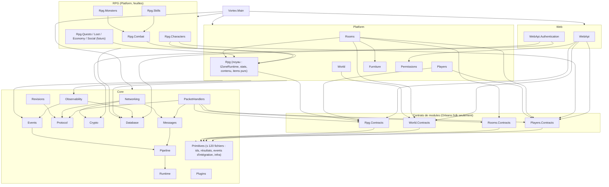

# Ambreia — architecture cible (TARGET-ARCHITECTURE)

Audit du 2026-10-10, lecture seule, `main` @ `c24e882`. Compagnon de `ENTERPRISE-AUDIT.md`.

## 0. Principe

**Un monolithe modulaire distribué par Orleans**, un seul processus `Vortex.Main` tant que la charge
ne justifie pas le contraire, composé de modules à frontières explicites : chaque module possède ses
données, ses règles, ses contrats, son wiring DI, ses tests et ses signaux. Le hôte compose.

Aucune extraction en service n'est justifiée aujourd'hui par un besoin réel (scaling indépendant,
équipe, sécurité, cycle de déploiement). Les deux seules candidates futures, si un jour elles le
sont : **le web API** (surface d'attaque et cycle de release distincts ; il est déjà un plugin isolé)
et **un job de migration/backup** (hors process de jeu). Tout le reste reste in-process.

## 1. Les modules : lesquels méritent une frontière (§3)

| Module demandé | Verdict | Forme cible | Pourquoi |
|---|---|---|---|
| Core (réseau, pipeline, protocole, révisions, crypto, runtime, plugins) | **garder** tel quel | 8 projets Core actuels | frontières réelles, scriptées, sans cycle |
| Platform (présence, rooms, meubles, permissions, config serveur) | garder | `Vortex.Players`, `Vortex.Rooms`, `Vortex.Furniture`, `Vortex.Permissions` | existants |
| World | garder | `Vortex.World` + `Vortex.World.Contracts` (document de zone sorti du kernel) | l'éditeur et le runtime partagent le document, pas le reste du kernel |
| Players | garder | `Vortex.Players` + `Vortex.Players.Contracts` | la présence devient extensible par `IPresenceStreamSource` |
| Social (groupe, guilde) | **pas de projet avant la feature** | futur `Vortex.Social` (grains `PartyGrain`, `GuildGrain`), chat `group`/`guild` déjà prévus | zéro code aujourd'hui |
| Economy (or, échanges, hôtel des ventes, marchands) | pas de projet avant la feature ; **mais le journal (`economy_ledger`) et la clé d'opération se décident avant** | futur `Vortex.Rpg.Economy` | INV-005 |
| RPG noyau | garder | `Vortex.Rpg` (runtime de zone, stats **ouvertes**, contenu, items purs) | le seam |
| Combat | garder, **stabiliser le seam** | `Vortex.Rpg.Combat` | hub de changement actuel |
| Skills | garder | `Vortex.Rpg.Skills` ; la dépendance vers Combat est **entérinée** (ADR-003) : Skills est une extension de Combat, pas un pair | la spec interdisait ; le code a raison |
| Items | **dossier, pas projet** tant que l'inventaire reste dans le grain personnage | `Vortex.Rpg/Items` (pur) + `Vortex.Rpg.Characters` | scinder en `Vortex.Rpg.Items` quand l'échange exige un grain d'inventaire |
| Characters | garder | `Vortex.Rpg.Characters` | existant |
| Monsters | garder ; finir M1c (rang, phases, sélecteur) | `Vortex.Rpg.Monsters` | contenu déjà accepté |
| Quests, Professions, Crafting, Loot, Dungeons, Guilds, Trading, Marketplace | **un projet par feature livrée**, créé par un golden path `add-rpg-module` | `Vortex.Rpg.<X>` | la spec §3.4 ; le coût d'un module doit tomber à 1-2 fichiers partagés |
| Chat | dossier `Chat/` de Players (existant) ; pas de projet | — | ouvert par DI, suffisant |
| Moderation, Administration | dossier `Admin/` du web API + capacités ; pas de projet avant un dashboard | — | 11 capacités déjà sans site |
| Content | garder | `Vortex.Rpg/Content` | modèle du dépôt |
| Networking, Protocol | garder | existants | — |
| Persistence | garder `Vortex.Database` ; **réduire ses consommateurs** | entités référencées par leur module propriétaire seulement | 12 projets le référencent |
| Observability | garder ; ajouter tracing et scopes | `Vortex.Observability` | — |
| Web API | garder en plugin ; **ou** rapatrier en hosted service (ADR-007) | `Vortex.WebApi` | trois listes manuelles + un script pour une isolation jamais utilisée en prod |
| Host | garder | `Vortex.Main` | composition root propre |

## 2. Graphe de dépendances cible (§99)



Changements par rapport à AS-IS, et seulement ceux-là :

1. quatre projets `*.Contracts` extraits de Primitives (Players, Rooms, World, Rpg) ;
2. les feuilles RPG **ne référencent plus `Vortex.Protocol`** : elles émettent des messages de domaine
   (`ZoneMessage`) que `Rooms` traduit en composers (ADR-004) ; `Rpg.Characters` idem via la présence ;
3. `Rpg.Skills → Rpg.Combat` entériné ; `Rpg.Monsters → Rpg.Combat` idem ; aucune autre arête RPG → RPG ;
4. `Vortex.Database` référencé par le module propriétaire de chaque entité seulement (WebApi garde
   `player_accounts`) ;
5. `Vortex.Logging` fusionné dans Primitives/Observability (pass-through).

## 3. Matrice des dépendances interdites (§100)

À convertir en test d'architecture (`check-architecture-walls.mjs` règle 10, ou un test NetArchTest).

| De → Vers | Primitives | *.Contracts | Core infra | Database | Platform (Players, Rooms, World, Furniture, Permissions) | Rpg noyau | Rpg feuille | Web | Main |
|---|---|---|---|---|---|---|---|---|---|
| **Primitives** | — | ✘ | ✘ | ✘ | ✘ | ✘ | ✘ | ✘ | ✘ |
| **\*.Contracts** | ✔ | ✘ (sauf Rpg.Contracts → Players.Contracts pour `PlayerId`-like : non, ils passent par Primitives) | ✘ | ✘ | ✘ | ✘ | ✘ | ✘ | ✘ |
| **Core infra** (Networking, Pipeline, Messages, Protocol, Revisions, Crypto, Runtime, Plugins, Events, Observability) | ✔ | ✔ (PacketHandlers → Contracts) | ✔ descendant | Observability, Plugins seulement | ✘ | ✘ | ✘ | ✘ | ✘ |
| **Database** | ✔ | ✘ | ✘ | — | ✘ | ✘ | ✘ | ✘ | ✘ |
| **Platform** | ✔ | ✔ | ✔ | **module propriétaire seulement** | ✘ entre eux, sauf Rooms → Furniture, Rooms → Rpg noyau | Rooms, Players → Rpg.Contracts | ✘ | ✘ | ✘ |
| **Rpg noyau** | ✔ | ✔ | ✔ | ✔ (contenu) | ✘ | — | ✘ | ✘ | ✘ |
| **Rpg feuille** | ✔ | ✔ | Logging/Events/Observability | ✔ (ses tables) | ✘ | ✔ | **Skills → Combat, Monsters → Combat uniquement** | ✘ | ✘ |
| **Web** | ✔ | ✔ | ✔ | `player_accounts` seulement | Permissions | Rpg.Contracts | ✘ | — | ✘ |
| **Main** | ✔ | ✔ | ✔ | ✔ | ✔ | ✔ | ✔ | ✔ | — |

Deux règles nouvelles que le script actuel n'a pas : **même couche** (Platform ↔ Platform, feuille ↔
feuille) et **entité EF hors de son module**.

## 4. Standard de module (§14, §16)

Un module Platform ou RPG est un projet qui :

```text
Vortex.Rpg.<X>/
    <X>Module.cs            IHostPluginModule : services, options validées, extensions déclarées
    Contracts/              (ou projet <X>.Contracts si un autre module en dépend)
    Domain/                 règles pures : state + command → result ; aucun Orleans, aucune DB
    Grains/                 grains + State/ Persistence/ (write-behind) ; le grain orchestre
    Systems/ ou Behaviors/  pièces d'extension déclarées par le module
    Content/                IContentKind, IContentReferences du module
    Events/                 IEventHandler<T> du module (découverts par scan)
    Chat/                   canaux, règles, liens (si le module en a)
    Configuration/          <X>Config + validateur (ValidateOnStart)
    Observability/          noms de métriques et d'audit du module
Vortex.Rpg.<X>.Tests/       un projet de tests par module (règle de la spec, non tenue aujourd'hui)
```

`IHostPluginModule` existe déjà (`Key`, `ConfigureServices`) et un test d'enregistrement le garde.
L'enrichir de **trois** choses seulement : `ValidateOptions` (ou `services.AddOptions<T>().ValidateOnStart()`
imposé par convention), `IHealthContributor` (readiness par module) et la déclaration explicite des
extensions (`AddEffect<T>` existe ; généraliser `Add<Point>`). Pas de framework interne au-delà.

Le coût d'ajout d'un module tombe à : `.sln`, une ligne dans `Main`, et **rien d'autre** si
`GrainFactoryExtensions` devient une extension par module (`Players.Contracts/GrainFactoryExtensions.cs`),
si la liste `PLATFORM` du script est dérivée du nom de projet (`Vortex.Rpg.*` = feuille) et si les
headers RPG sont alloués par plage par module (`Headers.<Module>.cs`, partial).

## 5. Frontière réseau (§34-35)

```text
octets → ClientPacketDecoder → PackageHandler (parser par révision) → message typé
      → MessageRegistry : behaviors (limite de débit, phase, intentions) → IMessageHandler<T>
      → grain (commande) → résultat → le grain qui a changé l'état envoie (composer typé)
      → PackageEncoder (serializer par révision) → octets
```

C'est **déjà** l'architecture cible : aucun code métier ne voit un id de header (ils sont `internal` à
`Vortex.Revisions`), une révision est un `IRevision` + maps, la release renumérote par table JSON.
Trois compléments : (1) plusieurs révisions enregistrables par DI (`AddRevision<T>`, au lieu du
`if/else` de `ServiceCollectionExtensions.cs:28-35`) ; (2) les moteurs RPG émettent des **messages de
domaine** (`ZoneMessage.Vitals`, `.CombatEvents`…) et un traducteur dans Rooms les transforme en
composers, ce qui retire `Vortex.Protocol` des feuilles RPG et rend le combat testable sans wire ;
(3) les behaviors du pipeline de commandes échouent **fermé**.

## 6. Modèle Orleans cible (§20-21)

| Grain | Clé | Responsabilité unique | État persisté | Cohérence | Idempotence | Concurrence |
|---|---|---|---|---|---|---|
| `PlayerPresenceGrain` | joueur | socket, file sortante, room active, **abonnements déclarés par les modules** | aucun (mémoire) | — | `EnterRoom` idempotent par génération | tour unique, 4 interleaves manifestés |
| `PlayerGrain` | joueur | carte (nom, figure, motto) **y compris création** | `players` | write-through | — | tour |
| `PlayerCharacterGrain` | joueur | classe, XP, niveau, stats, vitals, barre | `player_characters` | write-behind 30 s, niveau immédiat, **vitals immédiats à la sortie de zone** | `GainXp(key)` pour l'admin | tour |
| `PlayerInventoryGrain` (quand l'échange existe) | joueur | sac, équipement, colis | `rpg_items`, `rpg_item_grants` | write-behind 2 s ; dons/destructions immédiats | clé de don **par joueur** | tour |
| `RoomGrain` | room | runtime de zone : carte, avatars, meubles, simulation | `furniture` via `RoomPersistenceGrain` | write-behind 2 s | `Admit` idempotent (reprise) | tour, étapes de tick isolées, **budget d'overrun** |
| `RoomDirectoryGrain`, `PlayerDirectoryGrain`, `ZoneInstanceGrain` | global | annuaires | mémoire (bloqueur multi-silo connu) | — | — | `[KeepAlive]` |
| `ServerConfigGrain` | global | config vivante | `server_config` | write-through | — | ajouter `[KeepAlive]` |
| `AccountSessionGrain`, `AccountCharactersGrain` | compte | phase compte | — / crée le personnage | — | création idempotente par nom | tour |
| futurs `PartyGrain`, `TradeGrain`, `PlayerQuestGrain` | id de groupe / transaction / joueur | un agrégat chacun | leur table | transaction = un grain | clé d'opération | tour |

Règle : un grain orchestre et possède ; l'algorithme vit dans une classe pure du module
(`CharacterInventory`, `HitResolver`, `StatCalculator` sont les modèles).

## 7. Flux runtime cibles (§103)

| Flux | Chemin cible | Écart avec AS-IS |
|---|---|---|
| Authentification | HTTP login (BCrypt, limiteur **derrière proxy conscient**) → ticket (lié à l'origine, TTL) → socket (deadline de handshake 10 s) → `SSOTicket` → phase compte | deadline, proxy, origine du ticket |
| Sélection de personnage | `AccountCharactersGrain` → `PlayerGrain.CreateAsync` → `PlayerCharacterGrain` | création de `players` déplacée |
| Entrée monde | `IWorldEntry` → présence : abonnements (`room`, `world-chat`, + ceux déclarés) → `RoomGrain.Admit` → burst | sources de flux déclarées |
| Déplacement | `MoveAvatar` → limite **par intention** → `ClickTile` → A* (budget par tick, cache) → `UserUpdate` par tick | limite par intention, budget |
| Combat | tick `combat` (étape déclarée) → systèmes → hit chain → `ZoneMessage`s → traducteur Rooms → flux | messages de domaine, étape déclarée |
| Incantation | `RpgSkillCast` → `IRoomCombat` → `ICastingSystem` (résolu explicitement) → effets par clé | résolution explicite |
| Don d'objet | route admin (capacité, audit avec acteur, plafond/jour) → grain (clé par joueur, transaction) → `ItemGranted` → forensics | audit, clé par joueur |
| Équipement | `RpgEquip` → `CharacterInventory` pur → flush 2 s → `EquipmentStatSource` → profil frais à la room | inchangé |
| Voyage de zone | passage → `ExpectArrival` → `RoomForward` → `Admit` (entrée attendue) | inchangé |
| Entrée de donjon | `InstanceForAsync` → copie `ZoneInstanceGrain` (une par **groupe**, après `PartyGrain`) | une par joueur aujourd'hui |
| Rechargement de contenu | import atomique → `ContentReloadedEvent` → **chaque cache de module relit** (spawns, statuts actifs par id) | aucun écouteur aujourd'hui |
| Déconnexion / reconnexion | grâce 60 s (timer testé avec `TimeProvider`) → reprise sans second avatar | horloge injectable |

## 8. Arborescence cible du dépôt (§98)

```text
ambreia-server/
├── src/                                   (déplacement optionnel : 26 projets à la racine restent lisibles ; ne pas le faire pour le plaisir)
│   ├── Core/
│   │   ├── Vortex.Primitives/             ids, résultats, ActionContext, events d'intégration, contrats d'infra (≤ 120 fichiers)
│   │   ├── Vortex.Runtime/ Vortex.Pipeline/ Vortex.Messages/ Vortex.Events/
│   │   ├── Vortex.Networking/ Vortex.Protocol/ Vortex.Revisions/ Vortex.PacketHandlers/ Vortex.Crypto/
│   │   ├── Vortex.Database/               entités, contexte, migrations forward-only, seeds
│   │   ├── Vortex.Observability/          métriques, audit, forensics, tracing, health
│   │   └── Vortex.Plugins/
│   ├── Platform/
│   │   ├── Vortex.Players/ + Vortex.Players.Contracts/     présence, carte, chat, tickets
│   │   ├── Vortex.Rooms/ + Vortex.Rooms.Contracts/         runtime de zone, meubles, logics
│   │   ├── Vortex.World/ + Vortex.World.Contracts/         document de zone, éditeur
│   │   ├── Vortex.Furniture/ Vortex.Permissions/
│   │   └── Vortex.Rpg/ + Vortex.Rpg.Contracts/             IZoneRuntime, stats ouvertes, contenu, items purs
│   ├── Rpg/
│   │   ├── Vortex.Rpg.Characters/ Vortex.Rpg.Combat/ Vortex.Rpg.Skills/ Vortex.Rpg.Monsters/
│   │   └── (Vortex.Rpg.Loot, .Quests, .Economy, .Social, .Professions : un par feature livrée)
│   ├── Web/  Vortex.WebApi/ Vortex.WebApi.Authentication/
│   └── Host/ Vortex.Main/
├── tests/                                 un projet par module (Rpg.Characters.Tests, World.Tests à créer), Vortex.Tests.Support, Vortex.Architecture.Tests (fitness functions C#)
├── content/  schemas/                     inchangés
├── scripts/  hooks/ sql/forward/ content/ (ef, import, fresh-db en .sh **et** .ps1)
├── docs/
│   ├── architecture.md                    la carte (tenue)
│   ├── adr/                               ADR-001…  (§ ENTERPRISE-AUDIT)
│   ├── domains/<module>.md                une page par module : possède / contrats / events / extensions
│   ├── operations/                        runbooks (lenteur, logins, room qui lag, objets disparus, MySQL), backup/restore, DR
│   └── superpowers/                       specs, plans, audits (existant)
├── .github/workflows/quality.yml          + CodeQL, Dependabot, docker build, lock files
└── Dockerfile  docker-compose.yml         sans Dashboard ; healthcheck sur /ready
```

Par grand projet, responsabilité / API / dépendances autorisées : voir §1 et §3. Les deux déplacements
physiques (`src/`, `tests/`) sont **facultatifs** et à faire en une seule tâche `git mv` si on les fait.

## 9. Ce qui ne change pas (à garder absolument)

- Le seam `IZoneRuntime` / `IZoneSimulation` : le combat ne connaît pas `Vortex.Rooms`.
- Les sept points d'extension RPG et le chat déclarés par DI, cœur sans nom de variante.
- Le pipeline de contenu (kinds, import atomique, références, schémas générés).
- `CharacterInventory`, `HitResolver`, `StatCalculator` : règles pures testées.
- Handlers = orchestration ; identité depuis le contexte ; le grain envoie.
- Write-behind (`RoomPersistenceGrain`, items 2 s) et canal d'audit borné.
- Les scripts-gardiens (`check-*.mjs`), le manifeste d'interleaving, `IHostPluginModule` + son test.
- AGENTS.md, les skills comme golden paths, `driver.mjs` comme preuve vivante.
- Une révision = `IRevision` + maps, ids internes, release renumérotée.
